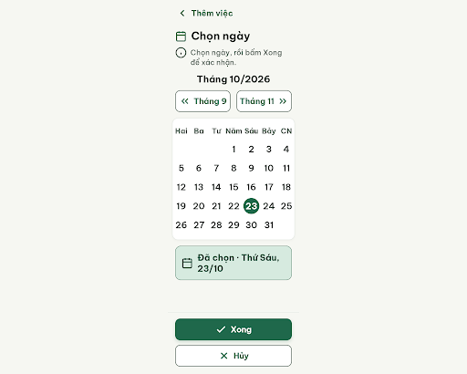
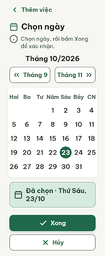

# N11 Chọn ngày – log vòng lặp Stitch

| Vòng | Điểm | Số error | Số warn | Đã sửa | Regression |
| --- | --- | --- | --- | --- | --- |
| v0 | 94 | 0 | 2 | – | – |
| v1 | 94 | 0 | 2 | không (Stitch không đổi CSS) | không |
| v2 | – | – | – | edit đã gửi, file xuất ra không đổi (giống v1) nên không chấm lại, tính là không tăng | – |

**Màn chốt: v1 – điểm 94** (Stitch screen id `525ceae5e74741178e1282a9be4c933c`, project 2013215887278758682; v0 id `156ccd08469b4e4abde26653848b0b06` cùng điểm)
**Kết quả: CONVERGED** (2 vòng liên tiếp không vượt 94, 0 error)

screen id: 156ccd08469b4e4abde26653848b0b06 (v0); 525ceae5e74741178e1282a9be4c933c (v1, v2 sửa tại chỗ)

## v0 – điểm 94

| Luật | Mức | Vị trí | Bằng chứng | Sửa |
| --- | --- | --- | --- | --- |
| R-TAP-03 | warn | Lưới ngày | Ô 48px, column-gap 0, row-gap 4px (< 8px) | row-gap 8px, vòng số 40px trong ô 48px |
| R-STY-03 | warn | Thẻ lịch | Lề 12px thay vì 20px; lưới 336px tràn 1px mỗi bên do viền 1px | Bỏ border, dùng box-shadow 1px |

Hai warn đến từ mâu thuẫn số đo (7 × 48px = 336px > 320px; khe ngang 8px cần 384px > 360px), đã ghi ngoại lệ vào `design-decisions.md`.

best: v0 – điểm 94.

## v1 – điểm 94

Edit prompt (`v1-edit-prompt.txt`): row-gap 8px, vòng số 40px, thẻ lịch bỏ border dùng box-shadow. Stitch trả màn mới nhưng `v1.html` vẫn `row-gap: 4px`, `border: 1px solid` → hai warn còn nguyên, không regression. Critic không ghi được file, `v1-critique.json` chưa có; nội dung giống v0 (cùng 2 warn R-TAP-03, R-STY-03).

best: v1 – điểm 94 (bằng v0, vòng sau hơn). Bộ đếm không tăng = 1.

## v2 – không chấm

Edit prompt (`v2-edit-prompt.txt`) ngắn hơn, gọi `edit_screens` trên v1. Stitch báo đã sửa tại chỗ (DOM ops trên screen 525ceae5…) nhưng link HTML/ảnh của `get_screen` không đổi, tải về giống hệt v1. Bộ đếm không tăng = 2 → CONVERGED.

Còn lại: 2 warn, cần sửa tay khi export Figma (ô ngày: row-gap 8px, vòng số 40px; thẻ lịch dùng stroke ngoài 1px thay border trong).
