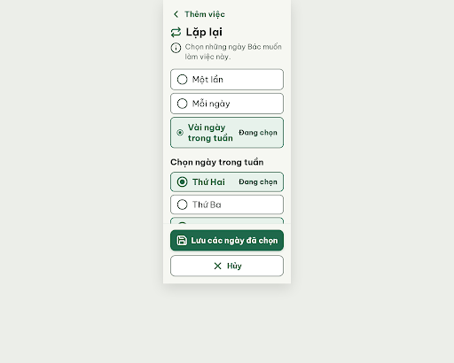
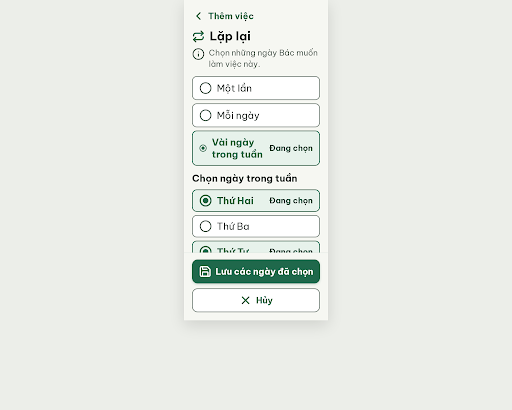

# N12 Lặp lại – log vòng lặp Stitch

| Vòng | Điểm | Số error | Số warn | Đã sửa | Regression |
| --- | --- | --- | --- | --- | --- |
| v0 | 94 | 0 | 2 | – | – |
| v1 | 100 | 0 | 0 | R-ICON-03, R-STY-03 | không |

**Màn chốt: v1 – điểm 100** (Stitch screen id `cb428d1607a146328ba5ba02f5bc83d7`, project 2013215887278758682)
**Kết quả: CONVERGED** (điểm 100, 0 error)

screen id: af61d90772a64587b656d3e977c824ad (v0); cb428d1607a146328ba5ba02f5bc83d7 (v1)

best: v1 – điểm 100

Lưu ý từ critic (không trừ điểm): ô chọn bo 12px (token `rounded.md`); chấm giữa icon `circle-dot` hơi to hơn Lucide gốc; v1 sửa khoảng cách bằng `style` gắn thẻ, CSS gốc vẫn ghi 20/24px. Stitch trả ảnh khung desktop 2560 × 2048, nội dung nằm trong cột hẹp ở giữa.

## v0 – điểm 94



| Luật | Mức | Vị trí | Bằng chứng | Sửa |
| --- | --- | --- | --- | --- |
| R-ICON-03 | warn | Khối tóm tắt "Đã chọn · …" | Dùng `repeat`, trùng icon tiêu đề; "ngày đã chọn" = `calendar` | Đổi sang `calendar` 32px #174C37 |
| R-STY-03 | warn | Khoảng cách giữa các khối | `.hint-row` 20px, `.options-group` 24px, `.weekdays-group` 20px | Đặt cả ba 16px |

Edit prompt v1 (`v1-edit-prompt.txt`):

```
Keep the overall layout and everything not mentioned below unchanged.
1. In the selection summary block ("Đã chọn · Thứ Hai, Thứ Tư, Thứ Sáu"), replace the repeat icon with the Lucide calendar icon, 32px, color #174C37, stroke 2.5. The repeat icon stays only next to the title "Lặp lại".
2. Make the vertical gap between blocks exactly 16px: set margin-bottom 16px on the hint row, on the three option rows group and on the weekday rows group (currently 20px, 24px and 20px).
```

## v1 – điểm 100



Không còn vi phạm. Đã sửa: R-ICON-03, R-STY-03. Không có regression.
