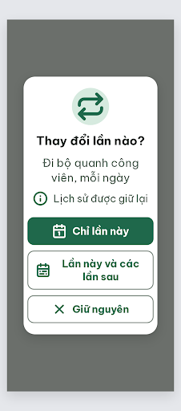

# N13 Phạm vi thay đổi – log vòng lặp Stitch

Biến thể của DLG-Done (màn chốt v2, screen id `c1d660d473ef49c7aeff150aef996d8d`). Project 2013215887278758682.

| Vòng | Điểm | Số error | Số warn | Đã sửa | Regression |
| --- | --- | --- | --- | --- | --- |
| v0 | 87 | 1 | 1 | – | – |
| v1 | chưa chấm | – | – | – | – |

best: v0 – điểm 87
**Màn chốt: v0 – điểm 87 (tạm, chưa xong vòng lặp)**
**Kết quả: chưa có (đang dừng ở v1, xem ghi chú)**

screen id: v0 `d1b7952fbb6d44e282ce1af218c04698`

Ghi chú v1: `edit_screens` (gửi `v1-edit-prompt.txt`) chỉ trả về sự kiện sửa DOM trên chính screen id của v0, không trả màn mới. Sau đó `get_screen` (3 lần) vẫn trả screenshot/HTML cũ của v0 (HTML còn "Lần này và các lần sau", chưa có "Từ nay về sau"). `list_screens` quá lớn và không thấy screen id này. Chưa gọi lại `edit_screens` để tránh tốn quota và sinh trùng.

Lưu ý quyết định: lỗi R-TXT-04 buộc đổi nhãn "Lần này và các lần sau" (6 tiếng, nhãn trong `flutter-handoff.md`/`user-flow.md`) thành "Từ nay về sau" (4 tiếng). Nếu giữ nhãn gốc thì màn còn 1 error → người quyết định, ghi vào `design-decisions.md`.

## v0 – điểm 87



| Luật | Mức | Vị trí | Bằng chứng | Sửa |
| --- | --- | --- | --- | --- |
| R-TXT-04 | error | Nút 2 "Lần này và các lần sau" | 6 tiếng (> 5), xuống 2 dòng | Đổi nhãn "Từ nay về sau", 1 dòng |
| R-STY-03 | warn | 3 nút so với mép thẻ | Thẻ 288 px, padding 20 → trong 248 px nhưng nút 272 px, tràn 12 px mỗi bên | Thẻ 312 px, nút 272 px |

### Edit prompt gửi sau v0 (v1-edit-prompt.txt)

```
Keep the overall layout and everything not mentioned below unchanged.
1. Button 2: change the label from "Lần này và các lần sau" to "Từ nay về sau" (4 words), 22px bold, #1F684B, on ONE line; keep the Lucide `calendar-range` icon 32px #1F684B on the left; button height 60px.
2. Dialog card: make the card 312px wide (20px margin each side of the 360px screen), padding 20px, radius 24px, background #FFFFFF, so the inner width is 272px.
3. The three buttons: width exactly 272px (equal to the inner width of the card, 100%), no overflow beyond the card padding; keep 12px gap, radius 14px, height 60px.
```
