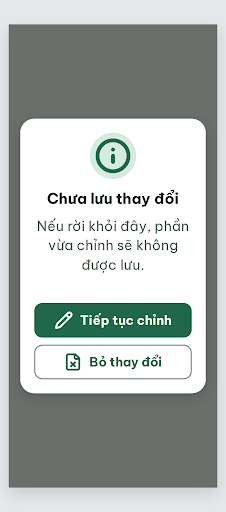

# N14 Chưa lưu thay đổi – log vòng lặp Stitch

| Vòng | Điểm | Số error | Số warn | Đã sửa | Regression |
| --- | --- | --- | --- | --- | --- |
| v0 | 100 | 0 | 0 | – | – |

**Màn chốt: v0 – điểm 100**
**Kết quả: CONVERGED** (điểm 100).

screen id: v0 (màn chốt) `c09c8c75cb384387b0ecea3fc1129a4f` (project 2013215887278758682). Biến thể của DLG-Done (`c1d660d473ef49c7aeff150aef996d8d`).

Ghi chú: khoảng cách từ câu chi tiết xuống nút là 48px (không phạm luật). Thẻ `<title>` trong HTML còn là "DLG-Done" do kế thừa màn gốc. Icon `file-x` thêm vào Từ điển icon ngày 19/10/2026.

## v0 – điểm 100

Không có vi phạm. Chi tiết trong `v0-critique.json`.

best: v0 – điểm 100
