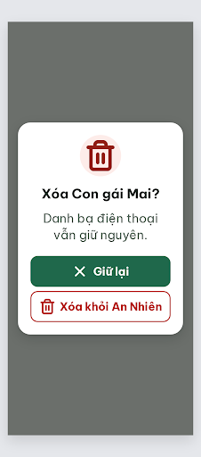

# N15 Xóa người thân – log vòng lặp Stitch

| Vòng | Điểm | Số error | Số warn | Đã sửa | Regression |
| --- | --- | --- | --- | --- | --- |
| v0 | 100 | 0 | 0 | – | – |

**Màn chốt: v0 – điểm 100** (Stitch screen id `5eaaab57481448628d512336b1b7124f`, project 2013215887278758682)
**Kết quả: CONVERGED** (điểm 100).

best: v0 – điểm 100

screen id: 5eaaab57481448628d512336b1b7124f. Biến thể của DLG-Delete, màn gốc `0837859db1b04283be1bf85c8a629f69`.

## v0 – điểm 100

Không có vi phạm. Contrast thấp nhất khoảng 6.6:1; chữ 22–26 px; hai nút 272×60 cách 8 px; một nút filled; icon `trash-2` / `x` đúng Từ điển icon.

Ghi chú:
- **Cần người quyết định:** câu phụ chỉ còn "Danh bạ điện thoại vẫn giữ nguyên." Handoff có thêm vế "Lịch sử hoạt động không bị xóa"; bỏ để vừa 2 dòng (R-TXT-03). Nếu muốn giữ cả hai vế, cần tách thành 2 dòng ngắn hoặc nới hộp thoại.
- Thẻ `<title>` trong HTML vẫn ghi "DLG-Done"; không hiện trên màn.
- Ảnh v0.png chỉ 226×512 px; phía sau scrim là nền trống #F6F7F2, không có màn nền.
- Critic không ghi được file critique nên orchestrator chép lại JSON (rút gọn).
