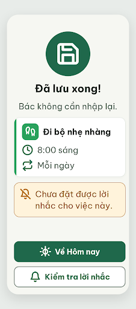
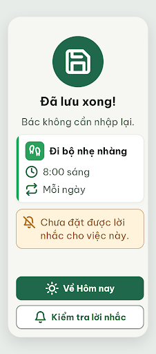

# N16 Đã lưu · nhắc cần kiểm tra – log vòng lặp Stitch

| Vòng | Điểm | Số error | Số warn | Đã sửa | Regression |
| --- | --- | --- | --- | --- | --- |
| v0 | 97 | 0 | 1 | – | – |
| v1 | 100 | 0 | 0 | R-ICON-03 | không |

**Màn chốt: v1 – điểm 100**
**Kết quả: CONVERGED** (điểm 100).

best: v1 – điểm 100

screen id v0: `ab7ebddc94194918831484584efc1338` · screen id v1 (màn chốt): `ecbd6f57ded449748f9280c21496c8e1` (project 2013215887278758682). Biến thể của ST-Saved, màn gốc `a247c36073c147c1a57e54685a90dec5`.

Ghi chú:
- `DESIGN.md` Từ điển icon: dòng `bell-off` mở rộng thành "Tắt nhắc, chưa đặt được lời nhắc" (màu `warning-strong`) cho N16. Người quyết định xác nhận.
- Hộp cảnh báo dùng nền `warning-container` #FFF3DB, viền #B26A00, chữ #8A5100 (5,86 : 1); không dùng màu lỗi vì việc vẫn được lưu (D31).
- Nút phụ "Kiểm tra lời nhắc" dẫn tới N07 (Nhắc việc).
- Chữ hàng 2–3 của thẻ tóm tắt là #526057 (chữ phụ), khác ST-Saved dùng #202B25; cả hai đạt tương phản.
- Critic không ghi được file critique nên orchestrator chép lại JSON (rút gọn).

## v0 – điểm 97



| Luật | Mức | Vị trí | Bằng chứng | Sửa |
| --- | --- | --- | --- | --- |
| R-ICON-03 | warn | Icon `sun` trong nút "Về Hôm nay" | tia dưới `y1="1" y2="21"` thành nét dọc xuyên tâm (Lucide chuẩn `y1="21" y2="23"`) | Vẽ lại `sun` chuẩn 32 px, nét 2.5, trắng |

### Edit prompt gửi sau v0 (v1-edit-prompt.txt)

```
Keep the overall layout and everything not mentioned below unchanged.
1. In the primary button "Về Hôm nay", replace the Lucide `sun` icon with the exact standard Lucide `sun` glyph, 32x32px, stroke 2.5, white #FFFFFF: a circle r=5 at the center plus 8 short rays; the bottom ray must be the short line from y=21 to y=23 (x=12), not a long vertical line through the center. Keep the icon on the left of the text, keep the button 320x60px.
```

## v1 – điểm 100



Không có vi phạm. Đã sửa R-ICON-03; không regression.
