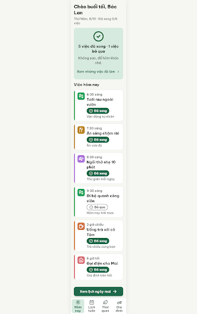

# N17 Hôm nay · đã xử lý hết (5 xong · 1 bỏ qua) – log vòng lặp Stitch

| Vòng | Điểm | Số error | Số warn | Đã sửa | Regression |
| --- | --- | --- | --- | --- | --- |
| v0 | 97 | 0 | 1 | – | – |

**Màn chốt: v0 – điểm 97**
**Kết quả: CONVERGED** (97, 0 error, 1 warn R-ICON-03). Stitch sửa icon tại chỗ nhưng không lưu (cùng lỗi như S03-alldone), nên không tăng được điểm bằng edit; sửa icon `utensils` bằng tay ở Figma.

Biến thể của S03-alldone (`--from S03-alldone`), gốc: screen id `3fe956631fc848f58bcf9dc1c338c061` (màn chốt v1 – 97).
screen id: v0 `98fc811ea8ae47dcbc0e5d42edf1c6fe` (project 2013215887278758682)

## v0 – điểm 97

best: v0 – điểm 97 (0 error, 1 warn)

| Luật | Mức | Vị trí | Bằng chứng | Sửa |
| --- | --- | --- | --- | --- |
| R-ICON-03 | warn | Ô icon "Ăn sáng chậm rãi" | dĩa + dao tự vẽ, không phải Lucide `utensils` | thay bằng `utensils` đúng path |

## Vòng 1 – sửa tại chỗ không được lưu
Edit prompt (`v0-edit-prompt.txt`) gửi lên screen `98fc811e…`. Stitch trả thao tác DOM `replace_element` trên chính screen đó, nhưng `get_screen` vẫn trả cùng file id HTML và ảnh của v0 → không có v1, không chấm lại. Không gửi lại để tiết kiệm quota.

Ghi chú nội dung:
- Màn này là Hôm nay cuối ngày có việc bỏ qua: không có nút "Báo tin vui" (SG-49, FR08); "Xem lịch ngày mai" là nút filled duy nhất; "Xem những việc đã làm" là nút text; "Về Hôm nay" không vẽ riêng vì tab "Hôm nay" đã chọn.
- Màn sinh ra ở khung DESKTOP/2560 px như các biến thể trước; nội dung theo khung 360 dp.
- Cần kiểm tra bằng mắt tab "Gia đình" (`hand-heart`) khi export sang Figma (lỗi kế thừa từ S03-alldone).
