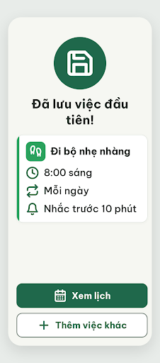

# N18 Đã lưu việc đầu tiên – log vòng lặp Stitch

| Vòng | Điểm | Số error | Số warn | Đã sửa | Regression |
| --- | --- | --- | --- | --- | --- |
| v0 | 100 | 0 | 0 | – | – |

**Màn chốt: v0 – điểm 100**
**Kết quả: CONVERGED** (điểm 100).

screen id: `34ec2f856f4d4d6ca40aa346244068c0` (project 2013215887278758682). Biến thể của ST-Saved, màn gốc `a247c36073c147c1a57e54685a90dec5`.

Ghi chú:
- Thêm vào `assets/stitch/DESIGN.md` (Từ điển icon): `calendar-days` cũng dùng cho nút "Xem lịch" ở N18 (19/10/2026).
- Giống ST-Saved: nếu áp R-TXT-05 cho thẻ tóm tắt thì điểm có thể thấp hơn; người quyết định.
- `v0.png` tải về chỉ 226 × 512 px (ảnh thu nhỏ do Stitch trả); đo kích thước thật dựa vào `v0.html`.
- `v0-critique.json` do orchestrator ghi lại từ kết quả critic (critic không có quyền ghi file).

## v0 – điểm 100

Không có vi phạm. Vòng đầu, không có lỗi đã sửa hay regression.

best: v0 – điểm 100
