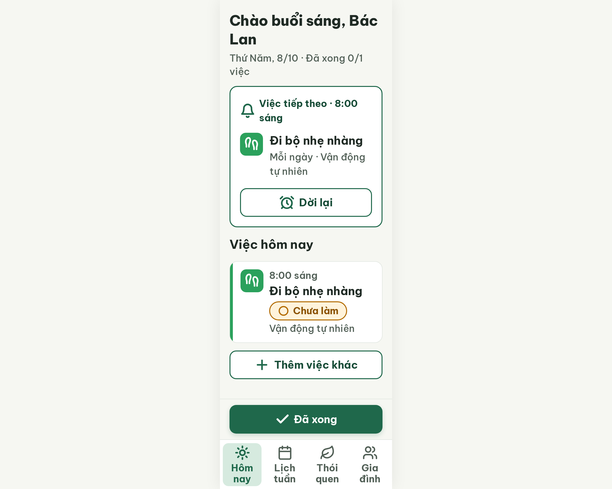

# N19 Hôm nay · việc đầu tiên – log vòng lặp Stitch

| Vòng | Điểm | Số error | Số warn | Đã sửa | Regression |
| --- | --- | --- | --- | --- | --- |
| v0 | 94 | 0 | 2 | – | – |
| v1 | 94 (không đổi) | 0 | 2 | không lưu được | – |

**Màn chốt: v0 – điểm 94**
**Kết quả: CONVERGED (dừng sớm)** – 0 error, 2 warn (R-ICON-03, R-ONE-02). Vòng v1: `edit_screens` báo đã thay 4 icon nhưng `get_screen` vẫn trả đúng link HTML/ảnh cũ và `v1.html` giống hệt `v0.html` (không có path `hand-heart`, `calendar-days`, `circle-check`, `alarm-clock-plus`). Cùng lỗi như N17 và S03-alldone: Stitch sửa icon tại chỗ nhưng không lưu. Chưa chạy đủ 2 vòng không tăng; dừng ở đây để khỏi tốn quota vì sửa icon bằng edit đã không có tác dụng ở các màn trước. Người quyết định có muốn thử lại không.

screen id: `544c57da97004d11aa60b153dfd1385c` (project 2013215887278758682). Biến thể của S03, màn gốc `cc28fdd64e6e4c70b59b419c44376787`.

Ghi chú:
- `v0-critique.json` do orchestrator ghi lại từ kết quả critic (critic không có quyền ghi file).
- Việc cần làm tay ở Figma: tab Gia đình `users` → `hand-heart`; tab Lịch tuần `calendar` → `calendar-days`; nút "Đã xong" `check` → `circle-check`; nút "Dời lại" `alarm-clock` → `alarm-clock-plus`.
- R-ONE-02 (warn): critic đề nghị chuyển nút "Đã xong" vào thẻ "Việc tiếp theo". Không làm vì R-TAP-02 (error) yêu cầu nút chính đặt ở đáy; S03 v3 chốt 100 điểm với thanh đáy này. Người quyết định.
- Ảnh `footprints` trong v0 nhìn giống hai chiếc dép; critic không trừ điểm, nên xem lại bằng mắt ở Figma.
- Thẻ "Việc tiếp theo" ở màn này không có nút "Đã xong" riêng, nút nằm ở thanh đáy (giữ như S03 v3).

## v0 – điểm 94

| Luật | Mức | Vị trí | Bằng chứng | Sửa |
| --- | --- | --- | --- | --- |
| R-ICON-03 | warn | Tab Gia đình, tab Lịch tuần, nút Đã xong, nút Dời lại | `users`, `calendar`, `check`, `alarm-clock` sai Từ điển icon | `hand-heart`, `calendar-days`, `circle-check`, `alarm-clock-plus` |
| R-ONE-02 | warn | Nút "Đã xong" ở thanh đáy | tách khỏi thẻ "Việc tiếp theo", 2 điểm nhấn | chuyển nút vào thẻ (không áp dụng, xem ghi chú) |

best: v0 – điểm 94

### Edit prompt v0 → v1

Xem `v1-edit-prompt.txt` (4 sửa icon, giữ thanh đáy). Kết quả: không lưu, v1 = v0.
