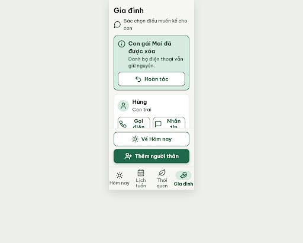
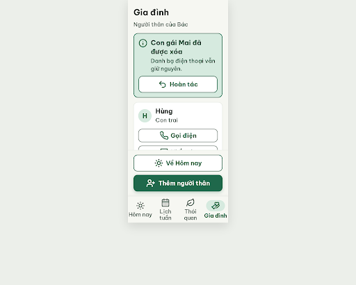

# N21 Gia đình sau khi xóa người thân – log vòng lặp Stitch

| Vòng | Điểm | Số error | Số warn | Đã sửa | Regression |
| --- | --- | --- | --- | --- | --- |
| v0 | 87 | 1 | 1 | – | – |
| v1 | 100 | 0 | 0 | R-LAY-01, R-ICON-03 | không |

**Màn chốt: v1 – điểm 100**
**Kết quả: CONVERGED** (điểm 100, 0 error, 0 warn).

Biến thể của S09, màn gốc `2bac776f261e4f8986ee3bc3d86053a2` (project 2013215887278758682).
screen id v0: `b6907451cc2a430da790c72992a380fe`
screen id v1 (màn chốt): `3eece7b1bda7430f912b02421f88145e`

Ghi chú cho người quyết định:
- Khối đáy cố định (nút "Về Hôm nay" + "Thêm người thân" + bottom nav, ~270px) che nửa thẻ Hùng và cả thẻ Bin ở khung đầu, phải cuộn mới thấy. Không luật nào bắt, không trừ điểm. Cân nhắc bỏ nút "Về Hôm nay" (tab Hôm nay đã làm việc đó); handoff N21 liệt kê cả hai nút.
- Dòng phụ đổi từ "Bác chọn điều muốn kể cho con" thành "Người thân của Bác" và avatar là chữ cái H/B, theo critic v0 (`message-circle` và `user` lệch Từ điển icon).
- Nút "Hoàn tác" trong banner là thêm so với handoff N21, theo D16 và NFR11.
- `v0-critique.json`, `v1-critique.json` do orchestrator ghi lại từ kết quả critic.

## v0 – điểm 87



| Luật | Mức | Vị trí | Bằng chứng | Sửa |
| --- | --- | --- | --- | --- |
| R-LAY-01 | error | Nút "Gọi điện", "Nhắn tin" trong thẻ Hùng, Bin | mỗi nút còn ~125px, cần ~135px, nhãn bị bẻ 2 dòng | Xếp dọc, mỗi nút 286×60px, nowrap |
| R-ICON-03 | warn | Icon phụ đề, avatar | `message-circle` ngoài từ điển; `user` đã là "Tên Bác, hồ sơ" | Bỏ icon phụ đề; avatar chữ cái đầu |

Đã sửa: không (vòng đầu). Regression: không.

## v1 – điểm 100



Không còn vi phạm. Đã sửa R-LAY-01, R-ICON-03. Regression: không.

best: v1 – điểm 100

### v1-edit-prompt.txt

```
Keep the overall layout and everything not mentioned below unchanged.

1. In the relative cards "Hùng" and "Bin": stack the two buttons VERTICALLY instead of side by side. Each button is full card inner width (286px), 60px high, 12px gap between them, radius 14px, 2px #7B887F border, white background. Order: "Gọi điện" (Lucide `phone` 32px, #1F684B) on top, "Nhắn tin" (Lucide `message-square` 32px, #1F684B) below. Label 22px bold #1F684B, white-space: nowrap, on ONE line, centered with the icon, nothing wrapped or clipped.
2. Replace the line "Bác chọn điều muốn kể cho con" with "Người thân của Bác" (20px, #526057, left aligned) and REMOVE the `message-circle` icon next to it (no icon on this line).
3. In the relative cards, replace the Lucide `user` icon in the 48x48px #D6EADF circle by a single letter: "H" for Hùng and "B" for Bin (24px bold #1F684B, centered, no icon).
4. Keep the result banner, the fixed bottom buttons and the bottom navigation exactly as they are. Increase scroll container padding-bottom to 300px so the last card is not covered.
```
