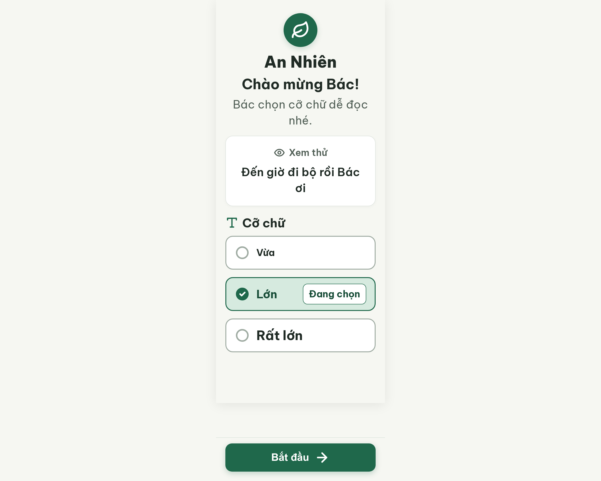
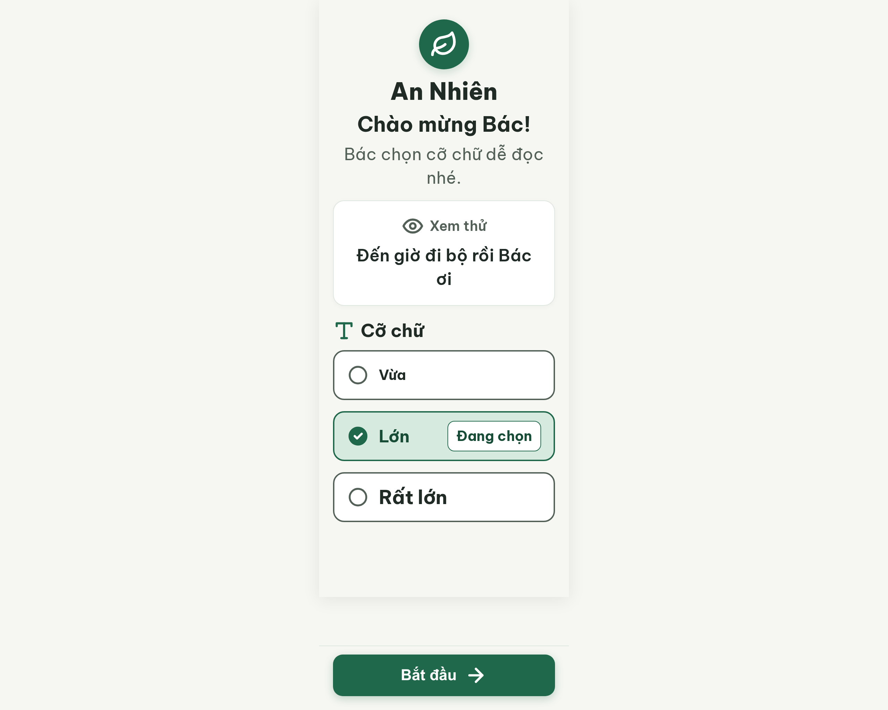

# S01 Chào mừng – chọn cỡ chữ – log vòng lặp Stitch

| Vòng | Điểm | Số error | Số warn | Đã sửa | Regression |
|---|---|---|---|---|---|
| v0 | 94 | 0 | 2 | – | – |
| v1 | 97 | 0 | 1 | R-ICON-03 | không |
| v2 | 100 | 0 | 0 | R-CON-02 (CSS + selectSize) | không |

**Màn chốt: v2 – điểm 100** (screen 85152f6e78aa49158e8c48fe8bd7589a)
**Kết quả: CONVERGED** (điểm 100, không còn error)

Project: 2013215887278758682 · Màn v0: 1f51101a3d174dfc84345412ea1620a0 · v1: 87fe4bd42384485d872382c2da449dbc · v2: 85152f6e78aa49158e8c48fe8bd7589a

Ghi chú: Stitch gắn DESKTOP (ảnh 2560×2048). Ảnh tải bằng link screenshot + `=w2560` (không thêm thì chỉ được bản 512×410). PRD 11.2 không có dòng riêng cho S01, nội dung màn ghép từ F12/FR12 và user-flow Flow 1 (xem `v0-prompt-trace.md`).

## v0 – điểm 94



| Luật | Mức | Vị trí | Bằng chứng | Sửa |
|---|---|---|---|---|
| R-CON-02 | warn | Viền 2px hai ô "Vừa", "Rất lớn" và vòng radio rỗng | #A0ACA3 trên #FFFFFF = 2,35 : 1 (< 3 : 1) | Đổi viền và nét vòng radio sang #526057 (≈ 6,6 : 1), giữ 2px. #A0ACA3 là token `border-strong` trong `assets/stitch/DESIGN.md`, nên sửa cả token |
| R-ICON-03 | warn | Icon con mắt cạnh "Xem thử" (24px), icon chữ T cạnh "Cỡ chữ" (28px) | Luật cần icon ≥ 32px | Tăng cả hai lên 32×32px |

Ghi nhận, không tính lỗi: câu xem thử và dòng phụ xuống dòng để lại một chữ lẻ ("ơi", "nhé."); khoảng trống lớn giữa danh sách và nút "Bắt đầu".

Đã sửa / regression: không có (vòng đầu).

Chi tiết 37 luật: `v0-critique.json`.


## v1 – điểm 97 (best: v1 – 97)



Edit prompt (`v0-edit-prompt.txt`):

```
Keep the overall layout and everything not mentioned below unchanged.
1. Change the border of the unselected font-size option cards "Vừa" and "Rất lớn" from #A0ACA3 to #526057, keeping 2px width.
2. Change the stroke of the empty radio circles in the unselected option cards to #526057, keeping 2px width.
3. Enlarge the eye icon next to the "Xem thử" tag from 24x24px to 32x32px.
4. Enlarge the letter-T icon next to the "Cỡ chữ" section title from 28x28px to 32x32px.
```

| Luật | Mức | Vị trí | Bằng chứng | Sửa |
|---|---|---|---|---|
| R-CON-02 | warn | `.option-card.unselected` và `selectSize()` | CSS vẫn `#A0ACA3` (2,35 : 1); inline #526057 chỉ che trạng thái tĩnh, ô "Lớn" và lần chạm thứ hai vẫn nhạt | Đổi class và stroke trong `selectSize()` sang #526057, bỏ inline |

Đã sửa: R-ICON-03. Regression: không.

## v2 – điểm 100 (best: v2 – 100)


Edit prompt (`v1-edit-prompt.txt`):

```
Keep the overall layout and everything not mentioned below unchanged.
1. In the CSS class for unselected option cards (.option-card.unselected), change the border from 2px solid #A0ACA3 to 2px solid #526057.
2. In the JavaScript function that switches the font size (selectSize), when it redraws an empty radio circle for an unselected card, use stroke="#526057" instead of stroke="#A0ACA3" (stroke-width unchanged).
3. Remove the duplicated inline border/stroke colors on the "Vừa" and "Rất lớn" cards so that all unselected cards ("Vừa", "Lớn", "Rất lớn") get #526057 from the shared class only.
```

Không còn vi phạm. Đã sửa: R-CON-02. Regression: không.

Ghi nhận ngoài rule.md, không trừ điểm: chữ lẻ "nhé." và "ơi" xuống dòng; ba ô chọn cỡ chữ là `div role="radio"` không có `tabindex` (cần bổ sung khi code Flutter).
