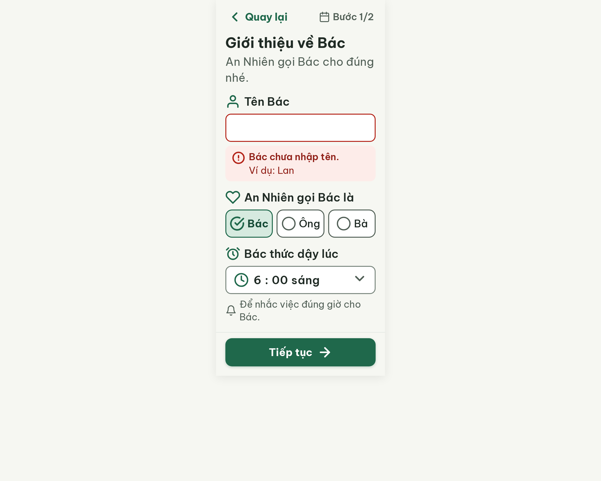

# S02 Thiết lập hồ sơ (Bước 1/2) – log vòng lặp Stitch

| Vòng | Điểm | Số error | Số warn | Đã sửa | Regression |
|---|---|---|---|---|---|
| v0 | 97 | 0 | 1 | – | – |

**Kết quả: PASS** (v0, không còn error, điểm ≥ 85)

Project: 2013215887278758682 · Màn v0: 17a2ead138fc48ea93625d553324704a

Ghi chú: Stitch gắn DESKTOP (ảnh 2560×2048) dù gọi MOBILE; HTML dùng viewport 360. Ảnh tải bằng link screenshot + `=w2560`. PRD 11.2 không có dòng riêng cho S02, nội dung ghép từ `README.md`, `ux/user-flow.md` Flow 1 và SG-01 (xem `v0-prompt-trace.md`).

## v0 – điểm 97

| Luật | Mức | Vị trí | Bằng chứng | Sửa |
|---|---|---|---|---|
| R-ICON-03 | warn | Icon lịch cạnh "Bước 1/2", icon chuông cạnh "Để nhắc việc đúng giờ cho Bác.", icon chấm than trong khối lỗi | 24px, 24px, 28px (cần ≥ 32px); icon lịch trùng nghĩa với tab "Lịch tuần" | Tăng chuông và chấm than lên 32×32px; bỏ icon lịch ở "Bước 1/2" (chỉ giữ chữ) hoặc thay bằng 2 chấm tiến độ 12px |

Ghi nhận, không tính lỗi: màn hiện sẵn trạng thái lỗi "Bác chưa nhập tên." vì prompt yêu cầu ô tên để trống. Nên có thêm bản trạng thái bình thường (ST-Validation là biến thể riêng) khi chốt Figma.

Đã sửa / regression: không có (vòng đầu).

Chi tiết 37 luật: `v0-critique.json`.
