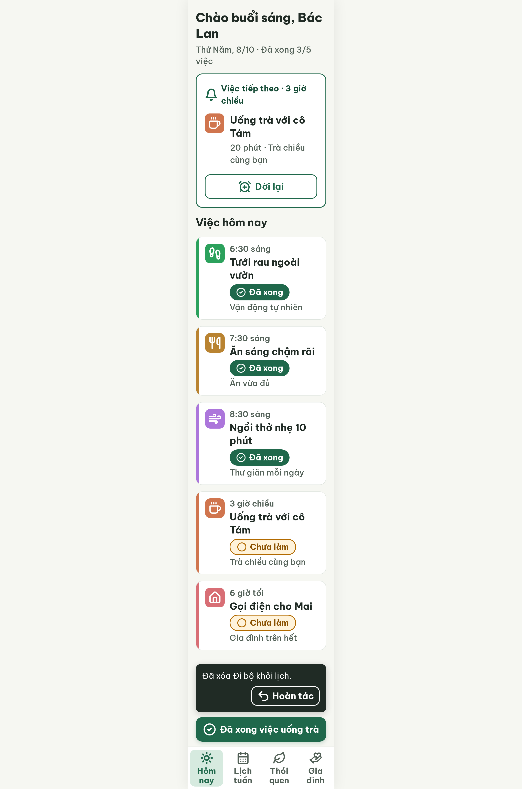

# S03-deleted Hôm nay · đã xóa việc (biến thể của S03)

| Vòng | Điểm | error | warn | Đã sửa | Regression |
|---|---|---|---|---|---|
| v0 (chấm lại, luật mới) | 97 | 0 | 1 | – | – |
| v1 | 100 | 0 | 0 | R-STY-02 | không |

**Màn chốt: v1 – điểm 100** (screen id cf2304905dc04d3ebcb810eec77a7ba4)
**Kết quả: CONVERGED**

screen id (v0): c4df0d09e62e4027b5761b9714db1cd9

## Chạy tiếp từ v0 (luật mới)
Chấm lại v0 theo luật hiện tại: **97 điểm**, 0 error, 1 warn (R-STY-02: nút chính bo 16px thay vì 14px). Bản chấm cũ: `v0-critique.old.json`. best: v0 – điểm 97; bộ đếm "không tăng" = 0.

## v0 – điểm 97


| Luật | Mức | Vị trí | Bằng chứng | Sửa |
|---|---|---|---|---|
| R-STY-02 | warn | Nút chính "Đã xong việc uống trà" | inline border-radius: 16px ghi đè .btn-primary 14px | Đổi về 14px |

### Edit prompt vòng 1
```
Keep the overall layout and everything not mentioned below unchanged.
1. Change the border radius of the sticky filled button "Đã xong việc uống trà" from 16px to 14px (remove the inline border-radius: 16px; use 14px). Keep it 60px high, 320px wide, with the Lucide `circle-check` icon 32px white.
```

## v1 – điểm 100


Không còn vi phạm. Đã sửa R-STY-02 (nút chính bo 14px). Không regression. best: v1 – điểm 100.
