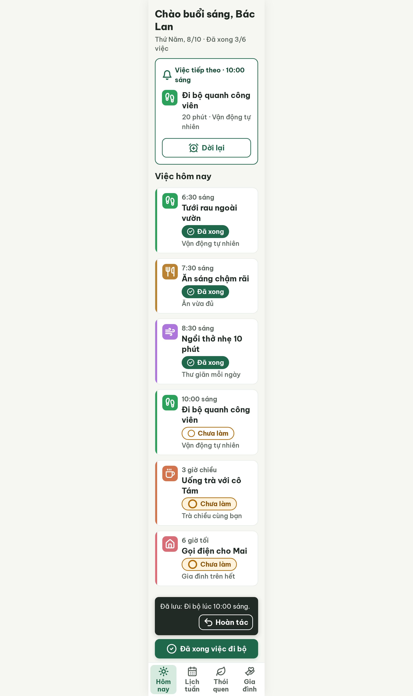
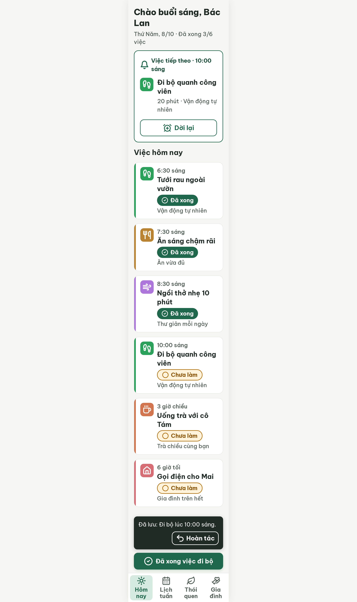

# S03-edited Hôm nay · đã lưu thay đổi – log vòng lặp Stitch

| Vòng | Điểm | Số error | Số warn | Đã sửa | Regression |
| --- | --- | --- | --- | --- | --- |
| v0 | 97 | 0 | 1 | – | – |
| v1 | 100 | 0 | 0 | R-ICON-03 | không |

**Màn chốt: v1 – điểm 100**
**Kết quả: CONVERGED** (điểm 100).

Biến thể của S03 (`--from S03`), gốc: screen id `cc28fdd64e6e4c70b59b419c44376787` (màn chốt S03 = v3).
screen id: v0 `7e2b9354e551457a996eeaa6077e02d4` · v1 (màn chốt) `dd17c80e8a9943b19655e5708c90b655` (project 2013215887278758682)

Ghi chú:
- Nội dung: Đi bộ được sửa từ 9:30 sáng thành 10:00 sáng (không phải "Dời lại" nên không có chip "Đã dời", chip vẫn "Chưa làm"); thẻ Việc tiếp theo "10:00 sáng"; snackbar dọc "Đã lưu: Đi bộ lúc 10:00 sáng." + "Hoàn tác"; nút đáy "Đã xong việc đi bộ".
- Snackbar rút còn "Đã lưu: Đi bộ lúc 10:00 sáng." (bỏ ", mỗi ngày" trong câu mẫu `flutter-handoff.md` S15) để vừa 1 dòng (R-TXT-03). Có thể thêm lại ở bản Flutter nếu dùng 2 dòng.
- Lỗi v0: chip "Đã xong" dùng nét tích tự vẽ, chip "Chưa làm" có 2 kiểu (r=9 nét 3 cỡ 32 px, và `circle` r=10 cỡ 24 px); v1 thống nhất `circle-check` / `circle` 24 px nét 2.2.
- Critic chấm R-COL-04 ("không nền tối") đạt dù snackbar nền #202B25 (mảng nhỏ, theo component `snackbar` trong DESIGN.md).
- Lời chào "Chào buổi sáng" giữ nguyên theo S03 gốc. S03 gốc vẫn cần `--resume`.

## v0 – điểm 97



| Luật | Mức | Vị trí | Bằng chứng | Sửa |
| --- | --- | --- | --- | --- |
| R-ICON-03 | warn | Chip "Đã xong" (6:30, 7:30, 8:30) và chip "Chưa làm" | Nét tích tự vẽ `m16 9-5.5 5.5L8 12` thay vì `circle-check`; chip "Chưa làm" 2 kiểu (r=9 nét 3 cỡ 32 px nền #FFF3DB / `circle` r=10 cỡ 24 px nền trắng) | `circle-check` 24 px nét 2.2 trắng; `circle` r=10 24 px nét 2.2 #B26A00; ba chip "Chưa làm" giống hệt nhau |

### Edit prompt gửi sau v0 (v0-edit-prompt.txt)

```
Keep the overall layout and everything not mentioned below unchanged.
1. In the three status chips "Đã xong" (rows 6:30 sáng, 7:30 sáng, 8:30 sáng) use the exact Lucide `circle-check` icon, 24px, white, stroke-width 2.2, viewBox 0 0 24 24, fill none, round caps and joins: <circle cx="12" cy="12" r="10"/><path d="m9 12 2 2 4-4"/>. Remove the hand-drawn check mark (m16 9-5.5 5.5L8 12).
2. In all three status chips "Chưa làm" (rows 10:00 sáng, 3 giờ chiều, 6 giờ tối) use the exact Lucide `circle` icon, 24px, stroke #B26A00, stroke-width 2.2, viewBox 0 0 24 24, fill none: <circle cx="12" cy="12" r="10"/>. Make the three chips identical: height 40px, radius 999px, background #FFF3DB, border 2px solid #B26A00, text "Chưa làm" 20px bold #8A5100.
```

## v1 – điểm 100



Không còn vi phạm. Đã sửa R-ICON-03. Regression: không. best: v1 – điểm 100
