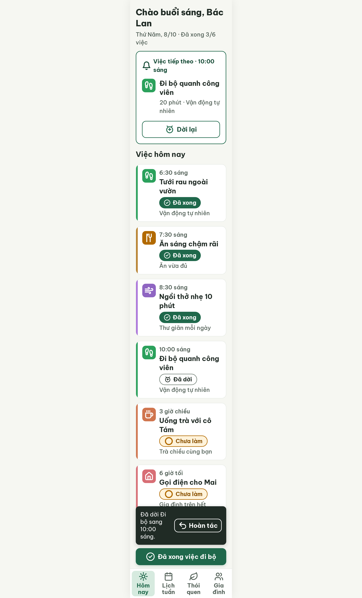
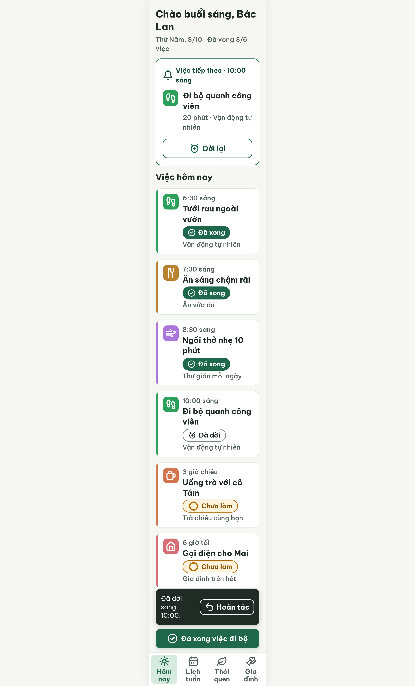
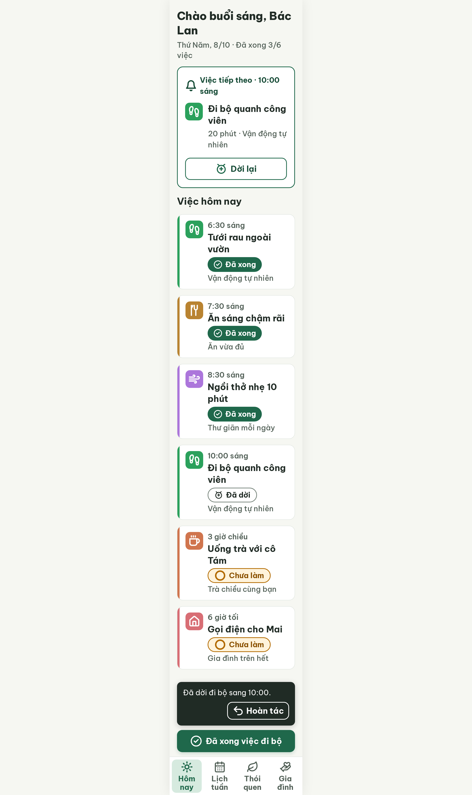

# S03-later Hôm nay (đã dời 30 phút) – log vòng lặp Stitch

| Vòng | Điểm | Số error | Số warn | Đã sửa | Regression |
| --- | --- | --- | --- | --- | --- |
| v0 | 71 | 2 | 3 | – | – |
| v1 | 90 | 1 | 0 | R-ICON-03, R-COL-02, R-COL-03, R-STY-01 | không |
| v2 | 100 | 0 | 0 | R-TXT-03 | không |

**Màn chốt: v2 – điểm 100**
**Kết quả: CONVERGED** (điểm 100).

Biến thể của S03 (gốc: screen id `cc28fdd64e6e4c70b59b419c44376787`, màn chốt S03 = v3). Lệnh chạy không có `--from S03`; chạy theo `CHIA-VIEC.md` dòng A08 ("EDIT S03").
screen id: v0 `ece7ea9689344007a9e7495967b8099b` · v1 `3acef4da569f46039eece4cdaba62751` · v2 (màn chốt) `4e5e8d14436f4fe28e4ba18362aaab83` (project 2013215887278758682)

Ghi chú:
- Nội dung: dời Đi bộ từ 9:30 sáng sang 10:00 sáng (30 phút nữa); tiến độ vẫn "Đã xong 3/6 việc"; chip "Đã dời" (icon `alarm-clock-plus`) thay "Chưa làm"; snackbar dọc "Đã dời đi bộ sang 10:00." + nút "Hoàn tác"; nút đáy "Đã xong việc đi bộ".
- Chip "Đã dời" chỉ ghi "Đã dời" (không kèm giờ như SG-23 "Đã dời · {4 giờ chiều}") vì giờ mới đã nằm ở dòng giờ của thẻ và chip dài sẽ tràn.
- Snackbar ở v2 cao ~120 px (cột dọc) thay vì 80 px của S03b (hàng ngang), vì câu "Đã dời … sang 10:00" dài hơn nên không vừa cạnh nút "Hoàn tác" (R-TXT-03). Hai màn S03b và S03-later nên thống nhất kiểu snackbar khi dựng Figma.
- Icon sai Từ điển kế thừa từ S03 v3 (tab Gia đình `users`, Lịch tuần `calendar`) và 2 ô icon lệch màu vạch (do Stitch tự đổi sang #B26A00, #8F65C2 khi sinh v0) đã sửa ở v1. S03 gốc vẫn cần `--resume`.
- Các biến thể S03-later4 / S03-tomorrow cùng dạng, có thể dựng từ màn này.

## v0 – điểm 71



| Luật | Mức | Vị trí | Bằng chứng | Sửa |
| --- | --- | --- | --- | --- |
| R-TXT-03 | error | Snackbar | Câu nằm cùng hàng nút "Hoàn tác" (~150 px, nowrap) nên chữ 20 px chỉ còn ~120 px, gãy 4 dòng | Snackbar xếp dọc, câu 1 dòng, nút ở dòng dưới |
| R-COL-02 | error | Thẻ "Ăn sáng chậm rãi", "Ngồi thở nhẹ 10 phút" | Vạch #B98331 / #AC76DB nhưng ô icon #B26A00 / #8F65C2 | Ô icon cùng màu vạch |
| R-ICON-03 | warn | Bottom nav | Tab Gia đình `users`; tab Lịch tuần `calendar` | `hand-heart`, `calendar-days` |
| R-COL-03, R-STY-01 | warn | Hai ô icon trên | #8F65C2, #B26A00 không thuộc 9 màu nhấn | Sửa cùng R-COL-02 |

### Edit prompt gửi sau v0 (v0-edit-prompt.txt)

```
Keep the overall layout and everything not mentioned below unchanged.
1. Snackbar: shorten the text to "Đã dời sang 10:00." (20px regular white, may wrap to 2 lines) so it fits left of the "Hoàn tác" button in the 80px row. Keep the button, its icon, its size and the 80px height.
2. In the task row "Ăn sáng chậm rãi" set the 48x48px icon tile background to #B98331 (same as its 6px left accent bar); keep the white `utensils` icon 32px.
3. In the task row "Ngồi thở nhẹ 10 phút" set the 48x48px icon tile background to #AC76DB (same as its 6px left accent bar); keep the white `wind` icon 32px.
4. Every habit tile must use exactly the habit accent color and the same color for its left bar: Vận động tự nhiên #2BA15C, Ăn vừa đủ #B98331, Thư giãn mỗi ngày #AC76DB, Trà chiều cùng bạn #D0754E, Gia đình trên hết #D86E75. No other colors such as #B26A00 or #8F65C2 on tiles.
5. Bottom navigation: the "Gia đình" tab currently uses the `users` icon; replace it with the Lucide `hand-heart` icon (32px, stroke 2.2, color #526057). The "Lịch tuần" tab currently uses `calendar`; replace it with the Lucide `calendar-days` icon (32px, stroke 2.2, color #526057). Keep `sun` (active "Hôm nay") and `leaf` ("Thói quen").
```

## v1 – điểm 90



| Luật | Mức | Vị trí | Bằng chứng | Sửa |
| --- | --- | --- | --- | --- |
| R-TXT-03 | error | Snackbar | Vẫn xếp ngang; "Hoàn tác" ~150 px không co nên câu "Đã dời sang 10:00." gãy 3 dòng (và mất tên việc) | Xếp dọc, câu "Đã dời đi bộ sang 10:00." 1 dòng, nút căn phải ở dòng dưới |

Đã sửa: R-ICON-03, R-COL-02, R-COL-03, R-STY-01. Regression: không. best: v1 – điểm 90

### Edit prompt gửi sau v1 (v1-edit-prompt.txt)

```
Keep the overall layout and everything not mentioned below unchanged.
1. Change the snackbar from a horizontal row to a vertical column: flex-direction column, gap 12px, padding 16px, width 320px, background #202B25, radius 12px (height becomes about 120px).
2. Line 1 of the snackbar: the text "Đã dời đi bộ sang 10:00." 20px regular, #FFFFFF, on ONE line (it has the full 288px inner width).
3. Line 2: the outline button "Hoàn tác" (48px high, radius 14px, 2px border #FFFFFF, no fill, padding 0 12px, gap 6px, white-space nowrap) with the Lucide `undo-2` icon 32px white on its left, aligned to the right (align-self: flex-end).
4. Increase the scroll container padding-bottom to 340px so the last task card is never covered by the taller snackbar, the sticky button or the bottom navigation.
```

## v2 – điểm 100



Không còn vi phạm. Đã sửa R-TXT-03. Regression: không. best: v2 – điểm 100
