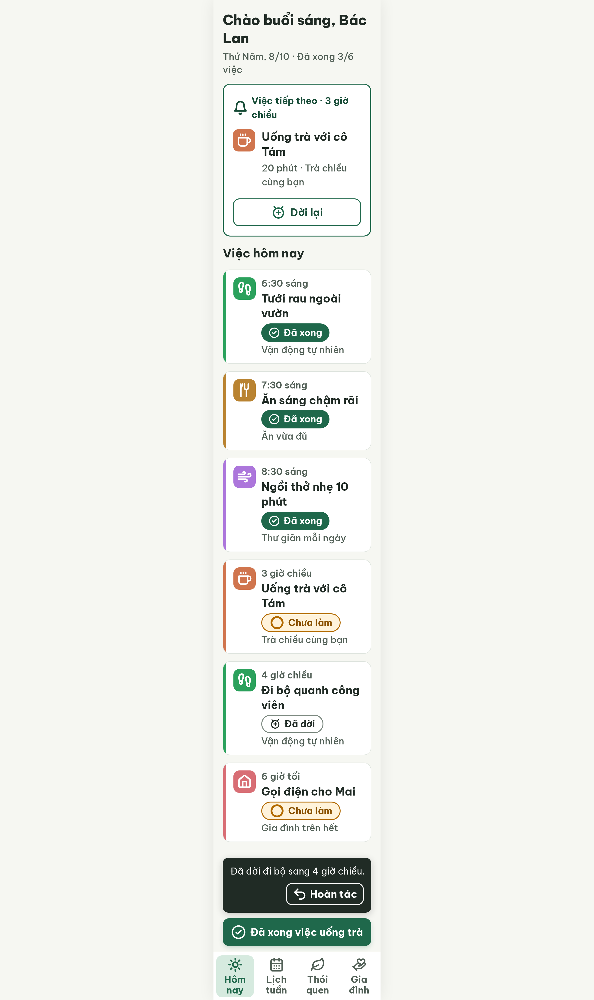

# S03-later4 Hôm nay · dời chiều nay – log vòng lặp Stitch

| Vòng | Điểm | Số error | Số warn | Đã sửa | Regression |
| --- | --- | --- | --- | --- | --- |
| v0 | 100 | 0 | 0 | – | – |

**Màn chốt: v0 – điểm 100**
**Kết quả: CONVERGED** (điểm 100).

Biến thể của S03 (`--from S03`), gốc: screen id `cc28fdd64e6e4c70b59b419c44376787` (màn chốt S03 = v3).
screen id: `4f6588ed8b1a4c5ba95864505ef1bd23` (project 2013215887278758682)

Ghi chú:
- v0 đã dùng sẵn các bài học từ S03b / S03-later (snackbar xếp dọc, "Hoàn tác" nowrap, padding-bottom 340, tile cùng màu vạch, icon đúng Từ điển, nhãn nút đáy nói rõ việc) nên đạt 100 ngay vòng đầu. Không sửa từ S03-later.
- Nội dung: Đi bộ dời từ 9:30 sáng sang 4 giờ chiều; việc tiếp theo thành "Uống trà với cô Tám" 3 giờ chiều; danh sách xếp lại theo giờ (3 giờ chiều, 4 giờ chiều, 6 giờ tối); chip "Đã dời" (không kèm giờ, giờ nằm ở dòng giờ của thẻ); snackbar "Đã dời đi bộ sang 4 giờ chiều." + "Hoàn tác"; nút đáy "Đã xong việc uống trà". Tiến độ vẫn "Đã xong 3/6 việc".
- **Cần người quyết định (critic chấm pass theo cách hiểu rộng):**
  - R-COL-02: thẻ "Việc tiếp theo" có ô icon màu nhưng không có vạch màu bên trái (coi là component riêng `card-next-task`). Nếu hiểu luật là mọi thẻ việc đều cần vạch màu thì là error; lỗi này cũng có ở S03 gốc và các biến thể.
  - R-LAY-01: câu snackbar và nhãn nút chính đặt `white-space: nowrap`, vừa khít 360 px; nếu chữ dài hơn có thể tràn ngang.
- Icon, màu tile ở màn này đúng; S03 gốc vẫn cần `--resume`.

## v0 – điểm 100

Không có vi phạm. 34 luật pass, 3 luật n/a (R-NAV-02, R-SAFE-02, R-VOI-01). Tương phản thấp nhất 5,32 : 1 (chữ tab đang chọn); viền chip "Đã dời" 3,70 : 1; chỉ 1 nút filled (60 px); icon đúng Từ điển.

Đã sửa / regression: không có (vòng đầu). best: v0 – điểm 100
