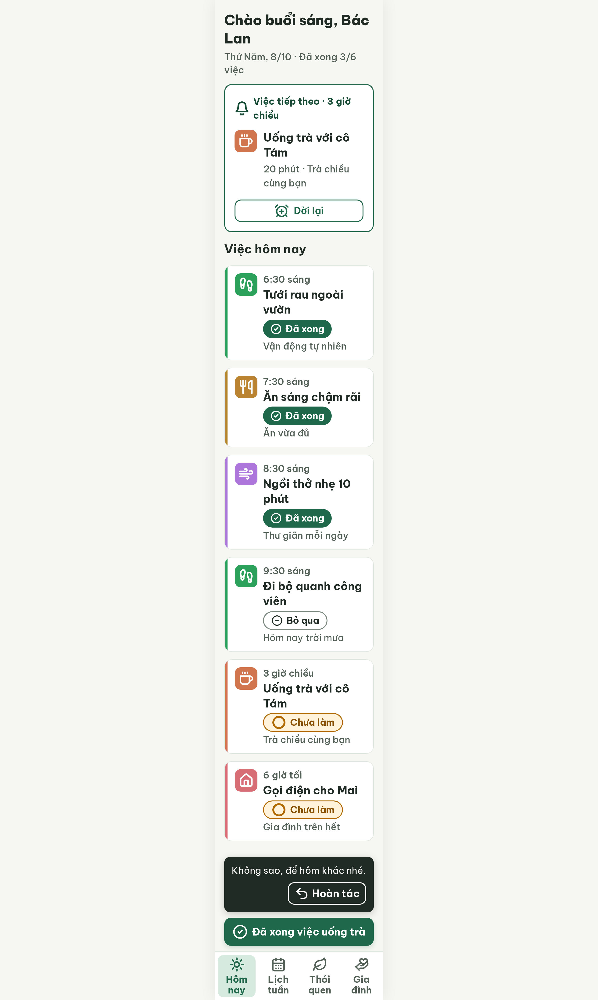
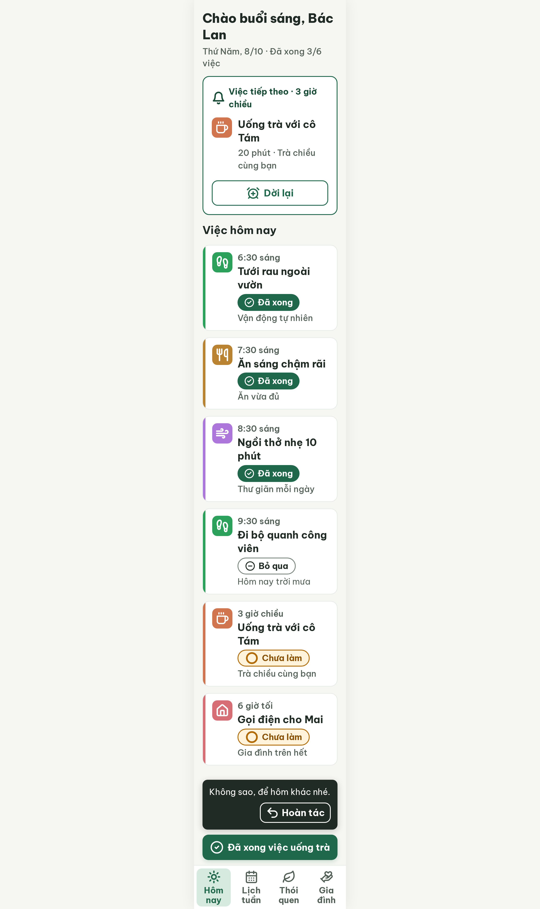

# S03-skip Hôm nay · đã bỏ qua – log vòng lặp Stitch

| Vòng | Điểm | Số error | Số warn | Đã sửa | Regression |
| --- | --- | --- | --- | --- | --- |
| v0 | 97 | 0 | 1 | – | – |
| v1 | 100 | 0 | 0 | R-TXT-02 | không |

**Màn chốt: v1 – điểm 100**
**Kết quả: CONVERGED** (điểm 100).

Biến thể của S03 (`--from S03`), gốc: screen id `cc28fdd64e6e4c70b59b419c44376787` (màn chốt S03 = v3).
screen id: v0 `42f3bb3e685b45d79ad46fcf0fb3ba9a` · v1 (màn chốt) `875d16012526440e8beb8055455f1f8f` (project 2013215887278758682)

Ghi chú:
- Nội dung: Đi bộ (9:30 sáng) bị bỏ qua vì trời mưa; chip "Bỏ qua" (icon `circle-minus`) và dòng phụ "Hôm nay trời mưa" thay dòng thói quen (SG-23 ghi "Bỏ qua · {lý do}", tách lý do ra dòng phụ để chip không tràn); tiến độ vẫn "Đã xong 3/6 việc"; việc tiếp theo "Uống trà với cô Tám" 3 giờ chiều; snackbar dọc "Không sao, để hôm khác nhé." + "Hoàn tác"; nút đáy "Đã xong việc uống trà".
- v0 đã đưa sẵn path Lucide đúng cho `utensils`, `alarm-clock-plus`, `circle-minus` (bài học S03-tomorrow) nên không phải sửa icon.
- Lời chào vẫn "Chào buổi sáng, Bác Lan" trong khi việc tiếp theo là 3 giờ chiều (lệch ngữ cảnh giờ trong ngày; critic không trừ điểm). Giữ nguyên vì `--from S03` yêu cầu giữ header; sửa khi dựng Flutter (lời chào theo giờ máy).
- Chưa có màn gợi ý thay thế khi bỏ qua vì mưa (PRD F16 / FR11, "Trời mưa thì Bác thử tập thở chậm 10 phút trong nhà nhé?"); có thể làm màn riêng.
- S03 gốc vẫn cần `--resume` (lỗi icon nav).

## v0 – điểm 97



| Luật | Mức | Vị trí | Bằng chứng | Sửa |
| --- | --- | --- | --- | --- |
| R-TXT-02 | warn | Nút viền "Dời lại" trong thẻ Việc tiếp theo | Chữ 20 px (`font-size: 20px` inline), nút cao 48 px; hai nút còn lại 22 px | Chữ 22 px đậm, nút cao 60 px, bo 14 px |

### Edit prompt gửi sau v0 (v0-edit-prompt.txt)

```
Keep the overall layout and everything not mentioned below unchanged.
1. In the "Việc tiếp theo" card, make the outline button "Dời lại" 60px high (it is 48px now) with radius 14px, 2px border #1F684B, and set its label to 22px bold (700) #1F684B (it is 20px now). Keep its `alarm-clock-plus` icon 32px on the left.
```

## v1 – điểm 100



Không còn vi phạm. Đã sửa R-TXT-02. Regression: không. best: v1 – điểm 100
