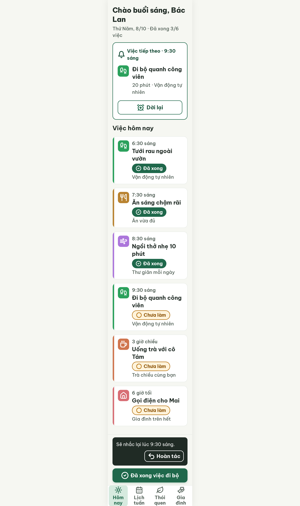
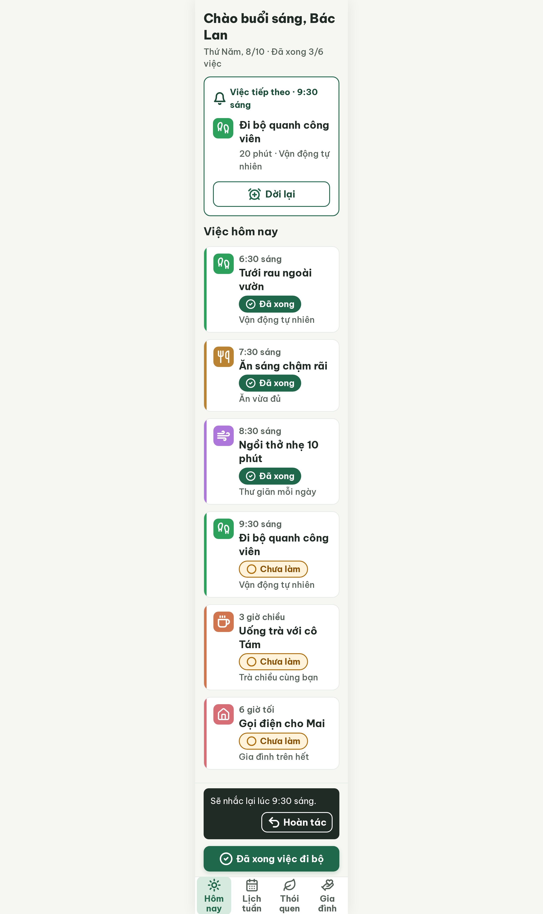

# S03-snooze Hôm nay · nhắc lại sau 10 phút (biến thể của S03)

| Vòng | Điểm | error | warn | Đã sửa | Regression |
|---|---|---|---|---|---|
| v0 | 97 | 0 | 1 | – | – |
| v1 | 100 | 0 | 0 | R-STY-03 | không |

**Màn chốt: v1 – điểm 100** (screen id 133e72ef02484f5cae4c9480b7538c4f)
**Kết quả: CONVERGED**

screen id: v0 `9d8d44e4c74d4ecc9a1ce17bda834514` (project 2013215887278758682; gốc S03 `cc28fdd64e6e4c70b59b419c44376787`)

## v0 – điểm 97


best: v0 – điểm 97 (0 error, 1 warn)

| Luật | Mức | Vị trí | Bằng chứng | Sửa |
|---|---|---|---|---|
| R-STY-03 | warn | Snackbar ↔ nút "Đã xong việc đi bộ" | sticky-action-bar gap 12px | gap 16px |

Ghi chú: critic đề nghị đổi giờ nhắc thành 9:40, không nhận. Lời nhắc đến lúc 9:20 ("Còn 10 phút nữa"), nhắc lại sau 10 phút là 9:30, đúng `flutter-handoff.md` S14 và `user-flow.md` Flow 6.

### Edit prompt vòng 1
```
Keep the overall layout and everything not mentioned below unchanged.
1. Increase the gap between the snackbar and the sticky filled button "Đã xong việc đi bộ" from 12px to 16px (sticky-action-bar gap: 16px). Keep the snackbar text "Sẽ nhắc lại lúc 9:30 sáng." unchanged, and keep the button 60px high, 320px wide, radius 14px.
```

## v1 – điểm 100


Không còn vi phạm. Đã sửa R-STY-03 (gap 16px). Không regression. best: v1 – điểm 100.

Lưu ý nội dung: critic hai vòng đều đề nghị đổi giờ thành 9:40. Giữ 9:30 vì lời nhắc đến lúc 9:20 (việc hẹn 9:30), nhắc lại sau 10 phút = 9:30, khớp `flutter-handoff.md` S14 và `ux/user-flow.md`. Người dùng nên xác nhận.
