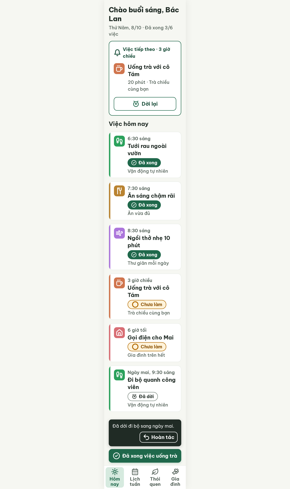

# S03-tomorrow Hôm nay · dời ngày mai – log vòng lặp Stitch

| Vòng | Điểm | Số error | Số warn | Đã sửa | Regression |
| --- | --- | --- | --- | --- | --- |
| v0 | 97 | 0 | 1 | – | – |
| v1 | 97 | 0 | 1 | một phần R-ICON-03 (tách icon chip khỏi nút "Dời lại") | không |
| v2 | 100 | 0 | 0 | R-ICON-03 | không |

**Màn chốt: v2 – điểm 100**
**Kết quả: CONVERGED** (điểm 100).

Biến thể của S03 (gốc: screen id `cc28fdd64e6e4c70b59b419c44376787`, màn chốt S03 = v3). Lệnh chạy không có `--from S03`; chạy theo `CHIA-VIEC.md` dòng A10 ("EDIT S03").
screen id: v0 `fa0ce95a8e40470294479e06e601463b` · v1 `786a5cf30df24d8bbef58e2b518245cd` · v2 (màn chốt) `dd8eec4be5024c57ba14071eb05569a6` (project 2013215887278758682)

Ghi chú:
- **Đã sửa Từ điển icon:** thêm dòng "Trạng thái | Đã dời | `redo-2`" vào `assets/stitch/DESIGN.md` (18/10/2026), vì `alarm-clock-plus` đã là hành động "Dời lại" (một icon hai nghĩa). **Hệ quả:** S03-later và S03-later4 (chip "Đã dời" dùng `alarm-clock-plus`, chấm 100 theo từ điển cũ) sẽ bị bắt R-ICON-03 nếu chấm lại; nên chạy `--resume` hai màn đó.
- Stitch tự viết sai path SVG khi sửa (v1 dùng `corner-up-right` thay `redo-2`, `utensils` vẫn tự vẽ, `alarm-clock-plus` thiếu 2 chân). v2 chốt bằng cách đưa nguyên path Lucide vào edit prompt.
- Chip "Đã dời" ghi "Đã dời", giờ mới nằm ở dòng giờ "Ngày mai, 9:30 sáng"; việc đã dời xếp cuối danh sách hôm nay. Có thể cân nhắc ẩn khỏi danh sách hôm nay khi dựng Flutter.
- Comment trong HTML ghi lệch nhãn thẻ (vd. comment "Đi bộ (Đã dời)" nằm trên thẻ "Gọi điện cho Mai"); phần hiển thị đúng, không tính lỗi. Không dùng comment HTML làm nguồn khi chuyển sang Figma.

## v0 – điểm 97



| Luật | Mức | Vị trí | Bằng chứng | Sửa |
| --- | --- | --- | --- | --- |
| R-ICON-03 | warn | Ô icon "Ăn sáng chậm rãi"; chip "Đã dời" | SVG `utensils` tự vẽ (không phải Lucide); chip "Đã dời" dùng chung `alarm-clock-plus` với nút "Dời lại" (một icon hai nghĩa) | `utensils` Lucide 32 px; chip dùng `redo-2` 24 px (thêm dòng vào Từ điển icon) |

### Edit prompt gửi sau v0 (v0-edit-prompt.txt)

```
Keep the overall layout and everything not mentioned below unchanged.
1. In the row "7:30 sáng · Ăn sáng chậm rãi", replace the hand-drawn icon inside the 48x48px #B98331 tile with the Lucide `utensils` icon, white, 32px, stroke 2.5.
2. In the status chip "Đã dời" (row "Đi bộ quanh công viên"), replace the `alarm-clock-plus` icon with the Lucide `redo-2` icon, 24px, stroke 2.2, color #202B25. Keep the chip text "Đã dời", its 40px height, white background and 2px #7B887F border. The outline button "Dời lại" in the "Việc tiếp theo" card keeps `alarm-clock-plus` 32px.
```

## v1 – điểm 97


| Luật | Mức | Vị trí | Bằng chứng | Sửa |
| --- | --- | --- | --- | --- |
| R-ICON-03 | warn | Chip "Đã dời"; ô "Ăn sáng chậm rãi"; nút "Dời lại" | Chip dùng path `corner-up-right` thay vì `redo-2`; `utensils` vẫn tự vẽ; `alarm-clock-plus` thiếu 2 chân | Đưa nguyên path Lucide đúng vào edit prompt |

Đã sửa: một phần (icon chip đã tách khỏi nút "Dời lại"). Regression: không. Điểm bằng v0 nên bộ đếm "không tăng" = 1; best: v1 – điểm 97 (bằng điểm, cùng số error, vòng sau hơn).

### Edit prompt gửi sau v1 (v1-edit-prompt.txt)

```
Keep the overall layout and everything not mentioned below unchanged.
1. In the row "7:30 sáng · Ăn sáng chậm rãi", the icon inside the 48x48px #B98331 tile must be the exact Lucide `utensils` icon, white, 32px, stroke-width 2.5, viewBox 0 0 24 24, fill none, round caps and joins, with exactly these paths: <path d="M3 2v7c0 1.1.9 2 2 2h4a2 2 0 0 0 2-2V2"/><path d="M7 2v20"/><path d="M21 15V2a5 5 0 0 0-5 5v6c0 1.1.9 2 2 2h3Zm0 0v7"/>. Remove the current hand-drawn icon.
2. In the status chip "Đã dời" (row "Đi bộ quanh công viên"), the icon must be the exact Lucide `redo-2` icon, 24px, stroke #202B25, stroke-width 2.2, viewBox 0 0 24 24, fill none, round caps and joins, with exactly these paths: <path d="m15 14 5-5-5-5"/><path d="M20 9H9.5A5.5 5.5 0 0 0 4 14.5A5.5 5.5 0 0 0 9.5 20H13"/>. Do not use `corner-up-right`.
3. In the outline button "Dời lại" of the "Việc tiếp theo" card, the icon must be the complete Lucide `alarm-clock-plus` icon, 32px, stroke #1F684B, stroke-width 2.2, with exactly these elements: <circle cx="12" cy="13" r="8"/><path d="M5 3 2 6"/><path d="m22 6-3-3"/><path d="M6.38 18.7 4 21"/><path d="M17.64 18.67 20 21"/><path d="M12 10v6"/><path d="M9 13h6"/> (clock face, plus sign, two bell tops and two legs).
```

## v2 – điểm 100


Không còn vi phạm. Đã sửa R-ICON-03. Regression: không. best: v2 – điểm 100
