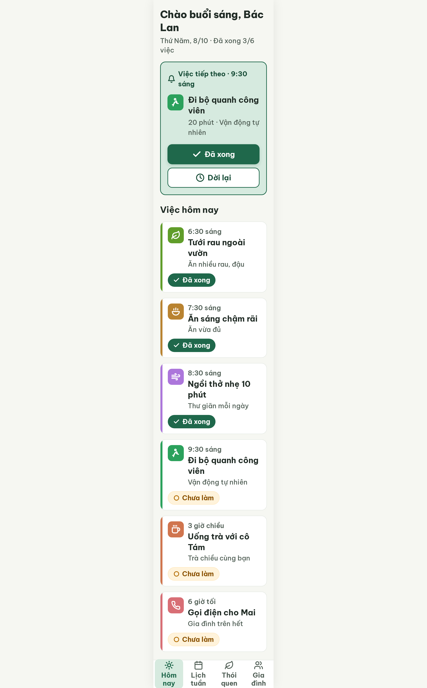
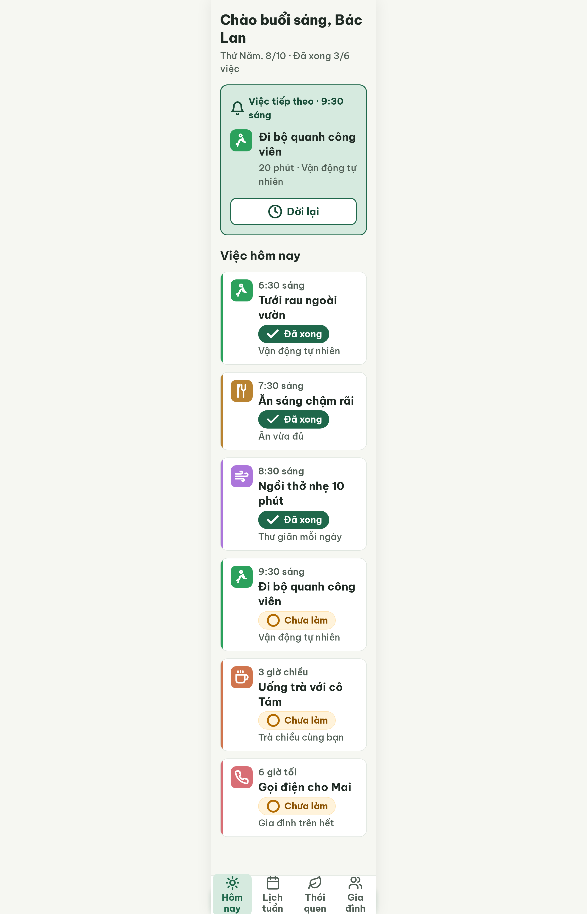
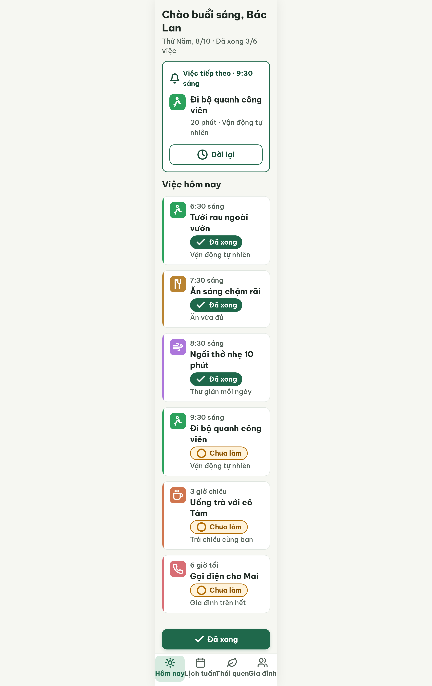
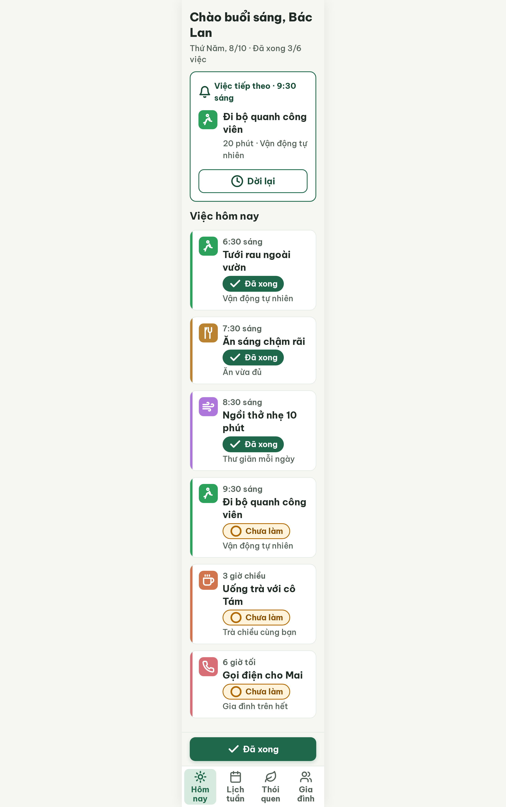

# S03 Hôm nay – log vòng lặp Stitch

| Vòng | Điểm | Số error | Số warn | Đã sửa | Regression |
|---|---|---|---|---|---|
| v0 | 71 | 2 | 3 | – | – |
| v1 | 71 | 2 | 3 | R-ICON-03 | R-CON-02 (lỗi v0 chấm sót) |
| v2 | 87 | 1 | 1 | R-CON-02, R-TAP-02, R-STA-01, R-STY-01, R-STY-03 | R-LAY-01, R-TAP-03 |
| v3 | 100 | 0 | 0 | R-LAY-01, R-TAP-03 | không |

**Kết quả: PASS** (v3, không còn error, điểm ≥ 85)

Project: 2013215887278758682 · Màn v0: 77ea5dc9ec2b4f6ca6aa36c29679b426

Ghi chú khung: Stitch gắn DESKTOP (ảnh 2560×4112, chụp 2x). Nội dung nằm trong cột max-width 360px nên ngang đúng 360dp; cao là trang cuộn dài.

## v0 – điểm 71

| Luật | Mức | Vị trí | Bằng chứng | Sửa |
|---|---|---|---|---|
| R-TAP-02 | error | Nút "Đã xong" | Nằm trong thẻ, rộng ~276px, ở nửa trên | Đưa ra thanh dính đáy, 320×60 |
| R-STA-01 | error | Chip "Chưa làm" | Viền 1px #FFE4B3, 1.24:1 | Viền 2px #B26A00, chip dưới tên việc |
| R-ICON-03 | warn | Icon | 24–28px; icon lá dùng hai nghĩa | 32px, icon riêng |
| R-STY-01 | warn | Viền chip | #FFE4B3 ngoài DESIGN.md | Dùng #B26A00 |
| R-STY-03 | warn | Khoảng cách khối | gap 20px | 16px |

Ghi chú critic: nhãn nav bị bẻ 2 dòng; "Tưới rau ngoài vườn" phải thuộc "Vận động tự nhiên".

### Edit prompt v0 → v1
Keep the overall layout and everything not mentioned below unchanged.
1. Move the filled button "Đã xong" (check icon, 60px high, radius 14, background #1F684B, white text 22px bold) out of the "Việc tiếp theo" card into a sticky bar fixed directly above the bottom navigation: width 320px (20px side margins), height 60px. Add padding-bottom 184px to the scrolling area so the bar never covers content.
2. In the "Việc tiếp theo" card keep only the info and the outlined button "Dời lại" (clock icon), full card width, 60px high.
3. Status chip "○ Chưa làm" (3 rows: 9:30 sáng, 3 giờ chiều, 6 giờ tối): change border to 2px solid #B26A00, keep background #FFF3DB, text #8A5100, circle icon #B26A00, height 40px. Remove any #FFE4B3 color.
4. Place each status chip directly below the task name (before the habit line) in every task row.
5. Make every icon 32px (bell, habit icons inside the 48x48 tiles, button icons, bottom-nav icons).
6. Use distinct icons: "Tưới rau ngoài vườn" uses the footprints icon with habit "Vận động tự nhiên" and accent #2BA15C (tile and 6px bar); keep the leaf icon only for the bottom tab "Thói quen"; "Ăn sáng chậm rãi" uses the utensils icon.
7. Set the gap between all main blocks to 16px; remove extra margins on the "Việc hôm nay" title (0px).
8. Bottom-nav labels "Hôm nay", "Lịch tuần", "Thói quen", "Gia đình" must stay on one line at 20px (tab width 90px, reduce horizontal padding to 4px).

## v1 – điểm 71

| Luật | Mức | Vị trí | Bằng chứng | Sửa |
|---|---|---|---|---|
| R-TAP-02 | error | Nút "Đã xong" | `.sticky-action-bar` không có CSS, bị bottom nav che, không thấy trên ảnh | position fixed bottom 96px, 320px |
| R-STA-01 | error | Chip "Chưa làm" | Vẫn viền 1px #FFE4B3 | 2px #B26A00 trong rule CSS |
| R-CON-02 | warn | Ô icon thẻ Việc tiếp theo | #2BA15C trên #D6EADF = 2.63:1 (lỗi v0 chấm sót) | Nền thẻ #FFFFFF, viền 2px #1F684B |
| R-STY-01 | warn | Viền chip | #FFE4B3 còn | Thay #B26A00 |
| R-STY-03 | warn | Khoảng cách khối | gap 20px, title margin lệch | gap 16px, margin 0 |

Đã sửa: R-ICON-03. Regression: R-CON-02 (thực ra lỗi v0 chấm sót). Điểm không tăng 1 vòng (71 → 71).

### Edit prompt v1 → v2
Keep the overall layout and everything not mentioned below unchanged.
1. The filled button "Đã xong" (check icon, 60px high, radius 14, background #1F684B, white text 22px bold) is currently hidden behind the bottom navigation. Put it in a container with CSS: position fixed; bottom 96px; left 50%; transform translateX(-50%); width 100%; max-width 360px; padding 12px 20px; background #F6F7F2; border-top 1px solid #DFE5DF; z-index 99. The button must be visible, 320px wide, directly above the bottom navigation.
2. Raise the bottom navigation height to 96px and keep its four labels "Hôm nay", "Lịch tuần", "Thói quen", "Gia đình" on ONE line (20px, white-space nowrap), with at least 8px space below the labels.
3. Increase padding-bottom of the scrolling area to 216px so the last task card is never covered.
4. Status chip "○ Chưa làm" (3 rows): replace the current 1px #FFE4B3 border with border: 2px solid #B26A00 written directly in the .status-chip.pending CSS rule; keep background #FFF3DB, text #8A5100, circle icon #B26A00, height 40px. The color #FFE4B3 must not appear anywhere.
5. Set gap between all main blocks to exactly 16px in the scroll container CSS; set margin 0 on the "Việc hôm nay" title.
6. In the "Việc tiếp theo" card change background from #D6EADF to #FFFFFF with a 2px solid #1F684B border, so the green 48x48 icon tile has at least 3:1 contrast.

## v2 – điểm 87

| Luật | Mức | Vị trí | Bằng chứng | Sửa |
|---|---|---|---|---|
| R-LAY-01 | error | Nhãn bottom nav | nowrap 20px, 4 nhãn ~403px > 360px, tràn ô tab, dính liền | nav 104px, tab flex 1 1 0, nhãn cho xuống 2 dòng |
| R-TAP-03 | warn | 4 tab bottom nav | Khoảng cách giữa tab 0px | gap 8px |

Đã sửa: R-CON-02, R-TAP-02, R-STA-01, R-STY-01, R-STY-03. Regression: R-LAY-01, R-TAP-03 (do `nowrap` ở edit v1→v2).

### Edit prompt v2 → v3
Keep the overall layout and everything not mentioned below unchanged.
1. Bottom navigation: the four labels "Hôm nay", "Lịch tuần", "Thói quen", "Gia đình" overflow their tabs and touch each other. Set .bottom-nav height 104px, padding 0 6px, gap 8px, justify-content stretch.
2. Set .nav-tab: flex 1 1 0; min-width 0; max-width 81px; padding 4px 0; icon 32px above the label, all centered.
3. Set .nav-label: white-space normal; font-size 20px; line-height 1.15; margin-bottom 0; labels may wrap to 2 lines of equal style, nothing may overflow its tab or touch the 360px frame edge.
4. Move the fixed "Đã xong" bar to bottom 104px (directly above the navigation) and set the scroll container padding-bottom to 224px.

## v3 – điểm 100

Không còn vi phạm. Đã sửa: R-LAY-01 (nav 104px, tab 81px, nhãn 2 dòng gọn), R-TAP-03 (gap 8px). Regression: không.

Ghi chú critic (không trừ điểm): nút "Đã xong" ở đáy chưa ghi tên việc, nên cân nhắc "Xong đi bộ"; nhãn tab ngắt 2 dòng; thẻ "Việc tiếp theo" chưa có vạch màu bên trái, nếu đọc luật chặt thì R-COL-02 có thể fail.
