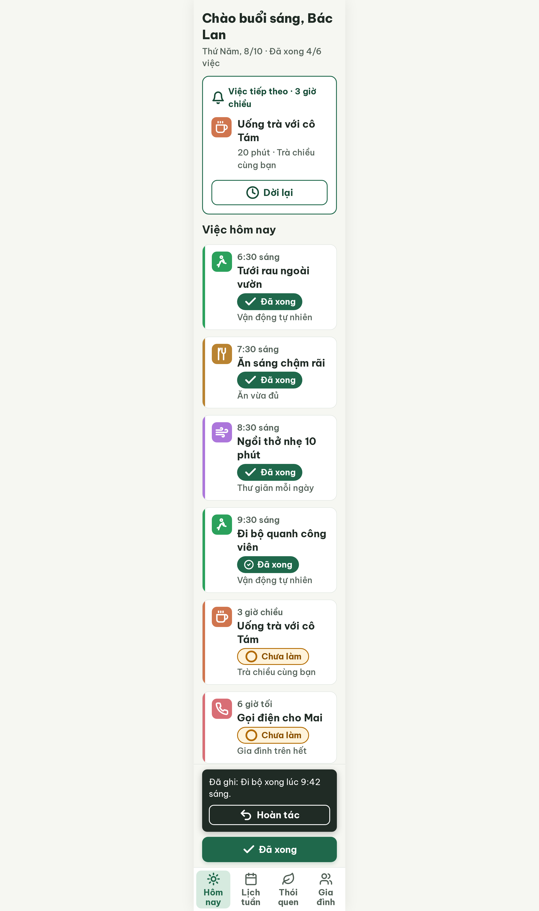
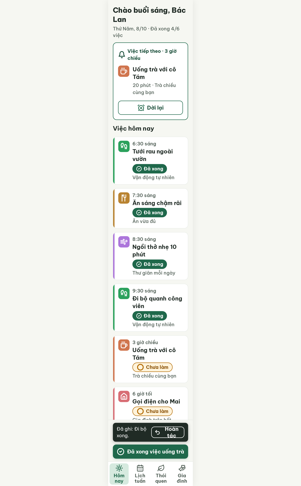
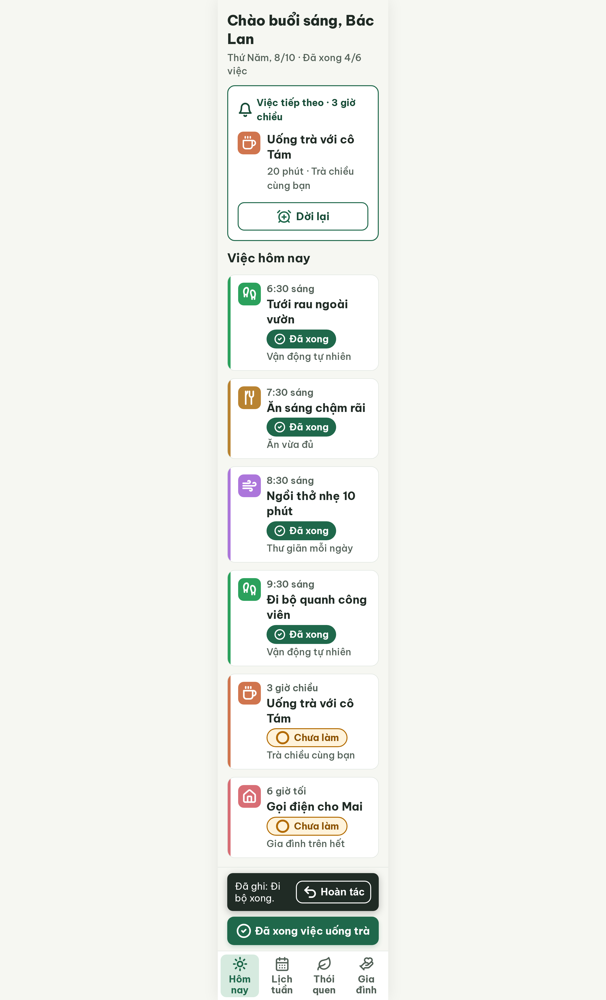

# S03b Hôm nay sau khi xong 1 việc – log vòng lặp Stitch

| Vòng | Điểm | Số error | Số warn | Đã sửa | Regression |
| --- | --- | --- | --- | --- | --- |
| v0 | 91 | 0 | 3 | – | – |
| v1 | 90 | 1 | 0 | R-ICON-03, R-ONE-02, R-STY-02 | R-LAY-01 (error mới) |
| v2 | 100 | 0 | 0 | R-LAY-01 (và 3 luật của v0) | không |

**Màn chốt: v2 – điểm 100**
**Kết quả: CONVERGED** (điểm 100).

Biến thể của S03 (`--from S03`), gốc: screen id `cc28fdd64e6e4c70b59b419c44376787` (màn chốt S03 = v3).
screen id: v0 `9429698d600f4fe7a82307c6a1934279` · v1 `586a6d9797d8488bb28eabae2092f05d` (tụt điểm, bỏ) · v2 (màn chốt) `7ff9ca8396ab43de862332eb0bee45ce` (project 2013215887278758682)

Ghi chú:
- v1 tụt 1 điểm so với v0 nên v2 sửa trên v0 (màn tốt nhất), dùng cùng 7 sửa đổi của v1 cộng 2 sửa mới (nowrap cho "Hoàn tác", padding-bottom 300 px).
- Phần lớn warn của v0 (icon sai Từ điển: nút "Dời lại" dùng `clock`, tab Gia đình `users`, tab Lịch tuần `calendar`, ô icon người chạy tự vẽ, `phone` cho Gọi điện cho Mai, `check` trộn `circle-check`) **kế thừa từ S03 v3**, chấm 100 theo luật cũ. S03 cần chạy `--resume`.
- Nút đáy đổi từ "Đã xong" thành "Đã xong việc uống trà" (5 tiếng) để rõ nút áp cho việc nào, khác S03 gốc.
- Snackbar thu về 1 hàng 80 px: "Đã ghi: Đi bộ xong." + nút "Hoàn tác". Câu mẫu đầy đủ của AppStyleGuide mục 5 là "Đã ghi: {Đi bộ} xong lúc {9:42 sáng}."; bản chốt bỏ phần giờ cho gọn.
- CSS v2: nút "Hoàn tác" có `white-space: nowrap; flex-shrink: 0`, `.scroll-container` `padding-bottom: 300px`.

## v0 – điểm 91



| Luật | Mức | Vị trí | Bằng chứng | Sửa |
| --- | --- | --- | --- | --- |
| R-ICON-03 | warn | Ô icon Vận động, ô icon "Gọi điện cho Mai", chip/nút Đã xong, nút "Dời lại", bottom nav | Icon người chạy tự vẽ; `phone` cho thói quen; `check` lẫn `circle-check`; `clock` cho Dời lại; `users`, `calendar` ở nav | `footprints`, `house`, `circle-check`, `alarm-clock-plus`, `hand-heart`, `calendar-days` |
| R-ONE-02 | warn | Snackbar + nút "Đã xong" đáy | Mảng đậm nhất màn, nút tách khỏi khối "Việc tiếp theo" | Nhãn nút "Đã xong việc uống trà"; snackbar 80 px |
| R-STY-02 | warn | Nút "Hoàn tác" | Bo 12 px, token nút 14 px | Bo 14 px |

## v1 – điểm 90 (tụt, bỏ)



| Luật | Mức | Vị trí | Bằng chứng | Sửa |
| --- | --- | --- | --- | --- |
| R-LAY-01 | error | Nút "Hoàn tác"; thẻ cuối "Gọi điện cho Mai" | Chữ "Hoàn tác" co thành 2 dòng, bị cắt trong nút 48 px; `padding-bottom` 250 px nhỏ hơn phần cố định đáy ~280 px nên thẻ cuối bị che ~30 px | `white-space: nowrap; flex-shrink: 0`; `padding-bottom: 300px` |

Đã sửa: 3 warn của v0. Regression: R-LAY-01. best: v0 – điểm 91. Bộ đếm "không tăng" = 1.

### Edit prompt gửi sau v0 (v0-edit-prompt.txt → v1)

```
Keep the overall layout and everything not mentioned below unchanged.
1. In the task rows "Tưới rau ngoài vườn" and "Đi bộ quanh công viên", replace the running-person icon inside the 48x48px #2BA15C tile with the Lucide `footprints` icon, white, 32px, stroke 2.5.
2. In the task row "Gọi điện cho Mai", replace the `phone` icon inside the 48x48px #D86E75 tile with the Lucide `house` icon, white, 32px, stroke 2.5.
3. Use the same icon for "done" everywhere: Lucide `circle-check`. In the status chips "Đã xong" (all four rows) use `circle-check` 24px white; in the sticky filled button use `circle-check` 32px white. Remove every plain `check` icon.
4. Rename the sticky filled button label from "Đã xong" to "Đã xong việc uống trà" (22px bold white, one line), so it is clear which task it marks. Keep it 60px high, 320px wide.
5. Replace the icon of the outline button "Dời lại" in the "Việc tiếp theo" card from `clock` to the Lucide `alarm-clock-plus`, 32px.
6. Bottom navigation: change the "Gia đình" tab icon from `users` to Lucide `hand-heart` and the "Lịch tuần" tab icon from `calendar` to Lucide `calendar-days`, both 32px, stroke 2.2, color #526057.
7. Make the snackbar smaller: one horizontal row, total height 80px (padding 16px), width 320px, background #202B25, radius 12px. Left: the text "Đã ghi: Đi bộ xong." 20px regular white (may wrap to 2 lines). Right: the outline button 48px high, radius 14px, 2px border #FFFFFF, label "Hoàn tác" 22px bold white with Lucide `undo-2` 32px white on its left. Keep the 12px gap between the snackbar and the sticky button.
```

### Edit prompt gửi sau v1, sửa trên v0 (v1-edit-prompt.txt → v2)

Giống prompt trên, thêm:

```
8. The "Hoàn tác" label must stay on one line: set white-space: nowrap and flex-shrink: 0 on the snackbar button, padding 0 12px, gap 6px between the icon and the label; the text "Đã ghi: Đi bộ xong." may wrap to 2 lines on its own.
9. Increase the scroll container padding-bottom to 300px so the last task card "Gọi điện cho Mai" (including its line "Gia đình trên hết") is never covered by the snackbar, the sticky button or the bottom navigation.
```

## v2 – điểm 100



Không còn vi phạm. 34 luật pass, 3 luật n/a. Đã sửa R-LAY-01 (và 3 warn của v0). Regression: không. best: v2 – điểm 100
