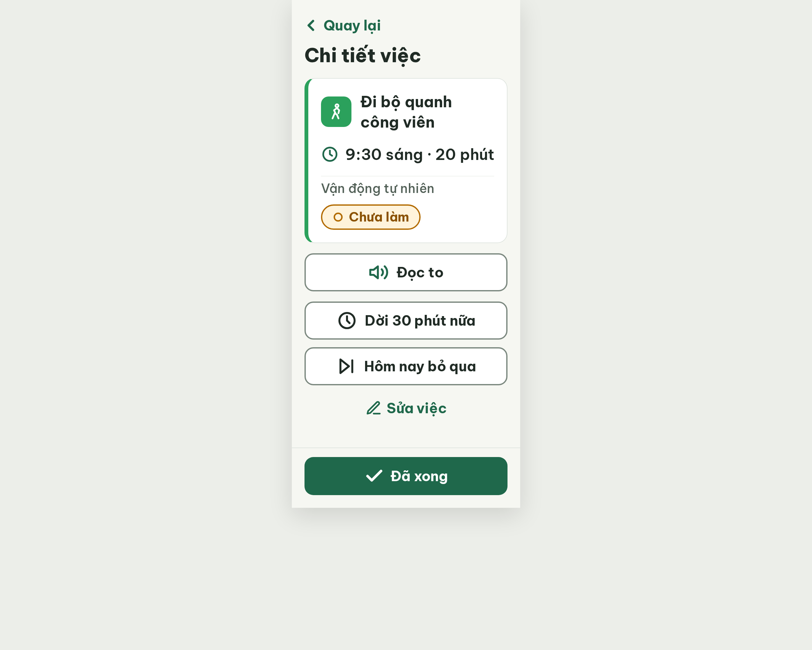

# S04 Chi tiết việc – log vòng lặp Stitch

| Vòng | Điểm | Số error | Số warn | Đã sửa | Regression |
| --- | --- | --- | --- | --- | --- |
| v0 | 97 | 0 | 1 | – | – |

**Kết quả: PASS** (v0: không còn error, 97 ≥ 85). Stitch screen id: `705adc6ba2724c08b49042a05947c728` (project 2013215887278758682).

## v0 – điểm 97

| Luật | Mức | Vị trí | Bằng chứng | Sửa |
| --- | --- | --- | --- | --- |
| R-ICON-03 | warn | Icon người đi bộ, đồng hồ, bút, mũi tên Quay lại, vòng tròn trong chip | Các icon 18–28 px, nhỏ hơn 32 px | Ô icon thói quen 56x56 với icon 36; đồng hồ, bút, mũi tên 32; icon chip 22 |

Ghi chú của critic (không tính lỗi):
- R-SAFE-01 chấm n/a: màn tĩnh chưa có hộp hỏi lại / "Hoàn tác" sau khi bấm "Đã xong" hoặc "Hôm nay bỏ qua"; cần màn dialog riêng.
- R-STA-01 pass nhưng sát ngưỡng: chip "○ Chưa làm" nằm dưới dòng giờ, chưa ngay cạnh tên việc.
- Prompt v0: `v0-prompt.txt`, nguồn ở `v0-prompt-trace.md` (PRD 11.2 không có dòng S04, nội dung lấy từ README, user-flow, rule R-VOI-01).
