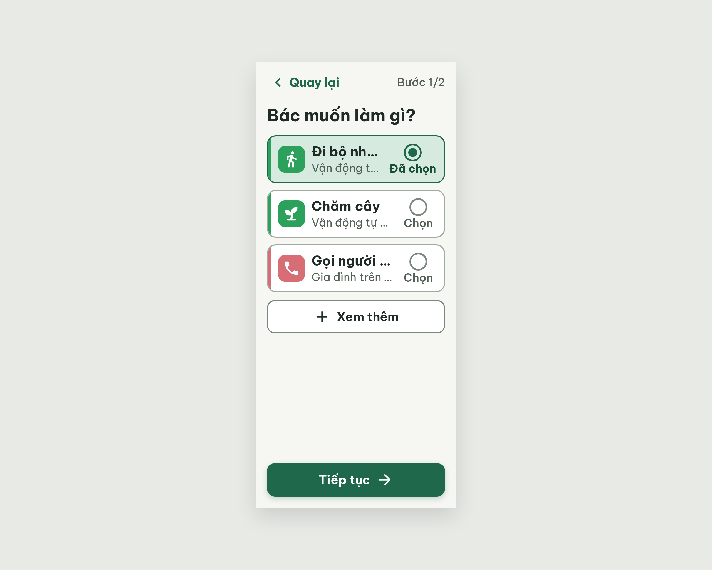
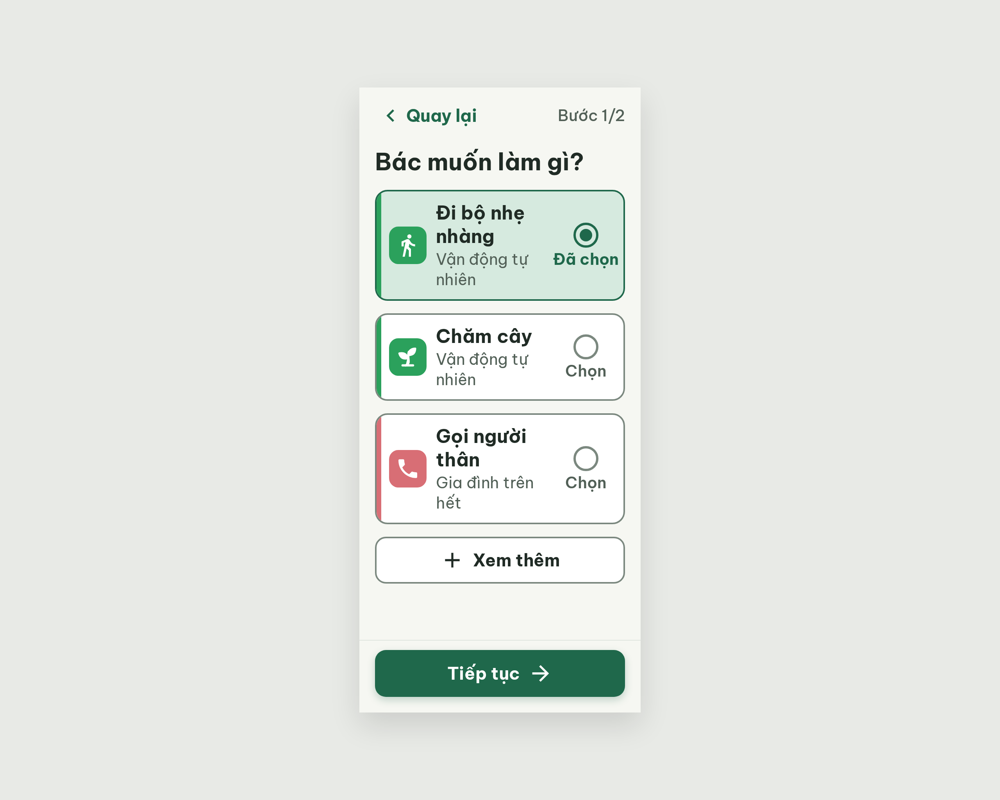

# S05 Thêm việc – chọn việc quen – log vòng lặp Stitch

| Vòng | Điểm | Số error | Số warn | Đã sửa | Regression |
| --- | --- | --- | --- | --- | --- |
| v0 | 81 | 1 | 3 | – | – |
| v1 | 84 | 1 | 2 | R-ICON-03 | không |
| v2 | 97 | 0 | 1 | R-LAY-01, R-STY-03 | không |

**Kết quả: PASS** (v2: 0 error, 97 ≥ 85). Stitch screen id cuối: `85cacc8170fb413aa40be1d7ddd52f4b` (project 2013215887278758682).

## v0 – điểm 81


| Luật | Mức | Vị trí | Bằng chứng | Sửa |
| --- | --- | --- | --- | --- |
| R-LAY-01 | error | Tên việc và dòng phụ trong 3 thẻ | nowrap + ellipsis, vùng chữ chỉ ~130px nên "Đi bộ nh...", "Vận động t..." | Bỏ nowrap/ellipsis, cột trạng thái 56px, padding thẻ 12/12/12/16 |
| R-CON-02 | warn | Viền thẻ chưa chọn | #A0ACA3 trên trắng 2,35:1 | Đổi #7B887F |
| R-ICON-03 | warn | Icon Chăm cây, icon Đã chọn | Icon cây trông như mũi tên; dấu ✓ trùng nghĩa "✓ Đã xong" | Icon sprout; nút radio |
| R-STY-03 | warn | Khoảng cách | gap 12, margin 14 | 16 và 16 |

Ghi chú: Stitch trả thêm 1 màn trùng (`6a63d7ae639749c69c2fe3eee609a9b9`), không dùng.

### Edit prompt gửi sau v0 (v0-edit-prompt.txt)

```
Keep the overall layout and everything not mentioned below unchanged.
1. Text is truncated with "..." in all three cards. Remove white-space:nowrap and text-overflow:ellipsis from the activity name and the habit line so they wrap to at most 2 lines. "Đi bộ nhẹ nhàng", "Chăm cây", "Gọi người thân", "Vận động tự nhiên" and "Gia đình trên hết" must show in full, no "…".
2. Shrink the selection column on the right of each card: a 32px icon with the label "Đã chọn" / "Chọn" (20px) under it, min-width 56px. Card padding 12px 12px 12px 16px.
3. Unselected card border: change 2px #A0ACA3 to 2px #7B887F.
4. Replace the "Chăm cây" icon with a clear sprout/seedling icon (Lucide "sprout" style), 32px, white on the #2BA15C tile.
5. Selection state icon: replace the check-circle with a radio button: circle 32px, 3px #1F684B border, with a solid 16px #1F684B dot in the center for "Đã chọn"; an empty circle with 3px #7B887F border for "Chọn". Keep the labels.
6. Set the gap between the three cards to 16px and the margin above the "Xem thêm" button to 16px.
```

## v1 – điểm 84



Điểm tăng 81 → 84. Đã sửa: R-ICON-03 (icon sprout, nút radio). Regression: không.

| Luật | Mức | Vị trí | Bằng chứng | Sửa |
| --- | --- | --- | --- | --- |
| R-LAY-01 | error | Tên việc, dòng phụ | Chưa sửa: CSS gốc vẫn nowrap + ellipsis (Stitch chỉ thêm override ở cuối nhưng ảnh và HTML vẫn cắt chữ) | Sửa thẳng rule gốc, xóa nowrap/ellipsis |
| R-CON-02 | warn | Viền thẻ chưa chọn | Chưa sửa: #A0ACA3 (2,35:1) | #7B887F |
| R-STY-03 | warn | Khoảng cách | Chưa sửa: gap 12, margin 14 | 16 và 16 |

### Edit prompt gửi sau v1 (v1-edit-prompt.txt)

```
Keep the overall layout and everything not mentioned below unchanged.
1. STILL BROKEN: the names are still cut with "…" ("Đi bộ nh…", "Gọi người …", "Vận động t…", "Gia đình trên …"). Edit the original stylesheet rules (not an appended override): in the rules of .activity-title and .habit-subtitle DELETE the declarations white-space:nowrap, overflow:hidden and text-overflow:ellipsis, and set white-space:normal. Also remove nowrap from the card text container. The names must wrap onto 2 lines and show in full: "Đi bộ nhẹ nhàng", "Chăm cây", "Gọi người thân", "Vận động tự nhiên", "Gia đình trên hết".
2. Give the text column more room: the selection column (radio 32px + label "Đã chọn"/"Chọn" 20px) gets width 72px, and the gap between icon tile, text and selection column is 12px. Card padding 12px 12px 12px 16px.
3. STILL BROKEN: the unselected card border is still #A0ACA3. In the original rule (line with border: 2px solid #A0ACA3) change it to 2px solid #7B887F.
4. STILL BROKEN: set .activity-list gap to 16px (currently 12px) and the "Xem thêm" button margin-top to 16px (currently 14px).
```


## v2 – điểm 97



| Luật | Mức | Vị trí | Bằng chứng | Sửa |
| --- | --- | --- | --- | --- |
| R-CON-02 | warn | Ô icon #2BA15C trên nền thẻ đang chọn #D6EADF | 2,63:1 (< 3:1); đã có từ v1, vòng trước chấm sót | Nền thẻ đang chọn đổi #EEF7F1 (ô icon đạt 3,02:1), giữ viền 2px #1F684B và radio đặc |

Đã sửa so với v1: R-LAY-01 (chữ xuống dòng, hết "..."), R-STY-03 (gap 16). Regression: không.
Ghi chú: edit ở v1 chỉ thêm override nên không có hiệu lực; v2 nêu rõ sửa rule gốc và Stitch dựng lại cả màn. Tên việc và dòng phụ giờ chiếm 2 dòng, thẻ cao ~76–110px, vẫn đạt R-TXT-03/05. Warn còn lại không chặn.
