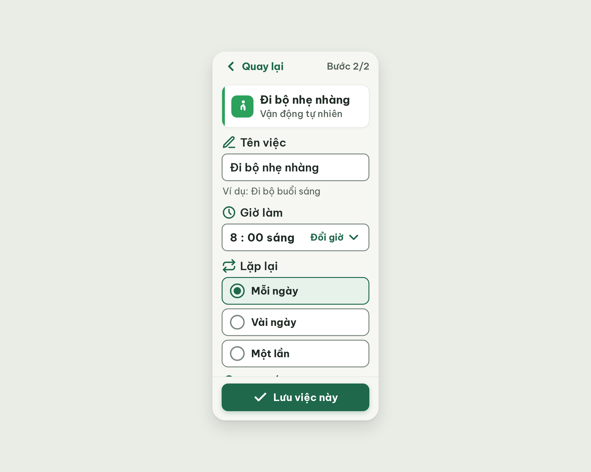

# S06 Thêm việc – thiết lập – log vòng lặp Stitch

| Vòng | Điểm | Số error | Số warn | Đã sửa | Regression |
| --- | --- | --- | --- | --- | --- |
| v0 | 94 | 0 | 2 | – | – |

**Kết quả: PASS** (v0: 0 error, 94 ≥ 85). Stitch screen id: `02520b9aa5a143b29ab1239cb2917908` (project 2013215887278758682).

## v0 – điểm 94

| Luật | Mức | Vị trí | Bằng chứng | Sửa |
| --- | --- | --- | --- | --- |
| R-TXT-02 | warn | Toàn màn; nhãn "Đổi giờ" | Không có tiêu đề màn (chữ lớn nhất 24px); "Đổi giờ" 20px, thấp hơn 22px của chữ nút | Thêm tiêu đề "Thêm việc" 30px bold; "Đổi giờ" 22px |
| R-ICON-03 | warn | Icon đi bộ trong ô #2BA15C; dấu ✓ ở "Lưu việc này" và "Bật" | Nét vẽ thực tế ~11×22px; ✓ trùng nghĩa "Đã xong" | Icon `footprints` 32px lấp khung; icon `bell-ring` cho "Bật" |

Ghi chú critic (không thuộc luật nào): ở khung 800px mục "Lời nhắc" bị thanh nút Lưu che, phải cuộn mới thấy. Có thể bỏ dòng "Ví dụ: Đi bộ buổi sáng" vì ô đã điền sẵn tên việc.
Hai warn không chặn; dừng ở v0 theo điều kiện PASS.
