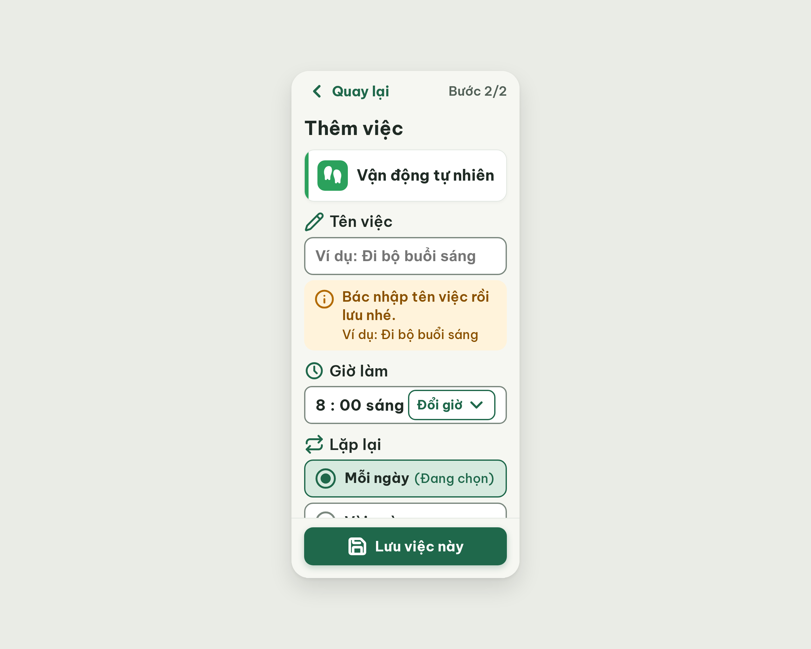

# S06e Thêm việc · thiếu thông tin (biến thể của S06)

| Vòng | Điểm | error | warn | Đã sửa | Regression |
|---|---|---|---|---|---|
| v0 | 91 | 0 | 3 | – | – |
| v1 | 97 | 0 | 1 | R-TXT-02, R-SAFE-02 | không |
| v2 | 97 | 0 | 1 | (bỏ `pencil`) | không |

**Màn chốt: v2 – điểm 97** (screen id baec561b56924d68b62a112e88dd1934; bằng điểm v1, lấy vòng sau)
**Kết quả: DỪNG SỚM, chờ người dùng quyết định** (0 error; bộ đếm "không tăng" = 1/2; lỗi còn lại là 1 warn R-ICON-03 cần quyết định thiết kế, xem cuối file)

screen id: v0 `73deffcd947440ae992a3232b319d766` (project 2013215887278758682; gốc S06 `02520b9aa5a143b29ab1239cb2917908`)

## v0 – điểm 91


best: v0 – điểm 91 (0 error, 3 warn)

| Luật | Mức | Vị trí | Bằng chứng | Sửa |
|---|---|---|---|---|
| R-SAFE-02 | warn | Hộp gợi ý dưới ô "Tên việc" | không có ví dụ cố định (chỉ placeholder, mất khi gõ) | thêm dòng "Ví dụ: Đi bộ buổi sáng" trong hộp |
| R-ICON-03 | warn | `chevron-down` ở "Đổi giờ" 24px; icon hộp gợi ý; `pencil` | 24px < 32px | `chevron-down` 32px |
| R-TXT-02 | warn | Nhãn "Tên việc" 20px | inline override, khác 3 nhãn còn lại 24px | 24px bold 600 |

Không nhận: đề nghị đổi hộp gợi ý thành lỗi đỏ `circle-alert` (đó là việc của ST-Validation; S06e là trạng thái trước khi báo lỗi, `info` = "Lưu ý, gợi ý" đúng từ điển). Không bỏ `pencil` cạnh nhãn vì ST-Validation dùng cùng icon và đạt 100.

### Edit prompt vòng 1
```
Keep the overall layout and everything not mentioned below unchanged.
1. Label "Tên việc": remove the inline 20px override so it is 24px bold 600 #202B25, the same as the labels "Giờ làm", "Lặp lại" and "Lời nhắc".
2. In the calm hint box (background #FFF3DB, radius 16px, padding 12px 16px, Lucide `info` icon 32px #B26A00 stays; it is a hint, not an error, so keep it neutral and not red): make the sentence "Bác nhập tên việc rồi lưu nhé." 22px bold 600 #8A5100, and add under it, inside the same box, the persistent example line "Ví dụ: Đi bộ buổi sáng" 20px #8A5100. The example must stay visible even after Bác starts typing.
3. In the "Đổi giờ" button increase the Lucide `chevron-down` icon from 24px to 32px (stroke 2.2, #1F684B), keep the button at least 48px high and the text "Đổi giờ" 20px bold.
```

## v1 – điểm 97


best: v1 – điểm 97 (0 error, 1 warn). Đã sửa: R-TXT-02, R-SAFE-02, chevron-down 32px. Regression: không.

| Luật | Mức | Vị trí | Bằng chứng | Sửa |
|---|---|---|---|---|
| R-ICON-03 | warn | Hộp gợi ý (`info`); nhãn "Tên việc" (`pencil`) | critic muốn `circle-alert`; `pencil` = "Sửa" | bỏ `pencil`; giữ `info` (đây là gợi ý trước khi lỗi, không phải lỗi đỏ) |

### Edit prompt vòng 2
```
Keep the overall layout and everything not mentioned below unchanged.
1. Remove the Lucide `pencil` icon in front of the label "Tên việc"; keep only the text "Tên việc" 24px bold 600 #202B25, left aligned like the labels "Giờ làm", "Lặp lại" and "Lời nhắc".
```

## v2 – điểm 97


best: v2 – điểm 97 (bằng v1). Lỗi còn lại: R-ICON-03 (warn) – hộp gợi ý dùng `info`, critic muốn `circle-alert` đỏ #B42318 trên nền đỏ nhạt.

Quyết định cần người dùng: làm theo critic thì S06e (chưa lỗi) sẽ trông giống hệt ST-Validation (đã báo lỗi), mất khác biệt giữa hai trạng thái. Giữ `info` = đúng nghĩa "Lưu ý, gợi ý" trong Từ điển icon, nhưng mất 3 điểm.
