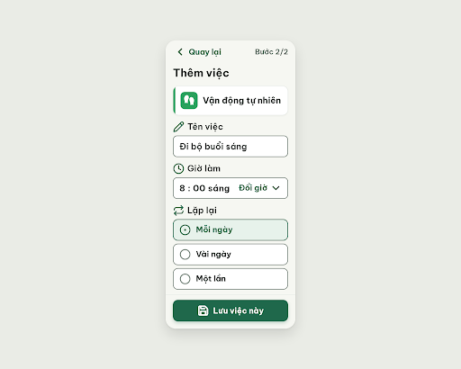

# S06o Thêm việc · đã sửa lỗi (biến thể của S06)

| Vòng | Điểm | error | warn | Đã sửa | Regression |
|---|---|---|---|---|---|
| v0 | 97 | 0 | 1 | – | – |
| v1 | chưa chấm | | | | |

**Màn chốt (tạm): v0 – điểm 97** (screen id 092edfe01b4443958da9f96f6817c1f2)
**Kết quả: chưa chốt** – đã gửi edit v1 nhưng `get_screen` vẫn trả ảnh và HTML của v0 (xem cuối file).

screen id: v0 `092edfe01b4443958da9f96f6817c1f2` (project 2013215887278758682; gốc S06 `02520b9aa5a143b29ab1239cb2917908`)

## v0 – điểm 97



best: v0 – điểm 97 (0 error, 1 warn)

| Luật | Mức | Vị trí | Bằng chứng | Sửa |
| --- | --- | --- | --- | --- |
| R-ICON-03 | warn | Nhãn "Tên việc"; ô "Mỗi ngày" đang chọn | `pencil` chỉ có nghĩa "Sửa" trong Từ điển icon nên một icon mang 2 nghĩa; `circle-dot` thiếu chữ "Đang chọn" đi kèm | Bỏ `pencil`; thêm chữ "Đang chọn" 20px #1F684B |

Ghi chú: `v0-critique.json` do critic trả về trong câu trả lời (critic không ghi được file), orchestrator lưu lại nguyên nội dung.

### Edit prompt vòng 1 (`v0-edit-prompt.txt`)
```
Keep the overall layout and everything not mentioned below unchanged.
1. Label "Tên việc": remove the Lucide `pencil` icon completely; keep only the text "Tên việc" 24px semibold 600 #202B25, left aligned.
2. Option "Mỗi ngày" (selected): keep the Lucide `circle-dot` icon 32px #1F684B and add the visible text "Đang chọn" at the right end of the row, 20px semibold 600 #1F684B, next to the text "Mỗi ngày" (22px bold).
```

## Vấn đề với v1
`edit_screens` trả về sự kiện sửa DOM trực tiếp trên screen id `092edfe0…` (xóa svg `pencil`, thêm span "(Đang chọn)" có `white-space: nowrap`), không tạo màn mới. Hai lần `get_screen` sau đó vẫn trả cùng link ảnh/HTML như v0; HTML tải về giống hệt v0 (không có "Đang chọn", còn path `pencil`). Chưa có v1.png/v1.html để chấm. Cần mở Stitch kiểm tra màn có đã cập nhật chưa, rồi chạy `/stitch-loop S06o --resume` hoặc export lại.
Lưu ý thêm: màn trả về `deviceType: DESKTOP`, 2560 × 2048, dù đã gửi MOBILE; ảnh hiển thị khung điện thoại ở giữa.
