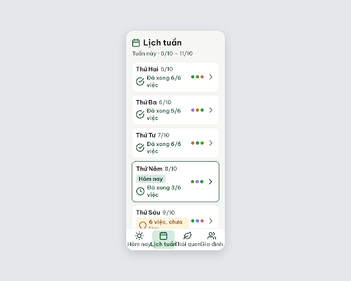
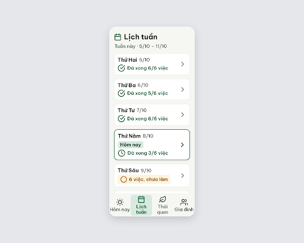

# S07 Lịch tuần – log vòng lặp Stitch

| Vòng | Điểm | Số error | Số warn | Đã sửa | Regression |
| --- | --- | --- | --- | --- | --- |
| v0 | 64 | 3 | 2 | – | – |
| v1 | 100 | 0 | 0 | R-LAY-01, R-ICON-02, R-ICON-03, R-COL-01, R-STY-03 | không |

**Kết quả: PASS** (v1: 0 error, 100 ≥ 85). Stitch screen id cuối: `7a45cbdcb1c2438793d833f4c7d00cb8` (project 2013215887278758682).

Lưu ý: PRD 11.2 không có dòng riêng cho S07, nội dung lấy từ F06 và `flutter-handoff.md`. Bản v1 bỏ chấm màu thói quen (SG-54 "chấm màu ở lịch tuần") để tránh lỗi chỉ-dựa-vào-màu; nếu muốn giữ màu thói quen, cần thiết kế lại bằng ô icon kèm nhãn. Bottom nav: "Lịch tuần" và "Thói quen" xuống 2 dòng, 2 tab còn lại 1 dòng (lệch nhẹ, không phạm luật).

## v0 – điểm 64



| Luật | Mức | Vị trí | Bằng chứng | Sửa |
| --- | --- | --- | --- | --- |
| R-LAY-01 | error | Bottom nav, 4 nhãn | `.nav-item` 82px, nhãn 20px `nowrap` rộng ~90–95px nên tràn, "Thói quen" dính "Gia đình" | nav cao 96px, tab flex 1 (90px), nhãn xuống 2 dòng, padding-bottom nội dung 116px |
| R-ICON-02 | error | Cụm chấm `.habit-dots` | Chấm 12px, không icon, tên thói quen chỉ nằm trong `title` | bỏ chấm |
| R-COL-01 | error | Cụm chấm `.habit-dots` | Nghĩa chỉ truyền bằng màu | bỏ chấm |
| R-ICON-03 | warn | "Chưa có việc" (Chủ nhật) | Icon lịch trùng icon tiêu đề và tab | đổi sang circle-minus 32px #526057 |
| R-STY-03 | warn | `.days-list` | gap 10px | gap 16px |

### Edit prompt (v0 → v1)

```
Keep the overall layout and everything not mentioned below unchanged.
1. Bottom navigation: set .bottom-nav padding to 0 and height 96px; make each tab flex: 1 (90px wide, 88px high); keep labels "Hôm nay", "Lịch tuần", "Thói quen", "Gia đình" at 20px, centered, allowed to wrap onto 2 lines (white-space: normal, line-height 1.15, letter-spacing -0.3px) so no label overflows its tab or touches the next label; add 116px bottom padding to the scrolling content so the last day row is not hidden behind the nav.
2. Remove the cluster of 12px colored habit dots from all day rows (they carry meaning by color only and have no icon or text label). Let the status label ("Đã xong 6/6 việc", "6 việc, chưa làm"...) use the freed width and stay on one line where possible.
3. Change the gap between the seven day cards from 10px to 16px.
4. On the "Chủ nhật 11/10" row replace the calendar-style icon beside "Chưa có việc" with a circle-minus icon, 32px, stroke #526057; the calendar icon stays only in the heading and the "Lịch tuần" tab.
```

## v1 – điểm 100



Không còn vi phạm. Đã sửa: R-LAY-01, R-ICON-02, R-ICON-03, R-COL-01, R-STY-03. Regression: không (R-COL-03 chuyển pass → n/a vì màn không còn dùng màu thói quen).
