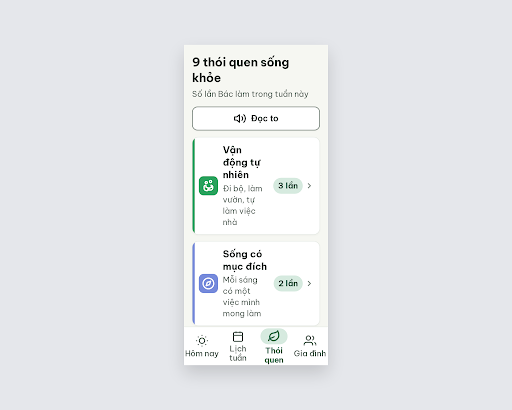
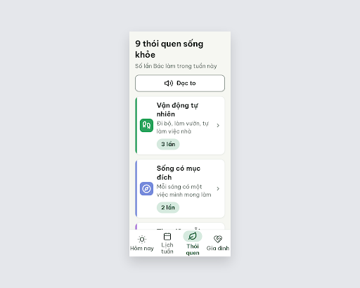

# S08 9 thói quen – log vòng lặp Stitch

| Vòng | Điểm | Số error | Số warn | Đã sửa | Regression |
| --- | --- | --- | --- | --- | --- |
| v0 | 87 | 1 | 1 | – | – |
| v1 | 87 | 1 | 1 | R-TXT-03 | R-LAY-01 (chữ bị cắt bởi line-clamp) |
| v2 | 97 | 0 | 1 | R-LAY-01 | không |

**Kết quả: PASS** (v2: 0 error, 97 ≥ 85). Stitch screen id cuối: `fda15558f95a4d50b5ffb09183f4733b` (project 2013215887278758682).

Lưu ý:
- Còn 1 warn R-ICON-03: icon "Bạn bè tích cực" chưa phải Lucide `handshake` (hình 4 nét chữ L như mắt xích). Nên thay icon khi dựng bản Figma/Flutter.
- Để tránh chữ bị cắt, 3 dòng phụ được rút ngắn so với `vocabulary.md` 1.1: "Ngủ trưa, ngồi tĩnh lặng" (bỏ "thắp hương ông bà"), "Đi chùa, sinh hoạt hội" (bỏ "nhà thờ", "câu lạc bộ"), "Uống trà, chuyện trò với bạn". Cần quyết định có cập nhật `vocabulary.md` hay để nội dung đầy đủ ở màn S16.
- Icon tab "Gia đình" đổi sang `heart-handshake` (để không trùng `users` của "Gắn kết cộng đồng"); S07 đang dùng icon người. Cần thống nhất icon tab giữa các màn.
- Điểm v1 bằng v0 (1 vòng không tăng), v2 tăng nên không dừng NEEDS_HUMAN.
- PRD 11.2 yêu cầu "số lần tuần này"; màn dùng chip "N lần", bắt đầu từ 1 để không hiện "0 lần".

## v0 – điểm 87



| Luật | Mức | Vị trí | Bằng chứng | Sửa |
| --- | --- | --- | --- | --- |
| R-TXT-03 | error | Tên và dòng phụ trong 9 thẻ | Cột chữ ~114px vì chip "3 lần" và mũi tên cùng hàng; dòng phụ gãy 4 dòng, tên gãy 3 dòng | Chuyển chip xuống dưới dòng phụ, padding 16px 12px 16px 16px |
| R-ICON-03 | warn | Thẻ "Gắn kết cộng đồng" và tab "Gia đình" | Cùng dùng icon `users`; icon "Bạn bè tích cực" là đường gấp khúc | Tab "Gia đình" → `heart-handshake`; thẻ Bạn bè → `handshake` |

### Edit prompt (v0 → v1)

```
Keep the overall layout and everything not mentioned below unchanged.
1. In all 9 habit rows, remove the count chip ("3 lần", "2 lần"...) from the horizontal row and place it BELOW the secondary description line inside the text column (chip height 40px, text 20px bold, #174C37 on #D6EADF, radius 999), left aligned; keep only the chevron-right (24px) on the right edge.
2. Set habit row card padding to 16px 12px 16px 16px so the text column is about 210px wide; habit name (24px bold) and description (20px) may each wrap to at most 2 lines, never 3 or 4.
3. Replace the "Gia đình" bottom-nav tab icon with the Lucide "heart-handshake" icon, 32px, stroke 2px, color #526057 (inactive) so it no longer repeats the "users" icon used by "Gắn kết cộng đồng".
4. Replace the "Bạn bè tích cực" tile icon with the standard Lucide "handshake" icon (white, 32px) instead of the current zigzag line.
```

## v1 – điểm 87


| Luật | Mức | Vị trí | Bằng chứng | Sửa |
| --- | --- | --- | --- | --- |
| R-LAY-01 | error | `.habit-name`, `.habit-desc` | `-webkit-line-clamp: 2; overflow: hidden`; "Ngủ trưa, ngồi tĩnh lặng, thắp hương ông bà" và "Đi chùa, nhà thờ, sinh hoạt hội, câu lạc bộ" cần 3 dòng nên mất chữ cuối | Bỏ line-clamp và overflow; rút 3 dòng phụ còn ≤ 6 tiếng |
| R-ICON-03 | warn | Ô icon "Vận động tự nhiên", "Bạn bè tích cực" | Icon Vận động là path tự chế; icon Bạn bè là hình mắt xích | Dùng đúng Lucide `footprints`, `handshake` |

Đã sửa: R-TXT-03. Regression: R-LAY-01.

### Edit prompt (v1 → v2)

```
Keep the overall layout and everything not mentioned below unchanged.
1. Remove "-webkit-line-clamp" and "overflow: hidden" from .habit-name and .habit-desc so no text is ever cut; the text must wrap fully and the card grows in height if needed.
2. Change the description of "Thư giãn mỗi ngày" to "Ngủ trưa, ngồi tĩnh lặng" (20px, #526057).
3. Change the description of "Gắn kết cộng đồng" to "Đi chùa, sinh hoạt hội" (20px, #526057).
4. Change the description of "Trà chiều cùng bạn" to "Uống trà, chuyện trò với bạn" (20px, #526057).
5. Replace the "Vận động tự nhiên" tile icon with the exact Lucide "footprints" icon (white stroke 2px, 32px, no fill) instead of the current custom shape.
6. Replace the "Bạn bè tích cực" tile icon with the exact Lucide "handshake" icon (white stroke 2px, 32px, no fill) instead of the current chain-link shape.
```

## v2 – điểm 97



| Luật | Mức | Vị trí | Bằng chứng | Sửa |
| --- | --- | --- | --- | --- |
| R-ICON-03 | warn | Ô icon "Bạn bè tích cực" | Vẫn là 4 nét chữ L ghép thành mắt xích, chưa phải Lucide `handshake` | Thay bằng đúng path Lucide `handshake` 32px, nét trắng 2px |

Đã sửa: R-LAY-01. Regression: không.
