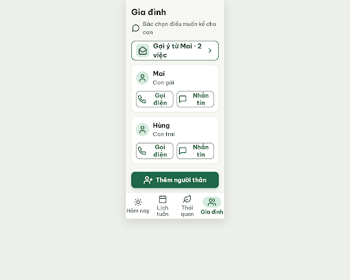

# S09 Gia đình – log vòng lặp Stitch

| Vòng | Điểm | Số error | Số warn | Đã sửa | Regression |
| --- | --- | --- | --- | --- | --- |
| v0 | 94 | 0 | 2 | – | – |

**Kết quả: PASS** (v0: 0 error, 94 ≥ 85; không cần vòng edit). Stitch screen id: `2bac776f261e4f8986ee3bc3d86053a2` (project 2013215887278758682).

Còn 2 warn chưa sửa (không chặn), nên xử lý khi dựng Figma / Flutter:
- R-STY-02: `.fixed-bottom-bar` (nút "Thêm người thân" + bottom nav) dùng `linear-gradient`; đổi sang nền phẳng #F6F7F2 + border-top 1px #DFE5DF.
- R-ICON-03: chevron của thẻ "Gợi ý từ Mai · 2 việc" chỉ 28px, cần 32px.
- Không trừ điểm: nhãn "Gọi điện", "Nhắn tin" (22px, nút ~138px) và 2 nhãn tab xuống 2 dòng; chữ không bị cắt.

## v0 – điểm 94

| Luật | Mức | Vị trí | Bằng chứng | Sửa |
| --- | --- | --- | --- | --- |
| R-STY-02 | warn | `.fixed-bottom-bar` | `linear-gradient(180deg, rgba(246,247,242,0) 0%, #F6F7F2 16%, #F6F7F2 100%)` | Nền phẳng #F6F7F2, border-top 1px #DFE5DF |
| R-ICON-03 | warn | Chevron thẻ "Gợi ý từ Mai · 2 việc" | `.chevron-icon` 28px < 32px | 32×32px |

Đã sửa: không (vòng đầu). Regression: không.
