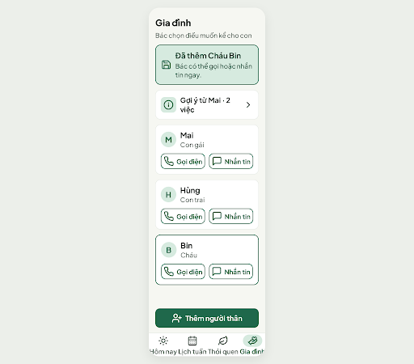
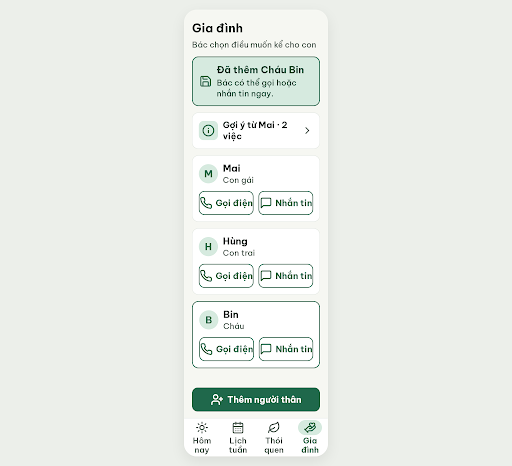

# S09b Gia đình · đã thêm người thân – log vòng lặp Stitch

| Vòng | Điểm | Số error | Số warn | Đã sửa | Regression |
| --- | --- | --- | --- | --- | --- |
| v0 | 84 | 1 | 2 | – | – |
| v1 | 100 | 0 | 0 | R-LAY-01, R-TXT-02, R-STY-02 | không |

**Màn chốt: v1 – điểm 100** (screen id `5811c9386ecd49359a0e14e2bce09031`)
**Kết quả: CONVERGED** (điểm 100, không thể tăng nữa)

Biến thể của S09 (screen id gốc `2bac776f261e4f8986ee3bc3d86053a2`). Dự án Stitch 2013215887278758682.

screen id: e36cfe774cae49359f4c3673883bc323 (v0, biến thể của S09; edit_screens trả thêm 2 màn trung gian e543dc91ebbc4d1cb37d4bf11be51c59 và ed18b14a04d64657af585c1d87068912, bỏ qua)

## v0 – điểm 84

| Luật | Mức | Vị trí | Bằng chứng | Sửa |
| --- | --- | --- | --- | --- |
| R-LAY-01 | error | Nhãn bottom nav | 20px nowrap trong cột 90px; "Thói quen", "Lịch tuần" ~95px, nhãn dính nhau | Nhãn xuống 2 dòng, nav cao 96px |
| R-TXT-02 | warn | Nút "Gọi điện"/"Nhắn tin"; tiêu đề | nút 20px, tiêu đề 28px | Nút 22px đậm cao 60px; tiêu đề 30px |
| R-STY-02 | warn | Toàn màn | font Plus Jakarta Sans | Be Vietnam Pro |

Đã sửa: không (vòng đầu). Regression: không.
best: v0 – điểm 84

v1 screen id: 5811c9386ecd49359a0e14e2bce09031 (sửa trên v0)

## Chạy tiếp từ v1 (luật mới)

Chấm lại v1 theo luật và Từ điển icon hiện tại (bản cũ giữ ở `v1-critique.old.json`): **100 điểm, 0 error, 0 warn**. Bộ đếm "không tăng" = 0 → dừng, CONVERGED.

## v1 – điểm 100

Không còn vi phạm. Đã sửa: R-LAY-01, R-TXT-02, R-STY-02. Regression: không.
best: v1 – điểm 100

Ghi chú cho Figma / Flutter (không trừ điểm):
- Nút "Gọi điện"/"Nhắn tin" ~134px, không padding trong; thêm padding 0 8px, gap 8px.
- Banner "Đã thêm Cháu Bin" dùng icon `save`; Từ điển icon chưa có nghĩa "đã thêm" (gợi ý `user-check`).
