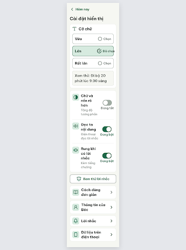
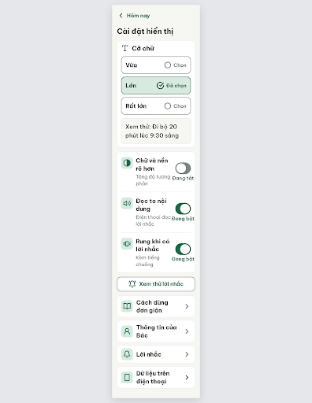

# S10 Cài đặt hiển thị – log vòng lặp Stitch

| Vòng | Điểm | Số error | Số warn | Đã sửa | Regression |
| --- | --- | --- | --- | --- | --- |
| v0 | 77 | 2 | 1 | – | – |
| v1 | 100 | 0 | 0 | R-LAY-01, R-TAP-01, R-CON-02 | không |

**Kết quả: PASS** (v1: 0 error, 100 ≥ 85). Stitch screen id cuối: `25627dadc6a642d6a3b6f03ccfdb1c66` (project 2013215887278758682).

Lưu ý:
- PRD 11.2 không có dòng riêng cho S10; nội dung lấy từ F12 và `flutter-handoff.md` (mục S10). Đổi tên cho hợp `vocabulary.md`: "Thông tin của Bác" (thay "Sửa hồ sơ"), "Lời nhắc" (thay "Nhắc việc"), "Rung khi có lời nhắc".
- Điểm nhỏ không vi phạm luật: chữ "Đang bật" / "Đang tắt" (89–93px) rộng hơn khung công tắc 64px, kết thúc cách viền thẻ ~2.3px. Khi dựng Figma / Flutter nên để khung công tắc rộng ≥ 96px hoặc đưa chữ trạng thái sang dòng phụ bên trái.
- Ảnh `v0.png`, `v1.png` chỉ ~390×512px; critic đo bằng cách render HTML ở 360px.

## v0 – điểm 77



| Luật | Mức | Vị trí | Bằng chứng | Sửa |
| --- | --- | --- | --- | --- |
| R-LAY-01 | error | Hàng "Lớn" đã chọn; cột chữ 3 hàng công tắc | Nhãn "Đã chọn" kết thúc x=330, viền phải hàng x=323 (tràn 7px); cột chữ công tắc ~121–125px nên "Rung khi có lời nhắc" gãy 3 dòng | `min-width:0` cho `.option-text-container`; cột chữ công tắc ≥ 160px, nhãn tối đa 2 dòng |
| R-TAP-01 | error | 3 công tắc | `.switch-track` 64×40px là phần tử duy nhất bấm được | Cả hàng bấm được; rãnh 64×48px |
| R-CON-02 | warn | Viền ô cỡ chữ chưa chọn, nền công tắc tắt | #A0ACA3 trên trắng = 2.35:1 | Đổi sang #7B887F (3.70:1) |

### Edit prompt (v0 → v1)

```
Keep the overall layout and everything not mentioned below unchanged.
1. In the "Cỡ chữ" option rows, set .option-text-container min-width to 0 so the "Đã chọn" / "Chọn" badge (icon + text) sits fully inside the row with at least 12px padding to the right border; nothing may extend past the row edge at 360px.
2. In the three switch rows, set .switch-control to min-width 64px and make the text column at least 160px wide; the 24px label may wrap to at most 2 lines (e.g. "Rung khi có lời nhắc" must not break into 3 lines). Move the state text "Đang bật" / "Đang tắt" to sit directly under the switch track (20px) if needed to free width.
3. Make each whole switch row (min height 72px, full card width) tappable to toggle the switch, and enlarge each switch track to 64x48px (thumb 40px, padding 4px) so every touch target is at least 48px high.
4. Change the border of the unselected font-size option rows ("Vừa", "Rất lớn") from #A0ACA3 to 2px #7B887F, and the background of switch tracks in the "Đang tắt" state from #A0ACA3 to #7B887F (contrast at least 3:1 against white).
```

## v1 – điểm 100



Không còn vi phạm. Đã sửa: R-LAY-01, R-TAP-01, R-CON-02. Regression: không.
