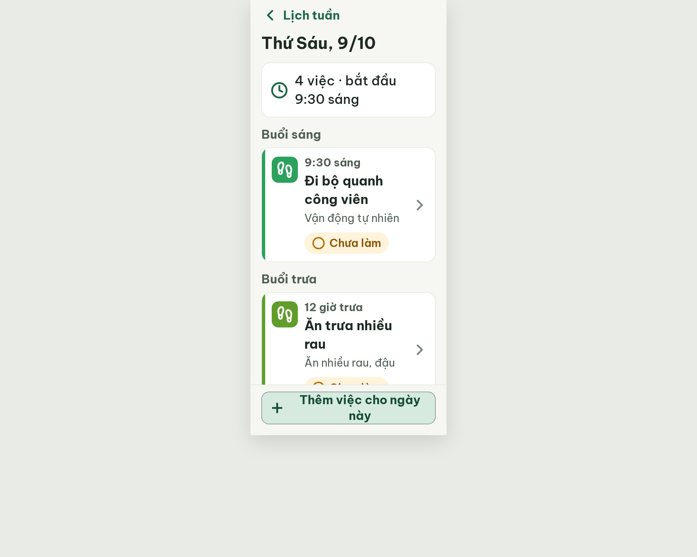
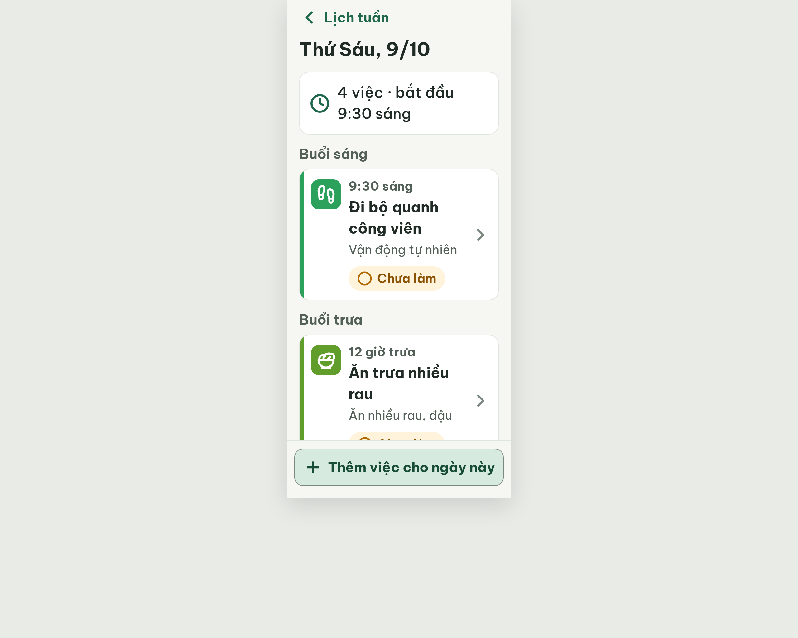

# S11 Chi tiết ngày – log vòng lặp Stitch

| Vòng | Điểm | Số error | Số warn | Đã sửa | Regression |
| --- | --- | --- | --- | --- | --- |
| v0 | 94 | 0 | 2 | – | – |
| v1 | 97 | 0 | 1 | R-STY-03 (khoảng cách 16px), footprints đúng path | không |
| v2 | 97 | 0 | 1 | R-ICON-03 (4 icon đúng Lucide) | R-STY-03 lặp lại (footer lề 12px) |
| v3 | 100 | 0 | 0 | R-STY-03 | không |

**Màn chốt: v3 – điểm 100** (Stitch screen id `f9de4a86bd8847d59ecb33eef043ccd2`, project 2013215887278758682)
**Kết quả: CONVERGED**

## v0 – điểm 94


| Luật | Mức | Vị trí | Bằng chứng | Sửa |
| --- | --- | --- | --- | --- |
| R-ICON-03 | warn | Ô icon "Vận động tự nhiên" | `footprints` bị vẽ lại, gót chân thành `v2`, ảnh là hai vòng hở | Dùng đúng 4 path Lucide gốc, 32px, nét 2.5 |
| R-STY-03 | warn | `.summary-card`, `.time-group` | margin-bottom 20px, chuẩn 16px | Đổi cả hai xuống 16px |

Ghi chú: R-NAV-01 chấm n/a (màn con có Back, không bottom nav). best: v0 – điểm 94.

### v0-edit-prompt
```
Keep the overall layout and everything not mentioned below unchanged.
1. Habit icon "Vận động tự nhiên": replace the current distorted drawing with the exact Lucide `footprints` icon (all 4 original paths, closed heel shapes), 32x32px, stroke 2.5, white #FFFFFF, inside the 48x48 #2BA15C tile.
2. Spacing: set the gap between the summary card and the first group, and between groups, to exactly 16px (replace margin-bottom 20px with 16px on the summary card and on each group).
3. Footer button "Thêm việc cho ngày này": reduce horizontal padding to 12px so the text keeps at least 12px clearance from the right border; keep height 60px and the plus icon 32px.
```

## v1 – điểm 97



| Luật | Mức | Vị trí | Bằng chứng | Sửa |
| --- | --- | --- | --- | --- |
| R-ICON-03 | warn | 4 ô icon thói quen | Cả 4 ô cùng vẽ SVG footprints (dòng 363, 395, 425, 455), một icon mang 4 nghĩa | Giữ footprints cho Đi bộ; salad / coffee / house cho 3 thẻ còn lại |

Đã sửa: R-STY-03 (khoảng cách 16px), footprints đã đúng path gốc. Regression: không.
Ghi chú (không trừ điểm): nhãn nút footer xuống 2 dòng do padding inline 12px. best: v1 – điểm 97.

### v1-edit-prompt
```
Keep the overall layout and everything not mentioned below unchanged.
1. Habit icon tiles: each task card currently draws the same footprints SVG. Keep `footprints` only on "Đi bộ quanh công viên" (#2BA15C tile). Replace the icon in the "Ăn trưa nhiều rau" tile (#609D2A) with the exact Lucide `salad` icon, in the "Uống trà với cô Tám" tile (#D0754E) with the exact Lucide `coffee` icon, and in the "Gọi điện cho Mai" tile (#D86E75) with the exact Lucide `house` icon. Every icon: 32x32px, stroke 2.5, white #FFFFFF, fill none, inside the 48x48 radius-12 tile.
2. Footer button "Thêm việc cho ngày này": the label must stay on ONE line (white-space: nowrap). Set horizontal padding to 8px, gap between plus icon and text 8px, text 22px bold; keep height 60px and plus icon 32px. Remove the inline padding 0 12px.
```

## v2 – điểm 97



| Luật | Mức | Vị trí | Bằng chứng | Sửa |
| --- | --- | --- | --- | --- |
| R-STY-03 | warn | Footer | v2.html dòng 478: `padding: 12px 12px 20px 12px`, nút lồi ra ngoài mép thẻ việc ~8px | Footer padding 12px 20px 20px 20px; rút nhãn thành "Thêm việc" |

Đã sửa: R-ICON-03 (4 icon đúng Lucide). Regression: không (R-STY-03 lặp lại từ khác nguyên nhân do edit v1 chạm footer).
Điểm bằng v1 (97, cùng 0 error): lấy v2 làm màn tốt nhất (vòng sau hơn), bộ đếm "không tăng" = 1. best: v2 – điểm 97.
Lưu ý: nhãn nút rút từ "Thêm việc cho ngày này" (handoff) xuống "Thêm việc" để vừa 1 dòng; tiêu đề màn đã ghi ngày.

### v2-edit-prompt
```
Keep the overall layout and everything not mentioned below unchanged.
1. Footer: remove the inline override so the footer padding is exactly 12px 20px 20px 20px; the tonal button is then 320px wide and aligned with the task cards (left and right edges at x=20 and x=340).
2. Footer button label: change "Thêm việc cho ngày này" to "Thêm việc" (22px bold, #174C37) with the Lucide `plus` icon 32px at its left; remove `white-space: nowrap` and `padding: 0 8px` from the button; keep height 60px, radius 14, background #D6EADF.
```

## v3 – điểm 100


Không còn vi phạm. Đã sửa R-STY-03 (footer padding 12px 20px 20px 20px, nút 320px). best: v3 – điểm 100.
Lệch so với handoff: nhãn nút footer là "Thêm việc" (handoff: "Thêm việc cho ngày này") để vừa 1 dòng; tiêu đề màn đã ghi ngày.
