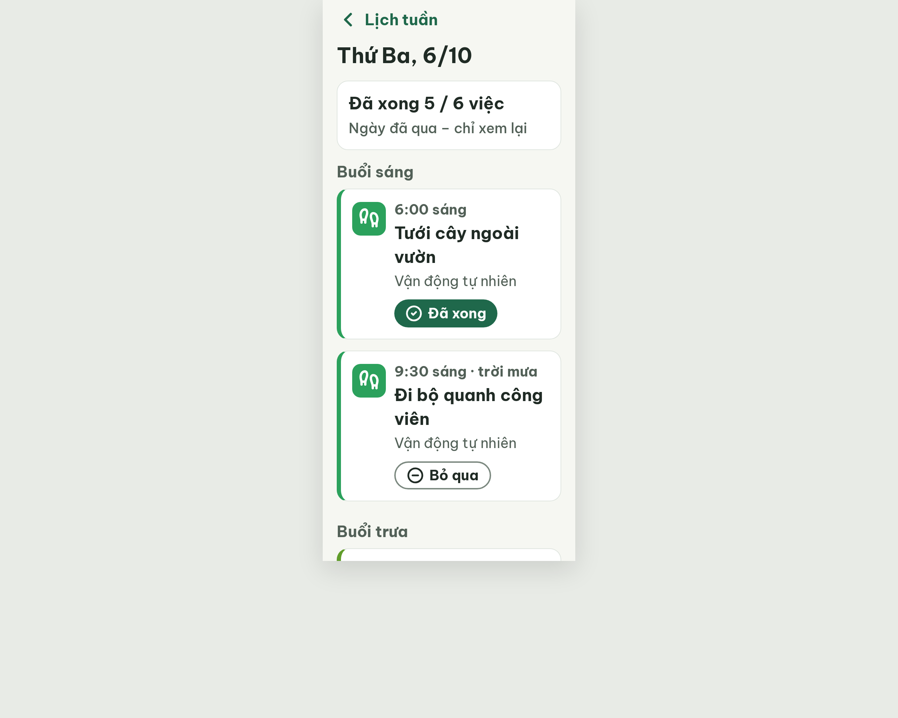
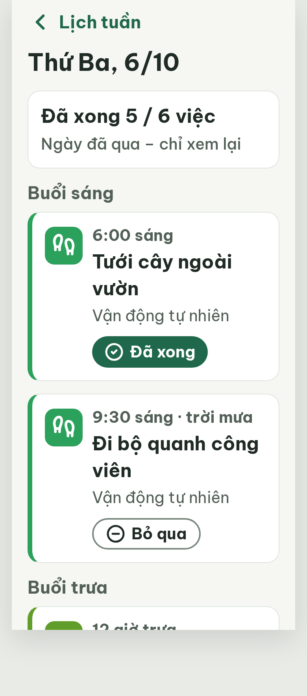

# S11b Chi tiết ngày · ngày khác – log vòng lặp Stitch

Biến thể của S11 (màn chốt `f9de4a86bd8847d59ecb33eef043ccd2`). Project 2013215887278758682.
v0 screen id: 8b3153c3c7594a34a4bd541120ff4ba0
v1 screen id: 9d00e0160fef4a67bee1b5052fc4a487

**Màn chốt: v1 – điểm 100** (screen id `9d00e0160fef4a67bee1b5052fc4a487`)
**Kết quả: CONVERGED**

| Vòng | Điểm | Số error | Số warn | Đã sửa | Regression |
| --- | --- | --- | --- | --- | --- |
| v0 | 97 | 0 | 1 | – | – |
| v1 | 100 | 0 | 0 | R-STY-03 (khoảng cách 16px) | không |

best: v1 – điểm 100

## Chạy tiếp từ v0 (luật mới)
Chấm lại v0 theo luật hiện tại: 97 (0 error, 1 warn R-STY-03), giống lần chấm trước. Bản cũ giữ ở `v0-critique.old.json`. Lần `edit_screens` trước không áp dụng được (HTML không đổi), nên gọi lại với deviceType MOBILE và nhận về screen mới.

## v0 – điểm 97



| Luật | Mức | Vị trí | Bằng chứng | Sửa |
| --- | --- | --- | --- | --- |
| R-STY-03 | warn | Khoảng cách giữa các nhóm buổi | task-card margin-bottom 8px + section margin-bottom 20px = 28px | Bỏ margin thẻ, gap 16px, section margin-bottom 16px |

## v1 – điểm 100



Không còn vi phạm. Đã sửa: R-STY-03. Regression: không. Ghi chú: footer cố định bị bỏ (màn chỉ xem lại, không cần nút chính).

### v1-edit-prompt
```
Keep the overall layout and everything not mentioned below unchanged. This is a MOBILE screen, 360px wide.
1. Spacing: remove margin-bottom 8px from every task card; set the gap between task cards inside a group to exactly 16px (flex gap on the task list).
2. Spacing: set the gap between the last card of a group and the next group label ("Buổi trưa", "Buổi chiều") to exactly 16px: section margin-bottom 16px (instead of 20px) and margin-top 0, so the margins never add up to more than 16px.
```
