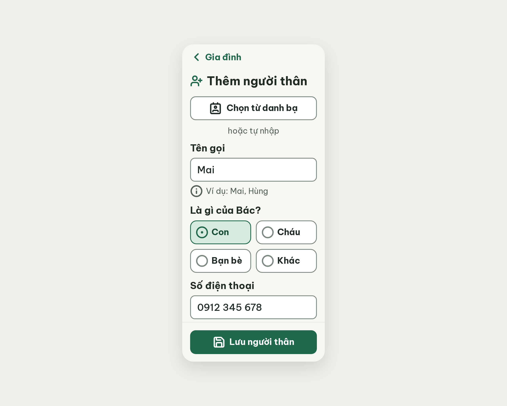
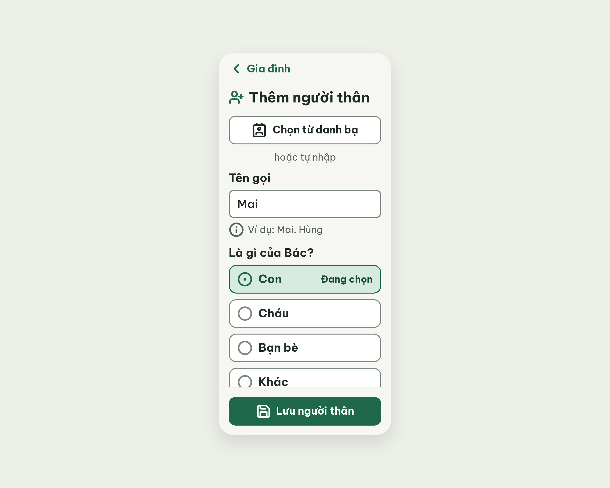

# S12 Thêm người thân – log vòng lặp Stitch

| Vòng | Điểm | Số error | Số warn | Đã sửa | Regression |
| --- | --- | --- | --- | --- | --- |
| v0 | 90 | 1 | 0 | – | – |
| v1 | 100 | 0 | 0 | R-COL-01 | không |

**Màn chốt: v1 – điểm 100** (Stitch screen id `4e54d2bf87a94c40a1c7a3e56e05aa3f`, project 2013215887278758682)
**Kết quả: CONVERGED**

## v0 – điểm 90



| Luật | Mức | Vị trí | Bằng chứng | Sửa |
| --- | --- | --- | --- | --- |
| R-COL-01 | error | Ô "Con" đang chọn | Chỉ khác nền #D6EADF, viền #1F684B và chấm nhỏ của circle-dot; không có chữ "Đang chọn" (DESIGN.md yêu cầu) | 4 hàng 1 cột cao 60px; thêm chữ "Đang chọn" 20px đậm bên phải hàng đã chọn |

Ghi chú: R-NAV-01 chấm n/a (màn form con). Ảnh chụp dừng ở ô Số điện thoại, critic xác nhận qua HTML vẫn cuộn tới hết. best: v0 – điểm 90.

### v0-edit-prompt
```
Keep the overall layout and everything not mentioned below unchanged.
1. Relation options "Con", "Cháu", "Bạn bè", "Khác": change the 2x2 grid into 4 full-width rows (one column), each row 60px high and 320px wide, 12px gap between rows, white, 2px #7B887F border, radius 16, with the icon (32px) on the left and the label (24px bold) next to it.
2. Selected row "Con": keep circle-dot icon 32px (stroke 2.5, #1F684B), 2px #1F684B border and #D6EADF background, and add the text "Đang chọn" (20px bold, #174C37) aligned to the right inside the row. Unselected rows keep the circle icon in #7B887F and show no extra text.
```

## v1 – điểm 100



Không còn vi phạm. Đã sửa R-COL-01 (4 hàng 1 cột, chữ "Đang chọn"). best: v1 – điểm 100.
Ghi chú: lần gọi `edit_screens` đầu của vòng này chỉ trả về sự kiện, không lưu màn mới (get_screen và list_screens không đổi); đã gọi lại 1 lần và nhận màn mới. Nút Back ghi "Gia đình" (tên màn trước, R-NAV-02 cho phép). Ảnh chụp bị thanh đáy che một phần hàng "Khác", phần này cuộn được.
Lệch handoff: bỏ hàng công tắc "Gọi nhanh", thay bằng dòng "Chỉ gửi tin khi Bác chọn gửi."; nhãn nút danh bạ "Chọn từ danh bạ"; thêm `contact` vào Từ điển icon.
