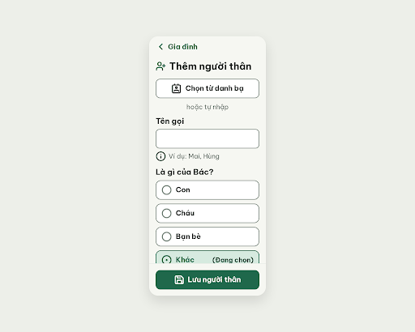

# S12a Thêm người thân · chưa có số – log vòng lặp Stitch

Biến thể của S12 (màn chốt `4e54d2bf87a94c40a1c7a3e56e05aa3f`). Project 2013215887278758682.
screen id: 88d69767e7b64a9f8eb05f59dde4ba4b

| Vòng | Điểm | Số error | Số warn | Đã sửa | Regression |
| --- | --- | --- | --- | --- | --- |
| v0 | 100 | 0 | 0 | – | – |

**Màn chốt: v0 – điểm 100** (Stitch screen id `88d69767e7b64a9f8eb05f59dde4ba4b`)
**Kết quả: CONVERGED**

## v0 – điểm 100

Không có vi phạm. best: v0 – điểm 100.

Ghi chú:
- Stitch tự thêm dấu ngoặc: nhãn là "(Đang chọn)" thay vì "Đang chọn" (không ảnh hưởng luật).
- Ảnh chụp bị footer che một phần hàng "Khác" và ô Số điện thoại; phần này cuộn dọc được trong HTML, không phải tràn ngang.
- Quan hệ mặc định "Khác" theo `flutter-handoff.md` S12 (không bắt chọn).
- Critic không ghi được `v0-critique.json` (bị từ chối quyền Bash); orchestrator chép kết quả critic trả về vào file.
- Stitch tạo màn có deviceType DESKTOP trong metadata (width 2560) dù đã yêu cầu MOBILE; ảnh hiển thị khung điện thoại.
