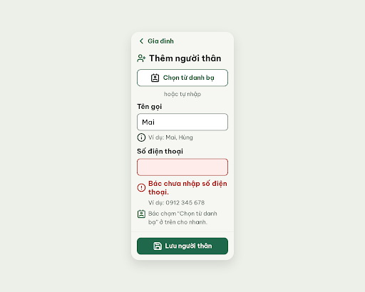
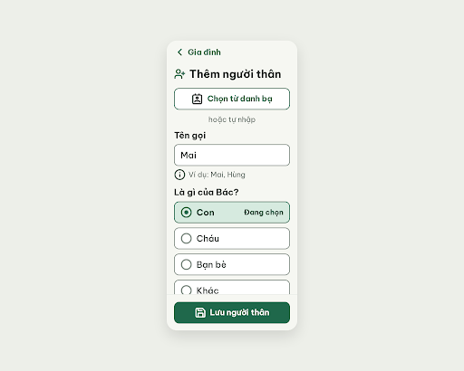

# S12e Thêm người thân · số sai – log vòng lặp Stitch

Biến thể của S12 (màn chốt `4e54d2bf87a94c40a1c7a3e56e05aa3f`). Project 2013215887278758682.
screen id v0: 082e2d7ec436489b9ab2a5ea3a1dedb3
screen id v1: 596693a46d1048499f7c8e51ed025995

| Vòng | Điểm | Số error | Số warn | Đã sửa | Regression |
| --- | --- | --- | --- | --- | --- |
| v0 | 100 | 0 | 0 | – | – |
| v1 | 100 | 0 | 0 | 3 lỗi ngoài luật của v0 | không |

**Màn chốt: v1 – điểm 100** (Stitch screen id `596693a46d1048499f7c8e51ed025995`)
**Kết quả: CONVERGED**

## v0 – điểm 100

Không vi phạm rule.md. Nhưng orchestrator xác nhận bằng ảnh + HTML thấy 3 lỗi ngoài luật nên chạy thêm 1 vòng sửa (bằng điểm, chọn vòng sau theo quy tắc hòa):
- Mất khối 4 hàng quan hệ (Con/Cháu/Bạn bè/Khác) so với S12.
- HTML lặp trường "Số điện thoại" (cùng id `contact-phone`, bản sau có value "0912 345 678").
- Dòng "Chỉ gửi tin khi Bác chọn gửi." bị footer che.

best: v0 – điểm 100

## v1 – điểm 100

Edit prompt: xem `v1-edit-prompt.txt` (khôi phục 4 hàng quan hệ với "Đang chọn" ở hàng Con; xóa trường điện thoại thứ hai; đưa dòng "Chỉ gửi tin…" vào vùng cuộn; padding-bottom 120px).

Không còn vi phạm. Đã sửa cả 3 lỗi ngoài luật, không regression. best: v1 – điểm 100.

Ghi chú:
- Tên màn ghi "số sai" nhưng `flutter-handoff.md` và `user-flow.md` (Flow 5) mô tả lỗi là **chưa nhập số**; bản này làm trường hợp trống. Lỗi "nhập thiếu chữ số" chưa làm.
- Câu lỗi dùng "Bác" thay "Bà" của handoff, cho khớp xưng hô cả màn.
- Khi mới mở, trường Số điện thoại và câu lỗi nằm dưới mép màn (do 4 hàng quan hệ 1 cột). Khi code Flutter cần tự cuộn tới trường lỗi (`Scrollable.ensureVisible`).
- Stitch trả metadata deviceType DESKTOP 2560×2048 dù yêu cầu MOBILE; ảnh/HTML vẫn là khung điện thoại, giống các màn trước.
- critic không có quyền ghi file nên orchestrator chép `v0-critique.json`, `v1-critique.json` từ kết quả critic.
