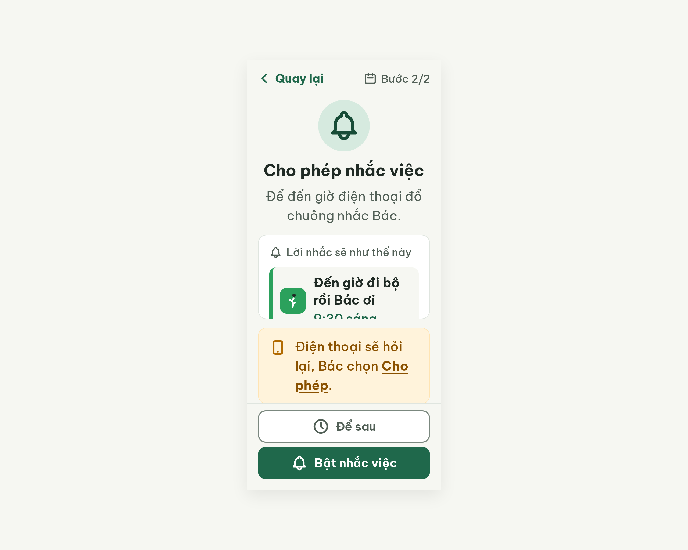
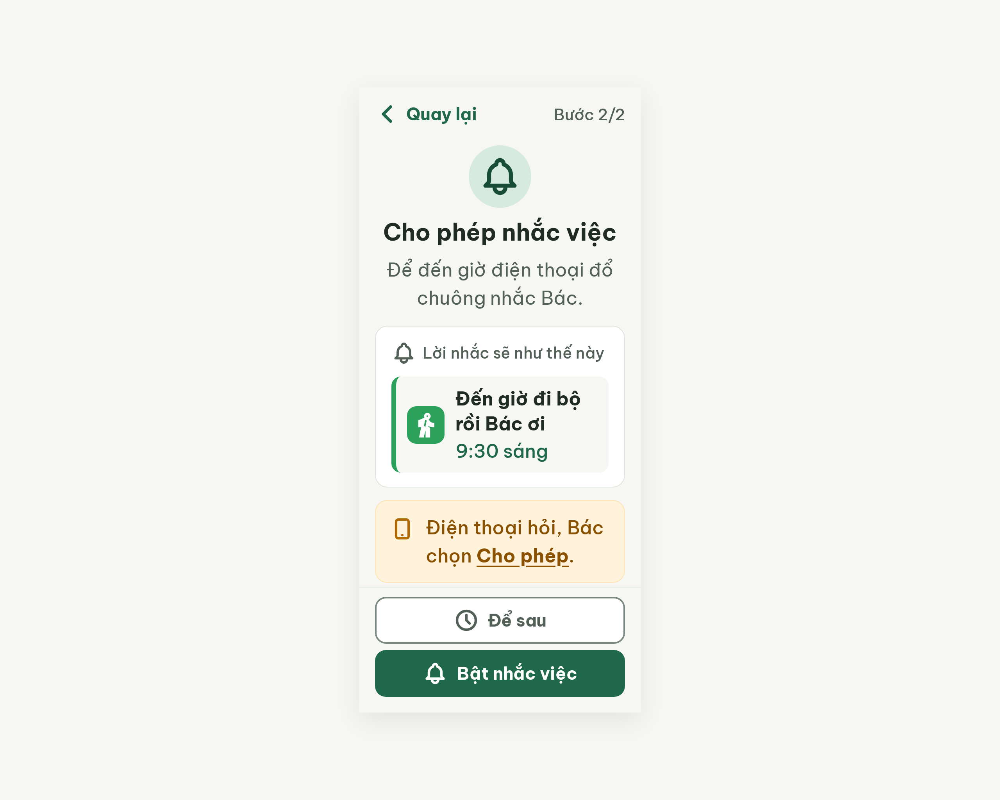

# S13 Cho phép nhắc việc – log vòng lặp Stitch

| Vòng | Điểm | Số error | Số warn | Đã sửa | Regression |
| --- | --- | --- | --- | --- | --- |
| v0 | 74 | 2 | 2 | – | – |
| v1 | 100 | 0 | 0 | R-LAY-01, R-TXT-03, R-ICON-03, R-STY-02 | không |

**Kết quả: PASS** (v1: 0 error, 100 ≥ 85). Stitch screen id cuối: `5da170d355454407948bdd5d113fd558` (project 2013215887278758682).

## v0 – điểm 74



| Luật | Mức | Vị trí | Bằng chứng | Sửa |
| --- | --- | --- | --- | --- |
| R-LAY-01 | error | Thẻ "Lời nhắc sẽ như thế này", dòng "9:30 sáng" | `.content` flex cột cao cố định làm các khối co lại; `.preview-card` có overflow:hidden nên chữ bị cắt nửa dưới | flex-shrink:0 cho 3 khối, bỏ overflow:hidden, ô chuông 80px (icon 56) |
| R-TXT-03 | error | Thẻ vàng "Điện thoại sẽ hỏi lại, Bác chọn Cho phép." | 24px, rộng chữ ~234px nên xuống 3 dòng | Rút câu, padding 16, gap 12 |
| R-ICON-03 | warn | Mũi tên Quay lại, icon lịch "Bước 2/2", icon chuông thẻ, icon đi bộ | Ba icon 24px; icon lịch trùng nghĩa tab Lịch tuần; icon đi bộ không nhận ra | Icon 32px, bỏ icon lịch, icon directions_walk đặc |
| R-STY-02 | warn | Nền vùng nút đáy | linear-gradient | Nền phẳng #F6F7F2 |

Đã sửa / regression: không có (vòng đầu).

### Edit prompt gửi sau v0 (v0-edit-prompt.txt)

```
Keep the overall layout and everything not mentioned below unchanged.
1. Fix clipped text: the "Lời nhắc sẽ như thế này" preview card must show the full line "9:30 sáng". Set flex-shrink:0 on the hero block, the preview card and the hint card, and remove overflow:hidden from the preview card.
2. To fit 800px height: shrink the bell circle to 80x80px (#D6EADF) with a 56px bell icon, and set its bottom margin to 12px.
3. Hint card: change the text to "Điện thoại hỏi, Bác chọn Cho phép." (24px, "Cho phép" bold) so it fits in at most 2 lines; set card padding 16px and the gap between the phone icon and the text 12px.
4. Increase these icons to 32x32px: the chevron of "Quay lại", and the bell icon next to "Lời nhắc sẽ như thế này".
5. Remove the calendar icon next to "Bước 2/2"; keep only the text "Bước 2/2" (20px, #526057).
6. Replace the walking icon inside the 48x48 #2BA15C tile with a solid walking-person icon (Material "directions_walk" style), 32px, white.
7. Change the bottom button area background from the gradient to a flat #F6F7F2 color, keep a 1px #DFE5DF top border.
```

## v1 – điểm 100



Không còn vi phạm. Đã sửa cả 4 lỗi của v0 (dòng "9:30 sáng" không còn bị cắt; câu thẻ vàng "Điện thoại hỏi, Bác chọn Cho phép." còn 2 dòng; icon 32px, bỏ icon lịch, icon đi bộ đặc; footer nền phẳng). Regression: không.
Ghi chú critic: ô icon #2BA15C trên nền app đo ~3,07:1, sát ngưỡng 3:1.
