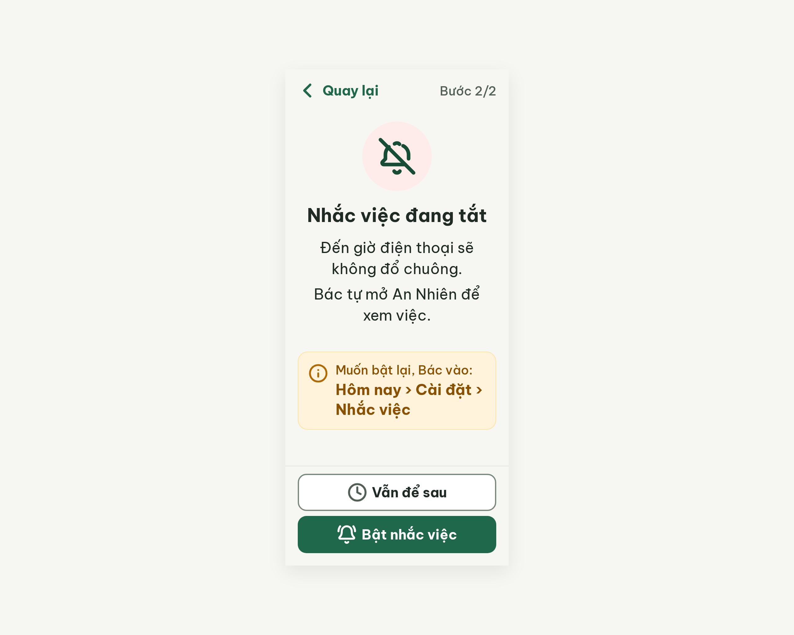
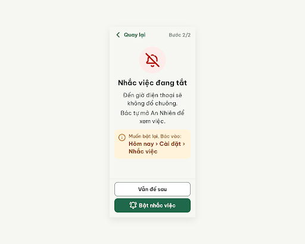

# S13d Nhắc việc đang tắt (biến thể của S13)

**Trạng thái: DỪNG GIỮA CHỪNG** (xem "Vòng 1" cuối file)

screen id: v0 `131d9adf7e1d4cf69ef181699df68807` (project 2013215887278758682; gốc S13 `5da170d355454407948bdd5d113fd558`)

## v0 – điểm 91


best: v0 – điểm 91 (0 error, 3 warn)

| Luật | Mức | Vị trí | Bằng chứng | Sửa |
|---|---|---|---|---|
| R-ICON-03 | warn | Nút "Vẫn để sau" | `clock` chỉ mang nghĩa "Giờ của việc" | bỏ icon (critic đề nghị `bell-off`, không nhận vì `bell-off` đã là icon tiêu đề, sẽ thành 2 nghĩa) |
| R-STY-01 | warn | Vòng tròn chuông; viền hộp gợi ý | CSS `.bell-circle svg` đè stroke xanh #174C37; viền #FFE4A0 ngoài token | giữ nền `error-container` #FDECE9 theo handoff, ép icon #B42318; bỏ viền |
| R-STY-03 | warn | Hộp gợi ý | margin-top 24px + gap 16px = 40px | bỏ margin-top |

### Edit prompt vòng 1
```
Keep the overall layout and everything not mentioned below unchanged.
1. In the 112px circle (background #FDECE9) the `bell-off` icon must be drawn in #B42318 (stroke 2.2, 64px). Remove the CSS rule `.bell-circle svg` that overrides the stroke with green #174C37; set the stroke to #B42318 on the svg itself.
2. Remove the 1px border #FFE4A0 from the guide card (background #FFF3DB, no border).
3. Remove `margin-top: 24px` from the guide card so the gap between the sentences block and the guide card is exactly 16px.
4. In the outlined button "Vẫn để sau" remove the `clock` icon, so the button shows only the label "Vẫn để sau" (22px bold #202B25, centered), still 60px high, full width minus 20px margins, 2px border #7B887F, radius 14px. Keep the filled button "Bật nhắc việc" with its `bell-ring` icon 32px white.
```

## Vòng 1 – chưa lấy được kết quả
Đã gửi `v0-edit-prompt.txt` lên screen `131d9adf7e1d4cf69ef181699df68807`. Stitch trả về 3 thao tác DOM (ép stroke #B42318, bỏ viền và margin-top hộp gợi ý, xóa icon `clock`) và sửa **tại chỗ**, không tạo screen mới. `get_screen` vẫn trả đúng link HTML/ảnh của v0 (cùng file id), nên không có `v1.*` để chấm. Chưa xác nhận được sửa đổi đã lưu.

best hiện tại: v0 – điểm 91 (0 error, 3 warn). Cần mở Stitch kiểm tra screen, hoặc chạy lại `/stitch-loop S13d … --resume`.

## Chạy tiếp từ v0 (luật mới)
Chấm lại v0 theo luật hiện tại: điểm 91 (0 error, 3 warn), trùng bản cũ (`v0-critique.old.json`). Cùng 3 warn: R-ICON-03 (`clock` ở "Vẫn để sau"), R-STY-01 (icon chuông ép xanh, viền hộp gợi ý ngoài token), R-STY-03 (khoảng cách 40px).
Critic đề nghị đổi nền vòng tròn sang #D6EADF và dùng `bell-off` cho nút; không nhận (giữ quyết định handoff `error-container` #FDECE9, và tránh 1 icon 2 nghĩa).

## Vòng 1 (chạy tiếp) – edit không lưu
Gửi lại `v0-edit-prompt.txt` lên screen `131d9adf7e1d4cf69ef181699df68807`. Stitch trả 3 DOM operation nhưng `get_screen` sau đó vẫn trả đúng file HTML cũ (md5 trùng v0.html; ảnh vẫn icon xanh, còn `clock`). Lần 2 liên tiếp edit không được lưu, nên dừng, không gọi thêm để khỏi tốn quota.

**Màn chốt: v0 – điểm 91**
**Kết quả: NEEDS_HUMAN** – Stitch không lưu edit tại chỗ trên màn biến thể này (0 error, 3 warn). Mở Stitch sửa tay 4 điểm trong `v0-edit-prompt.txt`, hoặc chấp nhận 91 và export v0 sang Figma.

## v1 – điểm 94 (chạy tiếp lần 2)


Lần chạy tiếp này gọi `edit_screens` với `deviceType: MOBILE` thì Stitch tạo **screen mới** `8dc0458f6e5c48529a44f627783d677f` (v1). Critic chấm: **94** (0 error, 2 warn), tăng 3 so với v0 (91). Bộ đếm "không tăng" = 0.

best: v1 – điểm 94 (0 error, 2 warn)

| Luật | Mức | Vị trí | Bằng chứng | Sửa |
|---|---|---|---|---|
| R-STY-01 | warn | Vòng tròn `bell-off` 112px | nền #FDECE9 và nét #B42318 !important; Từ điển icon ghi `bell-off` dùng `warning-strong`, không dùng màu error | nền #FFF3DB, icon nét #B26A00, bỏ inline đỏ |
| R-ICON-03 | warn | Mũi tên "Quay lại" | path `M15 19l-7-7 7-7` là chevron Heroicons, không phải Lucide | Lucide `chevron-left` 32px, path `m15 18-6-6 6-6`, nét #1F684B |

Đã sửa: R-STY-03 (khoảng cách 16px). Regression: không có. Quyết định cũ "giữ nền error-container theo handoff" bị bỏ vì `DESIGN.md` dòng 548 ghi rõ không dùng màu error cho `bell-off`.

### Edit prompt vòng 2
Xem `v1-edit-prompt.txt` (2 sửa đổi: vòng tròn `bell-off` sang #FFF3DB / #B26A00; mũi tên "Quay lại" sang Lucide `chevron-left`).

## v2 – edit không lưu
Gửi `v1-edit-prompt.txt` lên screen `8dc0458f6e5c48529a44f627783d677f` (deviceType MOBILE). Stitch trả 3 DOM operation nhưng `get_screen` vẫn trả file HTML cũ (md5 trùng `v1.html`), nên không có `v2.*` để chấm. Dừng, không gọi thêm để khỏi tốn quota.

**Màn chốt: v1 – điểm 94** (screen id `8dc0458f6e5c48529a44f627783d677f`)
**Kết quả: NEEDS_HUMAN** – màn chốt không còn error, còn 2 warn (R-STY-01, R-ICON-03). Stitch không lưu edit tại chỗ lần 2. Mở Stitch sửa tay 2 điểm trong `v1-edit-prompt.txt`, hoặc chấp nhận 94 và export v1 sang Figma.

## Chạy tiếp từ v1 (lần 3)
Gửi lại `v1-edit-prompt.txt` lên screen `8dc0458f6e5c48529a44f627783d677f` (deviceType MOBILE). Stitch trả 2 DOM operation (nền #FFF3DB + `bell-off` #B26A00; `chevron-left` Lucide) và báo đã sửa tại chỗ, nhưng `get_screen` vẫn trả HTML cũ (md5 trùng `v1.html`, không có path `m15 18-6-6 6-6`). Không có screen mới. Lần thứ 3 edit không được lưu, nên dừng, không gọi thêm.

**Màn chốt: v1 – điểm 94** (screen id `8dc0458f6e5c48529a44f627783d677f`)
**Kết quả: NEEDS_HUMAN** – 0 error, 2 warn (R-STY-01, R-ICON-03). Stitch không lưu edit tại chỗ trên màn này.

## Sửa cục bộ (không qua Stitch)
Stitch không lưu edit_screens (3 lần). Đã sửa trực tiếp `v1.html`: nền chuông #FFF3DB, nét #B26A00, mũi tên Lucide chevron-left. Dùng file này để đưa vào Figma. Chưa chấm lại, `v1.png` là ảnh cũ.

## Chạy tiếp từ v1 (lần 4, luật mới)
Chấm lại `v1.html` (đã vá cục bộ) + `v1.png` (cũ): **97** (0 error, 1 warn), tăng từ 94. Đã sửa R-ICON-03. Còn R-STY-01: CSS `.bell-circle svg` đặt stroke #174C37 đè nét #B26A00 của `bell-off`. Critic không ghi được file nên orchestrator ghi `v1-critique.json` (bản cũ ở `v1-critique.old.json`).
Stitch `edit_screens` không lưu 3 lần liên tiếp nên không gọi lần 4. Đã sửa cục bộ `v1.html`: đổi luật CSS đó thành `stroke: #B26A00`. `v1.png` vẫn là ảnh cũ (icon đỏ/hồng), chưa chụp lại được.

best: v1 – điểm 97 (chấm theo HTML)
**Màn chốt: v1 – điểm 97** (screen id `8dc0458f6e5c48529a44f627783d677f`, dùng `v1.html` đã vá cục bộ)
**Kết quả: NEEDS_HUMAN** – 0 error, warn cuối đã vá cục bộ nhưng chưa chấm lại; Stitch không lưu edit; ảnh png cũ.
