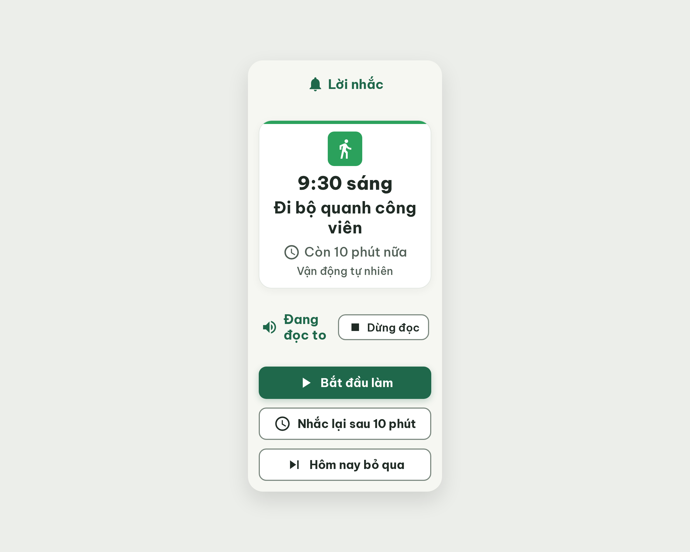
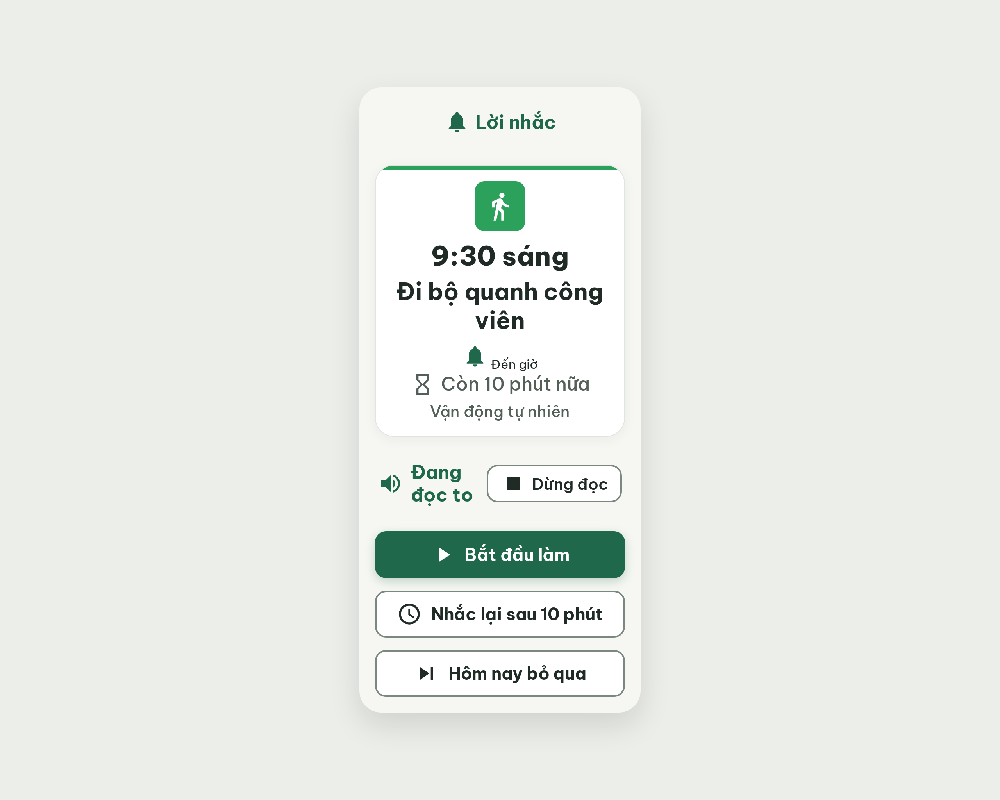
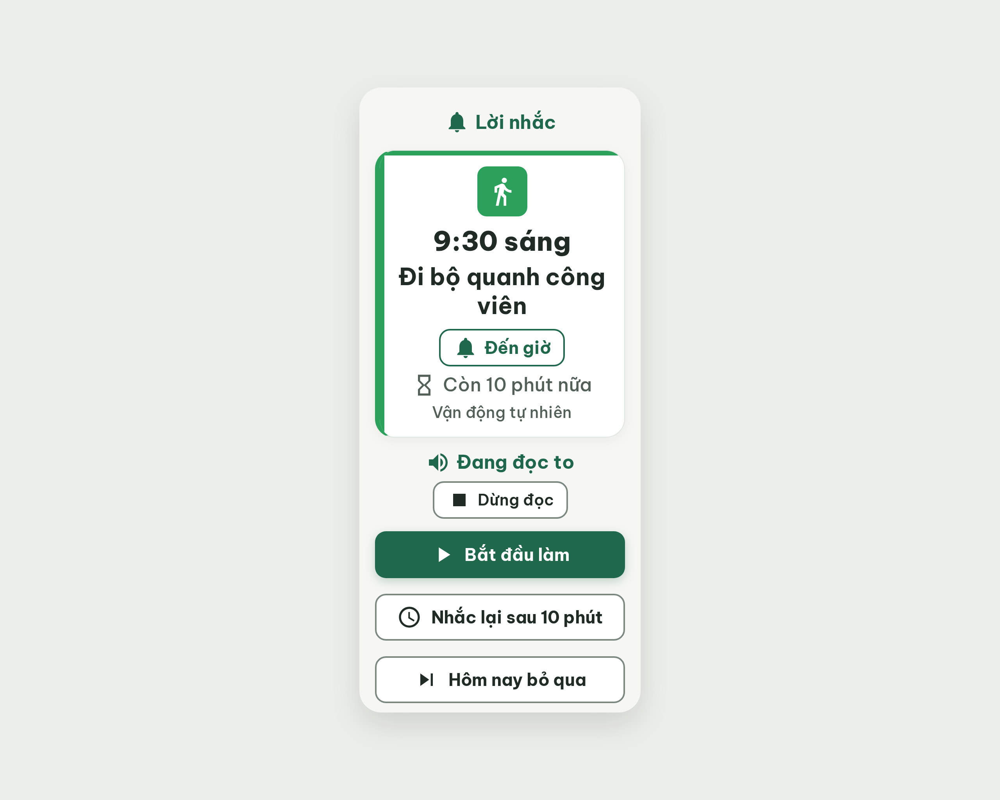

# S14 Lời nhắc đến giờ – log vòng lặp Stitch

| Vòng | Điểm | Số error | Số warn | Đã sửa | Regression |
| --- | --- | --- | --- | --- | --- |
| v0 | 71 | 2 | 3 | – | – |
| v1 | 71 | 2 | 3 | R-ICON-03, R-STA-01 | R-TXT-01 |
| v2 | 94 | 0 | 2 | R-TXT-01, R-COL-02, R-TAP-03 | không |

**Kết quả: PASS** (v2: 0 error, 94 ≥ 85). Stitch screen id cuối: `a0e49cb7a79e4b899d85db098781a1b7` (project 2013215887278758682).

## v0 – điểm 71



| Luật | Mức | Vị trí | Bằng chứng | Sửa |
| --- | --- | --- | --- | --- |
| R-STA-01 | error | Cạnh tên việc | Không có nhãn trạng thái; "🔔 Lời nhắc" chỉ là tên màn | Thêm chip "🔔 Đến giờ" dưới tên việc, cao 48 |
| R-COL-02 | error | Thẻ lời nhắc | Vạch màu 6px nằm ở cạnh trên, không phải bên trái | Vạch dọc trái 6px #2BA15C |
| R-STY-03 | warn | Khoảng cách các khối | space-between làm khoảng ~47px; hàng "Đang đọc to" gãy 2 dòng | Gap 16, margin-top:auto cho nhóm nút, xếp dọc hàng đọc to |
| R-TAP-03 | warn | 3 nút lời nhắc | gap 16px, cần ≥ 20 | gap 20 |
| R-ICON-03 | warn | Nút "Dừng đọc", icon đồng hồ | Icon 28px; đồng hồ dùng hai nghĩa | Icon 32; ống cát cho "Còn 10 phút nữa", đồng hồ chỉ cho "Nhắc lại" |

Ghi chú critic: hai lỗi error đến từ việc áp luật thẻ việc lên thẻ lời nhắc (PRD S14 không ghi chip trạng thái, token `card-reminder` không ghi vạch màu). Nếu nhóm coi thẻ lời nhắc khác thẻ việc thì cần sửa rule.md. R-STY-02 chấm pass với bo 24 theo token `card-reminder`.

### Edit prompt gửi sau v0 (v0-edit-prompt.txt)

```
Keep the overall layout and everything not mentioned below unchanged.
1. Add a status chip right under the task name "Đi bộ quanh công viên": bell icon 32px + text "Đến giờ" (22px bold, #1F684B), white background, 2px #1F684B border, height 48px, radius 14, centered.
2. Remove the 6px horizontal accent bar on the top edge of the reminder card. Replace it with a 6px wide vertical accent bar on the left edge of the card, full card height, color #2BA15C, fully rounded. Keep the 64x64 #2BA15C icon tile with the white icon.
3. Stop using space-between for the screen. Use a 16px gap between the "Lời nhắc" row, the reminder card and the voice row. Push the group of three buttons to the bottom with margin-top:auto and 20px bottom padding.
4. Set the gap between the three buttons ("Bắt đầu làm", "Nhắc lại sau 10 phút", "Hôm nay bỏ qua") to 20px.
5. Voice row: use min-height:52px instead of a fixed height. Stack "Đang đọc to" (speaker icon 32px + text, one line) and the outlined button "Dừng đọc" vertically, centered, 8px apart. The "Dừng đọc" button stays 48px high.
6. Make the stop icon inside "Dừng đọc" 32px.
7. Change the icon on the line "Còn 10 phút nữa" to an hourglass icon, 32px, so the clock icon is used only for the button "Nhắc lại sau 10 phút" (32px).
```

## v1 – điểm 71



Điểm không tăng so với v0 (71 → 71, lần không tăng đầu tiên).

| Luật | Mức | Vị trí | Bằng chứng | Sửa |
| --- | --- | --- | --- | --- |
| R-TXT-01 | error | Chip "Đến giờ" | **Regression:** chip mới không có CSS, chữ ~16px, đậm 400 | Viết lại CSS chip: 22px, 700, cao 48, viền 2px #1F684B |
| R-COL-02 | error | Thẻ lời nhắc | Chưa sửa: vạch màu vẫn ở cạnh trên | Xóa ::before ngang, thêm vạch dọc trái 6px |
| R-STY-03 | warn | Khoảng cách các khối | Chưa sửa: space-between; "Đang đọc to" gãy 2 dòng | gap 16, margin-top:auto, hàng đọc to xếp dọc, nowrap |
| R-TAP-03 | warn | 3 nút | Chưa sửa: gap 16 | gap 20 |
| R-STY-02 | warn | Thẻ lời nhắc | Bo 24 so với token card 16 | **Không sửa:** token `card-reminder` trong DESIGN.md quy định bo 24 (đã chấm pass ở v0) |

Đã sửa so với v0: R-ICON-03, R-STA-01 (chip "Đến giờ" đã có, icon 32px, ống cát cho "Còn 10 phút nữa").
Ghi chú: Stitch áp edit bằng thao tác DOM nên một số sửa đổi (CSS vạch trái, gap, hàng đọc to) không có hiệu lực; v2 mô tả lại bằng CSS cụ thể.

### Edit prompt gửi sau v1 (v1-edit-prompt.txt)

```
Keep the overall layout and everything not mentioned below unchanged.
1. The "Đến giờ" chip under the task name is unstyled (text looks 16px, regular weight, misaligned with the bell icon). Rewrite its CSS fully: display inline-flex, align-items center, gap 8px, height 48px, padding 0 16px, 2px solid #1F684B border, radius 14px, white background; bell icon 32px; text "Đến giờ" font-size 22px, font-weight 700, color #1F684B, line-height 1.2, same baseline as the icon.
2. The 6px colored accent bar is still a horizontal stripe along the TOP edge of the reminder card. Delete that top stripe completely (the ::before rule with right:0 and height:6px). Replace it with a vertical bar on the LEFT edge: position absolute, left 0, top 0, bottom 0, width 6px, height auto, background #2BA15C, border-radius 999px.
3. Remove justify-content: space-between from the screen container. Use flex column with gap 16px between "Lời nhắc", the reminder card and the voice block. Give the group of three buttons margin-top:auto so it sits at the bottom with 20px bottom padding.
4. Set the gap between the three buttons to exactly 20px (currently 16px).
5. Voice block: replace the fixed height 52px with min-height 52px and flex-direction column, align-items center, gap 8px: the line "Đang đọc to" (speaker icon 32px + text 24px) on ONE line with white-space nowrap, and the outlined button "Dừng đọc" (48px high) below it.
```


## v2 – điểm 94



| Luật | Mức | Vị trí | Bằng chứng | Sửa |
| --- | --- | --- | --- | --- |
| R-STY-02 | warn | Thẻ lời nhắc | Bo 24px, token card 16 (nhưng token `card-reminder` ghi 24; critic chấm theo rule.md) | Đổi về 16 nếu nhóm muốn theo rule.md |
| R-STY-03 | warn | Lề đáy | Nội dung ~825px trong khung 800; dưới nút cuối còn ~15px thay vì 20 | Bỏ padding-bottom của nhóm nút, padding-top khung 24→16, margin-bottom thẻ thói quen 12→8 |

Đã sửa so với v1: R-TXT-01 (chip 22px), R-COL-02 (vạch trái), R-TAP-03 (gap 20). Regression: không.
Ghi chú critic (không trừ điểm): `::before` vẫn vẽ vạch ngang trên thẻ; vạch trái bị vẽ hai lần (border-left + div) nên dày ~12px. Nên dọn khi export sang Figma.
Hai warn còn lại không chặn; dừng ở v2 theo điều kiện PASS.
