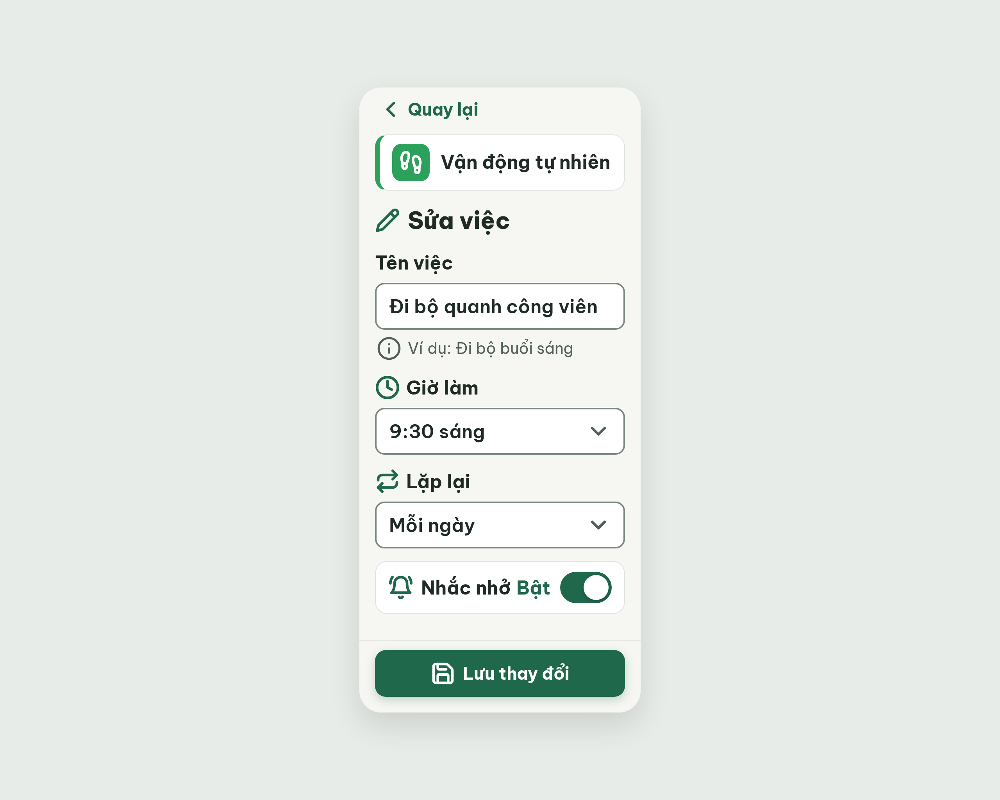

# S15 Sửa việc – log vòng lặp Stitch

| Vòng | Điểm | Số error | Số warn | Đã sửa | Regression |
| --- | --- | --- | --- | --- | --- |
| v0 | 97 | 0 | 1 | – | – |
| v1 | 100 | 0 | 0 | R-STY-03 | không |

**Màn chốt: v1 – điểm 100** (Stitch screen id `8f554e1c2eec4261b3bcd1c607686ec2`, project 2013215887278758682)
**Kết quả: CONVERGED**

## v0 – điểm 97



| Luật | Mức | Vị trí | Bằng chứng | Sửa |
| --- | --- | --- | --- | --- |
| R-STY-03 | warn | App bar | `.app-bar` padding 16 → nút "Quay lại" bắt đầu x=16, các khối khác x=20 | `.app-bar` padding 8px 20px, `.btn-back` padding 0, cao 48 |

Ghi chú: nút "Xóa việc này" nằm dưới nếp gấp, ảnh v0.png không chụp tới; critic chấm qua HTML. best: v0 – điểm 97.

### v0-edit-prompt
```
Keep the overall layout and everything not mentioned below unchanged.
1. App bar: change padding to 8px 20px so the "Quay lại" button and its chevron-left icon start exactly at x=20, aligned with the habit card and the fields; keep the button height 48px, remove any extra 16px inner padding on the back button.
```


## v1 – điểm 100


Không còn vi phạm. Đã sửa R-STY-03 (app bar padding 8px 20px). best: v1 – điểm 100.
Ghi chú (không trừ điểm): nút "Xóa việc này" nằm dưới nếp gấp; nhãn "Tên việc" chưa có icon (pencil đã dùng cho "Sửa việc").
