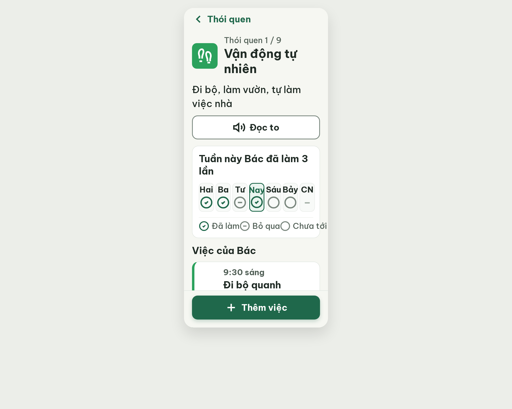
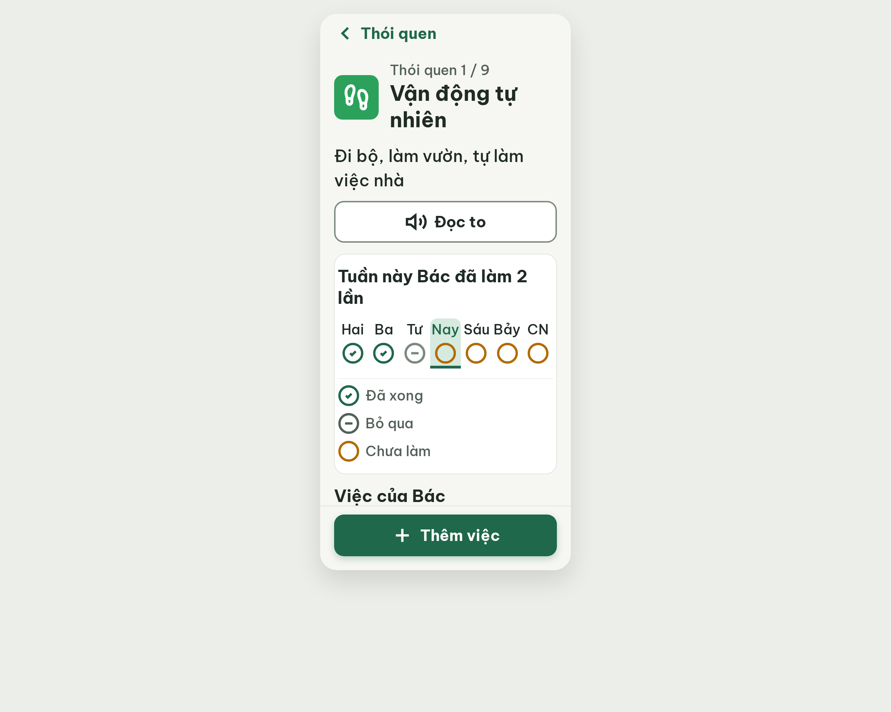
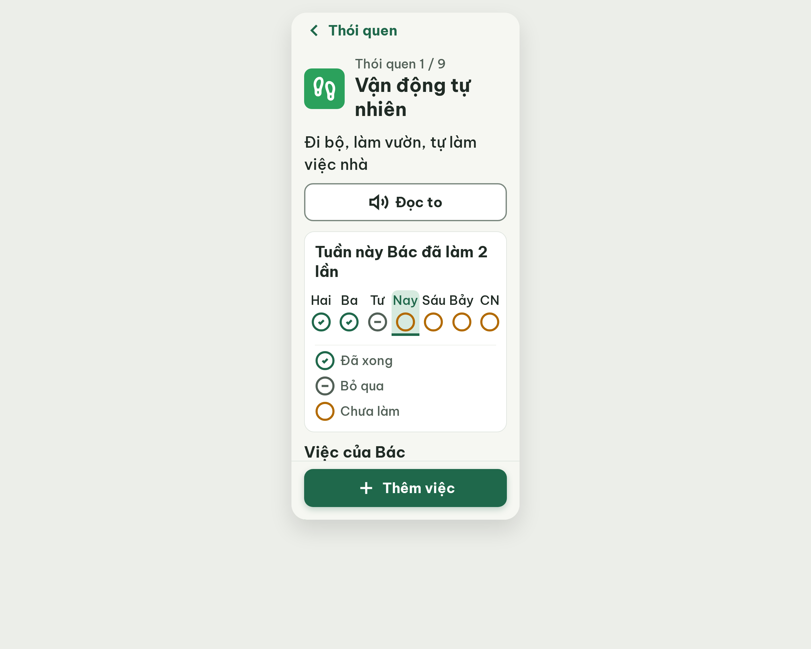

# S16 Chi tiết thói quen – log vòng lặp Stitch

| Vòng | Điểm | Số error | Số warn | Đã sửa | Regression |
| --- | --- | --- | --- | --- | --- |
| v0 | 64 | 3 | 2 | – | – |
| v1 | 80 | 2 | 0 | R-CON-01, R-ICON-03, R-STY-01 | không |
| v2 | 80 | 2 | 0 | R-STA-01 (một phần) | không |
| v3 | 97 | 0 | 1 | R-LAY-01, R-STA-01 | R-STY-03 |
| v4 | 100 | 0 | 0 | R-STY-03 | không |

**Màn chốt: v4 – điểm 100** (Stitch screen id `5f33a88d994f480f9f167043d6aca9f6`, project 2013215887278758682)
**Kết quả: CONVERGED**

## v0 – điểm 64



| Luật | Mức | Vị trí | Bằng chứng | Sửa |
| --- | --- | --- | --- | --- |
| R-LAY-01 | error | Thẻ tuần | Chú thích cần ~306px, thẻ chỉ 286px, "Chưa tới" lòi ra ngoài; ô ngày 37.4px < 38px min-width | Chú thích xếp dọc; bỏ min-width, gap 2px |
| R-STA-01 | error | Ô "Nay" vs chip | Ô Nay có dấu tích đã làm, thẻ việc lại "Chưa làm"; chú thích "Đã làm" thay vì "Đã xong" | Nay = circle #B26A00, tiêu đề "đã làm 2 lần", chú thích "Đã xong" |
| R-CON-01 | error | Ô CN | Dấu "–" #A0ACA3 trên #F8FAF8 = 2.25:1 | Đổi #526057 |
| R-ICON-03 | warn | Ô icon thói quen, chú thích | footprints bị vẽ lại; icon chú thích 26px | Dùng đúng path Lucide; icon chú thích 32px |
| R-STY-01 | warn | Ô hôm nay, dấu gạch | Nền #EBF5F0, #A0ACA3 ngoài bảng màu | #D6EADF, #526057 |

best: v0 – điểm 64.

### v0-edit-prompt
```
Keep the overall layout and everything not mentioned below unchanged.
1. Week card, legend: stack the 3 legend items vertically (one per line, 8px gap), each = 32px icon + 20px word: circle-check + "Đã xong", circle-minus + "Bỏ qua", circle + "Chưa tới". Nothing may extend past the card's inner edge (286px).
2. Week card, day row: remove min-width 38px on the cells; use 7 equal flexible cells with 2px gap and card padding 12px so "Hai", "Ba", "Tư", "Nay", "Sáu", "Bảy", "CN" (20px) fit fully inside their cells without touching the border. Keep full Vietnamese names, no "T2" abbreviations.
3. Today consistency: the "Nay" cell uses the `circle` icon in #B26A00 (not done yet) with the 2px #1F684B border, and the card title becomes "Tuần này Bác đã làm 2 lần", matching the "Chưa làm" chip below.
4. "CN" cell dash "–": color #526057 (not #A0ACA3), 32px tall glyph area, bold.
5. Today cell background: use #D6EADF instead of #EBF5F0.
6. Habit icon: replace the distorted footprints drawing with the exact Lucide `footprints` icon (4 original paths, closed heel shapes) in both tiles: 40px in the 64x64 tile, 32px in the 48x48 tile, stroke 2.5, white #FFFFFF, fill none:
<svg viewBox="0 0 24 24" fill="none" stroke="#FFFFFF" stroke-width="2.5" stroke-linecap="round" stroke-linejoin="round"><path d="M4 16v-2.38C4 11.5 2.97 10.5 3 8c.03-2.72 1.49-6 4.5-6C9.37 2 10 3.8 10 5.5c0 3.11-2 5.5-2 8.5V16a2 2 0 0 1-2 2 2 2 0 0 1-2-2Z"/><path d="M20 20v-2.38c0-2.12 1.03-3.12 1-5.62-.03-2.72-1.49-6-4.5-6C14.63 6 14 7.8 14 9.5c0 3.11 2 5.5 2 8.5V20a2 2 0 0 0 2 2 2 2 0 0 0 2-2Z"/><path d="M16 17h4"/><path d="M4 13h4"/></svg>
7. Legend icons: make every legend icon 32x32px (currently 26px).
```

## v1 – điểm 80


| Luật | Mức | Vị trí | Bằng chứng | Sửa |
| --- | --- | --- | --- | --- |
| R-LAY-01 | error | Hàng 7 ô ngày | Chữ "Nay" 20px đậm ~40px trong ô hôm nay chỉ còn 32.3px, đè viền xanh 2px; "Sáu", "Bảy" chạm mép ô | Padding thẻ 8px, gap 0 (ô ~43px), chữ weight 600; không viết tắt T2 (SG-09) |
| R-STA-01 | error | Chú thích, chip | Chú thích vẫn ghi "Đã làm" thay "Đã xong"; vòng vàng ô hôm nay không có chú thích; chip "Chưa làm" chưa có viền vàng đậm | "Đã xong"; "Chưa làm" circle #B26A00 dùng cho Nay/Sáu/Bảy; chip viền 2px #B26A00 |

Đã sửa: R-CON-01, R-ICON-03, R-STY-01. Regression: không. Điểm cao hơn v0 → best: v1 – điểm 80, bộ đếm "không tăng" = 0.
Lệch gợi ý critic: không đổi nhãn ngày thành "T2…T7" vì SG-09 cấm viết tắt trên màn người lớn tuổi.

### v1-edit-prompt
```
Keep the overall layout and everything not mentioned below unchanged.
1. Week card day row: set card inner horizontal padding to 8px and the gap between the 7 day cells to 0, so each cell is about 43px wide; day names ("Hai", "Ba", "Tư", "Nay", "Sáu", "Bảy", "CN") stay full Vietnamese words at 20px, font-weight 600, centered, with at least 2px clearance from every cell border, including the 2px #1F684B border of the "Nay" cell. No text may touch or overlap a border. Do not abbreviate to "T2".
2. Legend: rename "Đã làm" to "Đã xong". Replace the item "Chưa tới" by "Chưa làm" with the `circle` icon 32px in #B26A00. Use the same `circle` icon in #B26A00 for the "Nay", "Sáu" and "Bảy" cells, so the legend explains every icon in the row. Legend stays stacked vertically (8px gap, icon 32px + 20px word).
3. Task card chip "Chưa làm": add a 2px #B26A00 border (keep background #FFF3DB, text #8A5100, icon circle 24px #B26A00).
```

## v2 – điểm 80


| Luật | Mức | Vị trí | Bằng chứng | Sửa |
| --- | --- | --- | --- | --- |
| R-LAY-01 | error | Hàng 7 ngày | Ô 43.1px; chữ "Nay" ~40px trong ô hôm nay chỉ còn 31px, đè viền xanh 2px; "Sáu", "Bảy" chạm mép | Padding thẻ 4px (ô ~46px), bỏ viền ô hôm nay, thay bằng nền #D6EADF + vạch đáy 4px; weight 500 |
| R-STA-01 | error | Ô CN | Dấu "–" không thuộc 5 nhãn, không có chú thích; ngày tương lai có 2 ký hiệu | CN dùng `circle` #B26A00 như Sáu, Bảy (việc lặp mỗi ngày) |

Đã sửa so với v1: các lỗi R-STA-01 cũ (chú thích "Đã xong", dòng "Chưa làm", viền chip). Điểm bằng v1 (80, cùng 2 error): lấy v2 làm màn tốt nhất (vòng sau hơn), bộ đếm "không tăng" = 1. best: v2 – điểm 80.
Stitch hỏi lại lần đầu ở vòng này (chưa áp dụng); đã trả lời "áp dụng ngay".
Lệch gợi ý critic: không đổi nhãn sang "T2…" (SG-09) và không thêm dòng "Hôm nay là Thứ Năm" (thêm chữ).

### v2-edit-prompt
```
Keep the overall layout and everything not mentioned below unchanged.
1. Week card day row: set the card inner horizontal padding to 4px and the cell gap to 0, so each of the 7 cells is about 46px wide. Day names stay full Vietnamese words ("Hai", "Ba", "Tư", "Nay", "Sáu", "Bảy", "CN") at 20px, font-weight 500, letter-spacing 0, white-space nowrap, centered in cells that have padding 0 and NO horizontal margin on the text.
2. "Nay" cell: remove the 2px border around the cell (it squeezes the text). Mark today instead with a #D6EADF cell background plus a 4px high #1F684B bar along the bottom edge of the cell; the text keeps its full cell width.
3. "CN" cell: replace the dash "–" with the same Lucide `circle` icon 32px, stroke 2.5, #B26A00 used by "Nay", "Sáu" and "Bảy" (the task repeats every day). No dash anywhere on the screen.
```

## v3 – điểm 97



| Luật | Mức | Vị trí | Bằng chứng | Sửa |
| --- | --- | --- | --- | --- |
| R-STY-03 | warn | Thẻ "Tuần này Bác đã làm 2 lần" | Inline `padding: 16px 4px`, chuẩn 16px; tiêu đề và icon chú thích cách viền trái 4px | Padding thẻ 16px; chỉ hàng 7 ngày có margin 0 -12px (310px, ô ~44px) |

Đã sửa: R-LAY-01 (hàng ngày không còn đè viền), R-STA-01 (CN dùng circle). Regression: R-STY-03 (do sửa padding để vừa hàng ngày). Điểm cao hơn v2 → best: v3 – điểm 97, bộ đếm "không tăng" = 0.
Ghi chú (không trừ điểm): icon "Bỏ qua" khác màu giữa chú thích (#526057) và hàng ngày (#7B887F) → cùng #526057.

### v3-edit-prompt
```
Keep the overall layout and everything not mentioned below unchanged.
1. Week card "Tuần này Bác đã làm 2 lần": restore card padding to 16px on all four sides (remove the inline `padding: 16px 4px`).
2. Only the row of 7 day cells gets `margin-left: -12px; margin-right: -12px` so the row stays 310px wide and each cell stays about 44px; day names remain 20px, weight 500, nowrap, with no text touching a cell edge. Title, legend icons and legend words keep the 16px card padding.
3. "Bỏ qua" icon (circle-minus): use color #526057 both in the legend and in the "Tư" day cell.
```

## v4 – điểm 100



Không còn vi phạm. Đã sửa R-STY-03 (thẻ tuần padding 16px, hàng ngày margin 0 -12px). best: v4 – điểm 100.
Lưu ý: v4.png trùng dung lượng với v3.png nhưng nội dung file khác (đã so sánh), nên không phải ảnh cũ.
Khác với PRD/handoff: bỏ khối "Học từ đâu?" và chip gợi ý; nhãn footer "Thêm việc"; ghi trong v0-prompt-trace.md.
