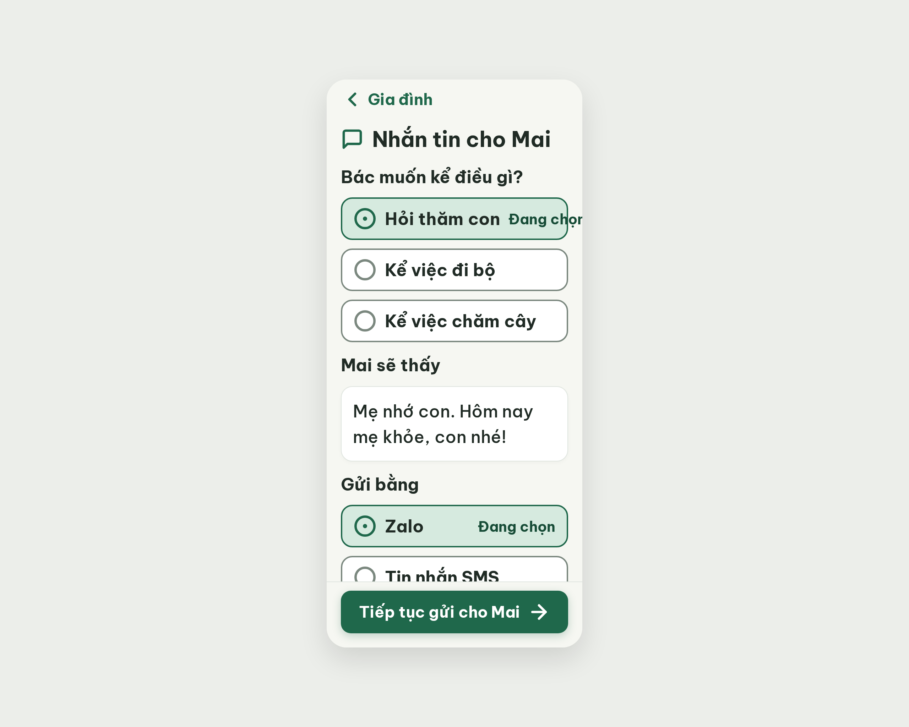
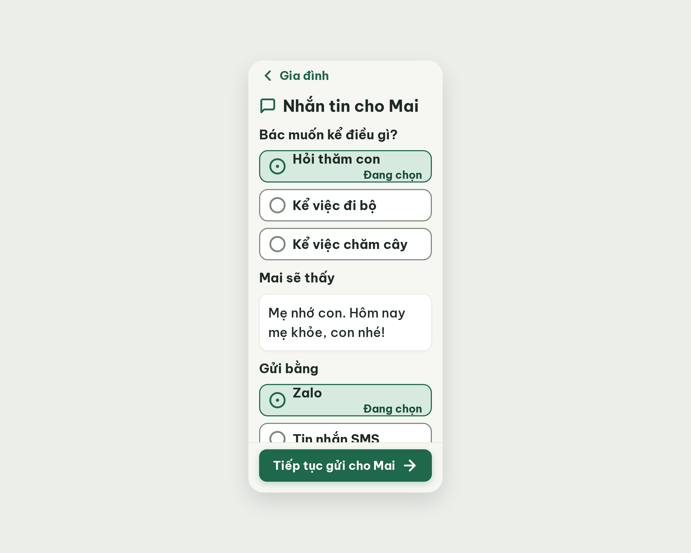

# S17 Nhắn tin cho người thân – log vòng lặp Stitch

| Vòng | Điểm | Số error | Số warn | Đã sửa | Regression |
| --- | --- | --- | --- | --- | --- |
| v0 | 90 | 1 | 0 | – | – |
| v1 | 100 | 0 | 0 | R-LAY-01 | không |

**Màn chốt: v1 – điểm 100** (Stitch screen id `b284c276835247b6982c7285770db2e9`, project 2013215887278758682)
**Kết quả: CONVERGED**

## v0 – điểm 90



| Luật | Mức | Vị trí | Bằng chứng | Sửa |
| --- | --- | --- | --- | --- |
| R-LAY-01 | error | Ô đang chọn "Hỏi thăm con" (và "Zalo") | Chỉ còn 232px cho chữ, cần ~265px (nowrap): "Đang chọn" tràn và bị cắt thành "Đang chọ" | Đưa "Đang chọn" xuống dòng 2, ô đang chọn cao 84px |

best: v0 – điểm 90.

### v0-edit-prompt
```
Keep the overall layout and everything not mentioned below unchanged.
1. Selected option rows ("Hỏi thăm con" and "Zalo"): move the text "Đang chọn" (20px bold, #174C37) from the right side to a second line directly under the option label, left aligned with the label; remove white-space: nowrap so nothing is clipped. The selected row grows to 84px high (padding 12px 16px, circle-dot icon 32px vertically centered) while keeping 320px width, 2px #1F684B border and #D6EADF background. Unselected rows stay 60px high.
2. Verify that no text in any option row extends beyond the row's right border or the 340px content edge.
```

## v1 – điểm 100



Không còn vi phạm. Đã sửa R-LAY-01 ("Đang chọn" xuống dòng 2).
best: v1 – điểm 100.
Ghi chú (không trừ điểm): ô đang chọn vẫn `height: 60px`, chưa lên 84px như edit prompt yêu cầu; hai dòng chữ nằm sát viền trên và dưới ô. Nên nâng `.option-row.selected` lên 84px khi chốt/ở bản Figma.
Lệch handoff: bỏ khối chip "Thêm một câu"; câu xem trước là câu soạn sẵn "Mẹ nhớ con. Hôm nay mẹ khỏe, con nhé!"; nhãn "Tin nhắn SMS".
