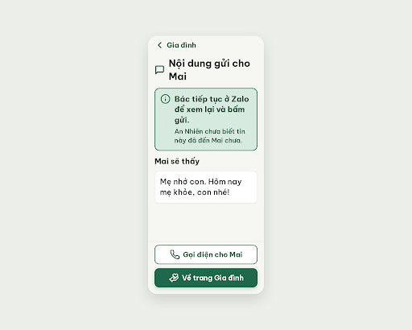
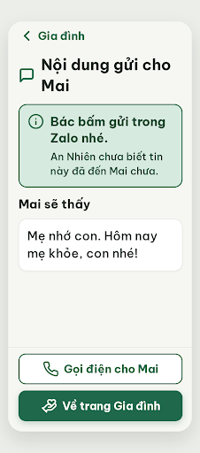

# S17b Nhắn tin · đã mở chia sẻ – log vòng lặp Stitch

Biến thể của S17 (`--from S17`), v0 sinh bằng `edit_screens` trên screen id `b284c276835247b6982c7285770db2e9`.

| Vòng | Điểm | Số error | Số warn | Đã sửa | Regression |
| --- | --- | --- | --- | --- | --- |
| v0 | 90 | 1 | 0 | – | – |
| v1 | 100 | 0 | 0 | R-TXT-03 | không |

**Màn chốt: v1 – điểm 100** (Stitch screen id `8dbd82153c14463aa7a54d58eb920e7b`, project 2013215887278758682)
**Kết quả: CONVERGED**

screen id: 527c3df14c194c84acbec4154ca62d4b (v0)

## v0 – điểm 90



| Luật | Mức | Vị trí | Bằng chứng | Sửa |
| --- | --- | --- | --- | --- |
| R-TXT-03 | error | Khung thông tin, câu đậm "Bác tiếp tục ở Zalo để xem lại và bấm gửi." | 24px bold trong vùng chữ ~244px, xuống 3 dòng, quá giới hạn 2 dòng | Rút còn "Bác bấm gửi trong Zalo nhé." |

best: v0 – điểm 90.

### v0-edit-prompt
```
Keep the overall layout and everything not mentioned below unchanged.
1. In the info card, change line 1 (24px bold, #174C37) from "Bác tiếp tục ở Zalo để xem lại và bấm gửi." to the shorter "Bác bấm gửi trong Zalo nhé." so it fits in at most 2 lines inside the card text area (about 244px wide). Keep line 2 "An Nhiên chưa biết tin này đã đến Mai chưa." (20px, #174C37) unchanged.
2. Make sure the screen is a 360px-wide mobile frame, with the same colors, icons (Lucide info, phone, hand-heart, message-square, chevron-left, 32px) and the two stacked footer buttons.
```

## v1 – điểm 100



Không còn vi phạm. Đã sửa R-TXT-03. Không regression.
best: v1 – điểm 100.

Ghi chú (không trừ điểm):
- Từ điển icon ghi `chevron-left` "luôn kèm chữ Quay lại", màn này ghi "Gia đình" (R-NAV-02 cho phép tên màn trước). Nên sửa ghi chú trong từ điển cho khớp.
- `hand-heart` ở nút "Về trang Gia đình" là icon của tab Gia đình, cùng nghĩa.
- Lệch handoff: câu "An Nhiên chưa xác nhận tin đã gửi" đổi thành "An Nhiên chưa biết tin này đã đến Mai chưa." để không chứa cụm "đã gửi"; bỏ phần "trích câu đầu" vì khung "Mai sẽ thấy" đã hiện đủ tin.
- Critic không có quyền ghi file; hai file critique do điều phối ghi lại từ kết quả critic trả về (v0 là bản rút gọn 13 luật, v1 đủ 38 luật).
- Stitch trả metadata v0 là DESKTOP, rộng 2560; v1 là MOBILE, rộng 780. Ảnh v0 vẫn là khung điện thoại.
