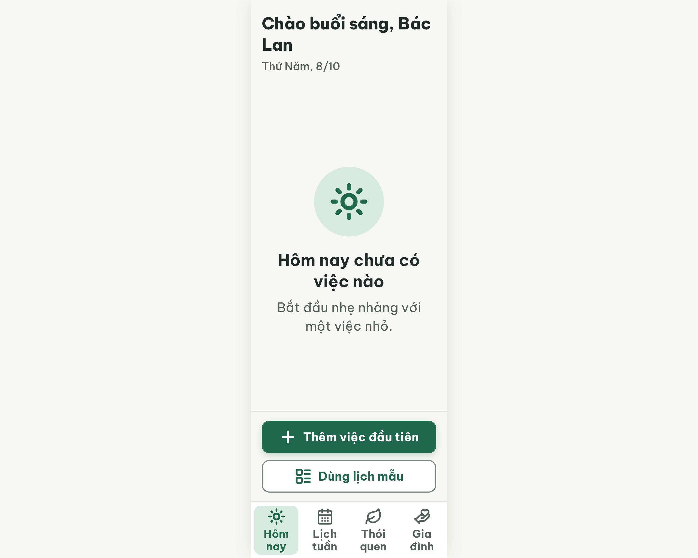

# ST-Empty Hôm nay chưa có việc – log vòng lặp Stitch

| Vòng | Điểm | Số error | Số warn | Đã sửa | Regression |
| --- | --- | --- | --- | --- | --- |
| v0 | 97 | 0 | 1 | – | – |
| v1 | 100 | 0 | 0 | R-ICON-03 | không |

**Màn chốt: v1 – điểm 100**
**Kết quả: CONVERGED** (điểm 100).

Biến thể của S03 (`--from S03`), gốc: screen id `cc28fdd64e6e4c70b59b419c44376787` (màn chốt S03 = v3).
screen id: v0 `97cf0266fdd54abeb428a3af0a05fa7a` · v1 (màn chốt) `bcb650d8dc114750a2be58222edbaada` (project 2013215887278758682)

Ghi chú:
- `stitch-runs/S03/log.md` chưa có dòng "Màn chốt" và không có `run.txt`; screen id của v3 tìm bằng `list_screens`, xác nhận md5 ảnh trùng `S03/v3.png`. Không sửa thư mục S03.
- **Màn gốc S03 chấm lại sẽ không còn 100:** S03 v3 (chấm 100 theo bộ luật cũ) dùng icon `users` cho tab Gia đình và `calendar` cho tab Lịch tuần, bị critic hiện tại bắt ở R-ICON-03. Biến thể ST-Empty kế thừa lỗi này ở v0 và đã sửa ở v1. Nên chạy `/stitch-loop S03 Hôm nay --resume` để S03 cũng được sửa.
- Đã thêm `layout-list` (Dùng lịch mẫu) vào Từ điển icon trong `assets/stitch/DESIGN.md` ngày 18/10/2026.
- Nhãn tab xuống 2 dòng ("Hôm / nay", "Lịch / tuần"...), không bị cắt (kế thừa từ S03).

## v0 – điểm 97


| Luật | Mức | Vị trí | Bằng chứng | Sửa |
| --- | --- | --- | --- | --- |
| R-ICON-03 | warn | Bottom nav, tab Gia đình và Lịch tuần | Tab Gia đình dùng `users` (đã là thói quen Gắn kết cộng đồng); tab Lịch tuần dùng `calendar` thay vì `calendar-days` | Đổi sang `hand-heart` và `calendar-days`, 32 px, stroke 2.2, #526057 |

### Edit prompt gửi sau v0 (v0-edit-prompt.txt)

```
Keep the overall layout and everything not mentioned below unchanged.
1. In the bottom navigation, change the "Gia đình" tab icon from `users` to the Lucide `hand-heart` icon, 32px, stroke 2.2, color #526057.
2. In the bottom navigation, change the "Lịch tuần" tab icon from `calendar` to the Lucide `calendar-days` icon, 32px, stroke 2.2, color #526057.
3. Keep the `sun` icon for the active "Hôm nay" tab and the `leaf` icon for "Thói quen" as they are (32px). Keep every label and tab size unchanged.
```

## v1 – điểm 100



Không còn vi phạm. Đã sửa R-ICON-03. Regression: không. best: v1 – điểm 100
