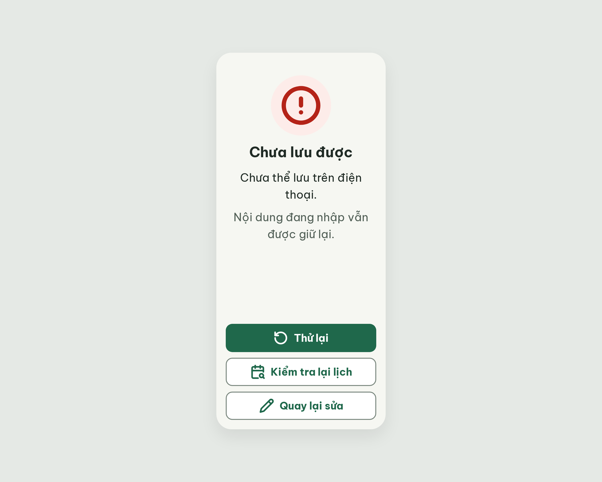

# ST-Error Chưa lưu được – log vòng lặp Stitch

| Vòng | Điểm | Số error | Số warn | Đã sửa | Regression |
| --- | --- | --- | --- | --- | --- |
| v0 | 100 | 0 | 0 | – | – |

**Màn chốt: v0 – điểm 100**
**Kết quả: CONVERGED** (điểm 100).

screen id: `9b64bb35a5ed4b768b68511ceb839c3e` (project 2013215887278758682)

Ghi chú:
- Đã thêm vào `assets/stitch/DESIGN.md` (Từ điển icon, 18/10/2026): `rotate-ccw` = Thử lại, `calendar-search` = Kiểm tra lại lịch, và mở rộng `circle-alert` cho "lỗi lưu".
- Critic chấm R-NAV-02 pass vì coi nút "Quay lại sửa" là lối quay lại (màn không có nút Back riêng).
- Critic coi khoảng cách 12 px giữa 2 đoạn văn và giữa 3 nút là khoảng cách trong nhóm nên R-STY-03 pass. Nếu hiểu chặt (mọi khoảng cách phải 16 px) thì thành 1 warn, điểm 97.
- Bản handoff có thêm câu "Hãy thử lại."; v0 bỏ câu này vì đã có nút "Thử lại" và để mỗi đoạn không quá 2 dòng (R-TXT-03).

## v0 – điểm 100

Không có vi phạm. 25 luật pass, 12 luật n/a. Số đo: chữ 30 / 24 / 22 px; tương phản thấp nhất 6,2 : 1; viền nút phụ 3,7 : 1; 3 nút 320 × 60 px cách nhau 12 px, 1 nút filled; icon `circle-alert` 88 px và 3 icon 32 px đúng Từ điển icon.

Đã sửa / regression: không có (vòng đầu).
best: v0 – điểm 100
