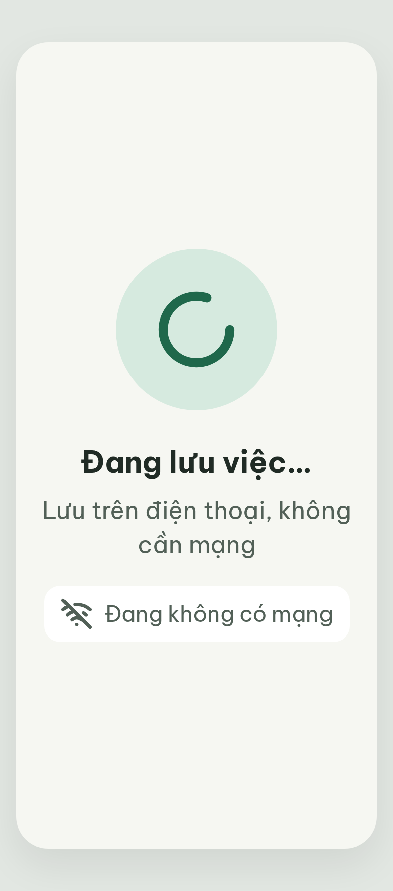

# ST-Loading-offline Đang lưu · mất mạng – log vòng lặp Stitch

| Vòng | Điểm | Số error | Số warn | Đã sửa | Regression |
| --- | --- | --- | --- | --- | --- |
| v0 | 100 | 0 | 0 | – | – |

**Màn chốt: v0 – điểm 100**
**Kết quả: CONVERGED** (điểm 100, không thể tăng thêm).

best: v0 – điểm 100

screen id: `4415d02f5f7245cba86d1bcab91efdbb` (project 2013215887278758682)

Biến thể của ST-Loading (screen id `a61bcc98740d4f8c84bdcb06f404b531`).

Ghi chú:
- Đã thêm `wifi-off` = "Đang không có mạng" vào Từ điển icon trong `assets/stitch/DESIGN.md` (19/10/2026).
- Nội dung màn (dòng "Lưu trên điện thoại, không cần mạng" và chip "Đang không có mạng") do agent soạn, không có sẵn trong PRD/handoff; handoff chỉ ghi luồng S06o → ST-Loading-offline → ST-Error. Dòng phụ xuống 2 dòng ở 360 px (trong giới hạn R-TXT-03).
- Màn không còn câu "Không cần bấm gì thêm" của ST-Loading.
- Subagent critic không ghi được `v0-critique.json` (bị từ chối quyền Bash); orchestrator chép nguyên kết quả của critic vào file. Điểm do critic chấm, orchestrator chỉ đối chiếu ảnh.
- Ảnh tải về 780 × 1768 (khung điện thoại Stitch bao quanh màn).

## v0 – điểm 100

Không có vi phạm. Số đo: chữ 30 / 24 / 22 px; tương phản thấp nhất ≈ 5,3 : 1; icon `loader-circle` 88 px, `wifi-off` 32 px; căn giữa; không nút, không từ cấm.

Đã sửa / regression: không có (vòng đầu).
