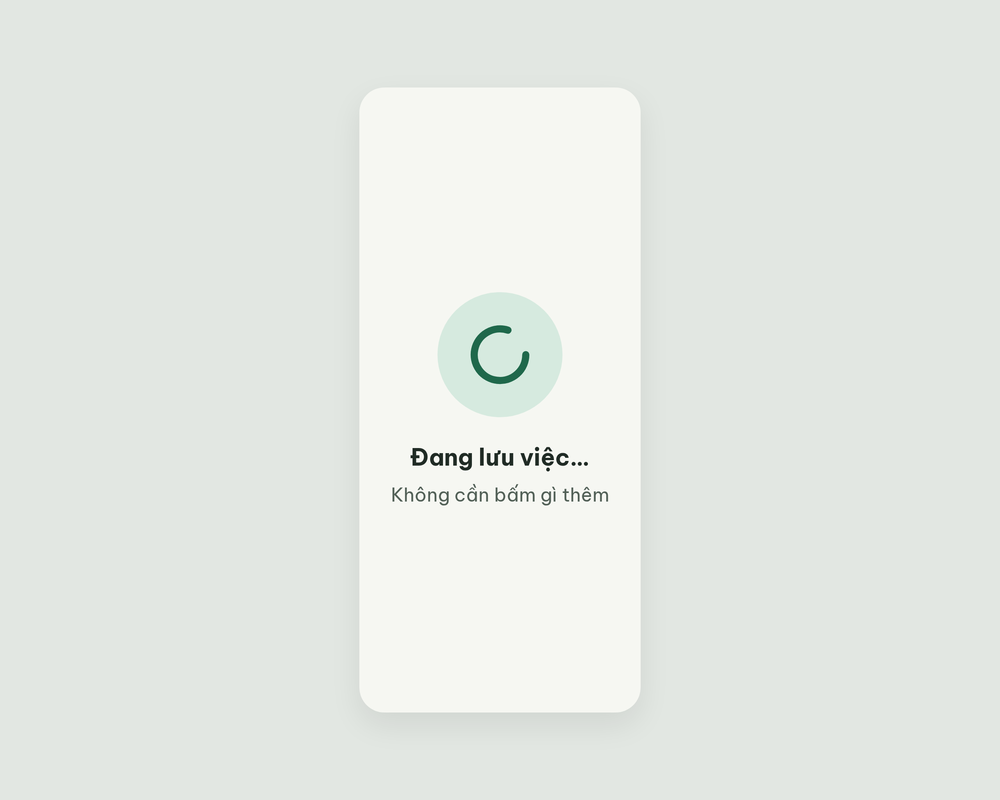

# ST-Loading Đang lưu việc – log vòng lặp Stitch

| Vòng | Điểm | Số error | Số warn | Đã sửa | Regression |
| --- | --- | --- | --- | --- | --- |
| v0 | 100 | 0 | 0 | – | – |

**Màn chốt: v0 – điểm 100**
**Kết quả: CONVERGED** (điểm 100, không thể tăng thêm).

screen id: `a61bcc98740d4f8c84bdcb06f404b531` (project 2013215887278758682)

Ghi chú: `get_screen` trả ảnh thumbnail 512×410; tải bản đầy đủ bằng cách thêm `=w2560` vào link ảnh (2560×2048). Stitch gắn nhãn deviceType DESKTOP nhưng HTML dùng khung 360×800 đúng yêu cầu. Màn dùng icon mới `loader-circle` (đã thêm vào `assets/stitch/DESIGN.md` Từ điển icon ngày 18/10/2026).

## v0 – điểm 100

Không có vi phạm. 18 luật pass, 19 luật n/a (màn không có nút, bottom nav, thẻ việc, chip trạng thái). Số đo: chữ 30 px / 24 px; tương phản 15,4 : 1 và 6,2 : 1; icon `loader-circle` 88 px; căn giữa; lề 20 px; không từ cấm.

Đã sửa / regression: không có (vòng đầu).
