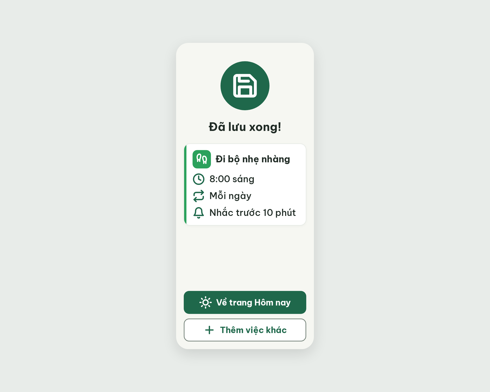
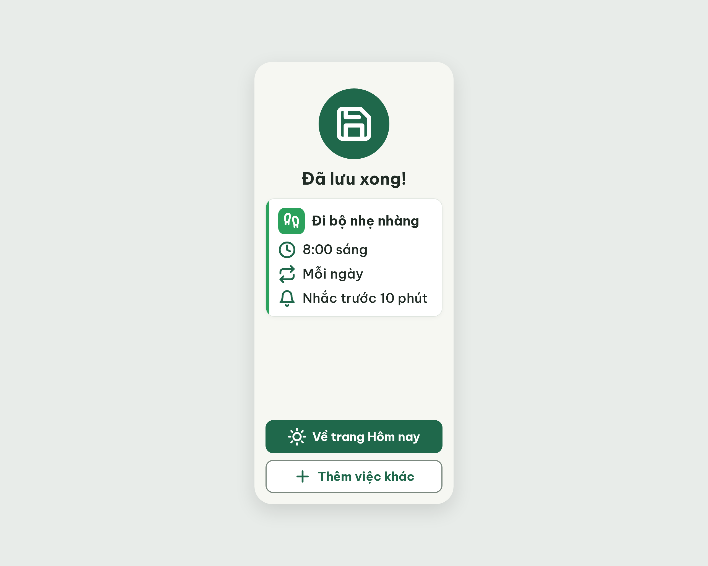

# ST-Saved Đã lưu xong – log vòng lặp Stitch

| Vòng | Điểm | Số error | Số warn | Đã sửa | Regression |
| --- | --- | --- | --- | --- | --- |
| v0 | 97 | 0 | 1 | – | – |
| v1 | 100 | 0 | 0 | R-STY-03 | không |

**Màn chốt: v1 – điểm 100**
**Kết quả: CONVERGED** (điểm 100).

screen id v0: `8a2ad41e258a4d4b883bad8881ad9643` · screen id v1 (màn chốt): `a247c36073c147c1a57e54685a90dec5` (project 2013215887278758682)

Ghi chú:
- Critic ghi R-TXT-05 là n/a ở thẻ tóm tắt (không phải thẻ việc trong danh sách; có 3 dòng phụ). Nếu áp luật này cho cả thẻ tóm tắt thì v0 và v1 mất 10 điểm (còn 87 và 90). Người quyết định có áp dụng hay không.
- Bản sửa v1 ghi đè khoảng cách bằng `style="margin-top: 16px;"` trên từng thẻ; CSS `.headline` và `.summary-card` vẫn ghi 24px. Lưu ý khi chuyển sang Figma: lấy 16px theo ảnh.
- Icon xác nhận dùng `save` (không dùng `circle-check`, vì Từ điển icon giữ nó cho "Đã xong").

## v0 – điểm 97



| Luật | Mức | Vị trí | Bằng chứng | Sửa |
| --- | --- | --- | --- | --- |
| R-STY-03 | warn | Tiêu đề "Đã lưu xong!" và thẻ tóm tắt | `.summary-card margin-top: 24px; .headline margin-top: 24px` (chuẩn 16px) | Đổi cả hai sang 16px, giữ lề 20px |

Đã sửa / regression: không có (vòng đầu).

### Edit prompt gửi sau v0 (v0-edit-prompt.txt)

```
Keep the overall layout and everything not mentioned below unchanged.
1. Set the gap between the headline "Đã lưu xong!" and the 128x128px #1F684B circle above it to 16px (was 24px).
2. Set the gap between the headline "Đã lưu xong!" and the white summary card below it to 16px (was 24px). Keep the 20px screen margin and all other sizes.
```

## v1 – điểm 100



Không còn vi phạm. Đã sửa R-STY-03. Regression: không.
best: v1 – điểm 100
