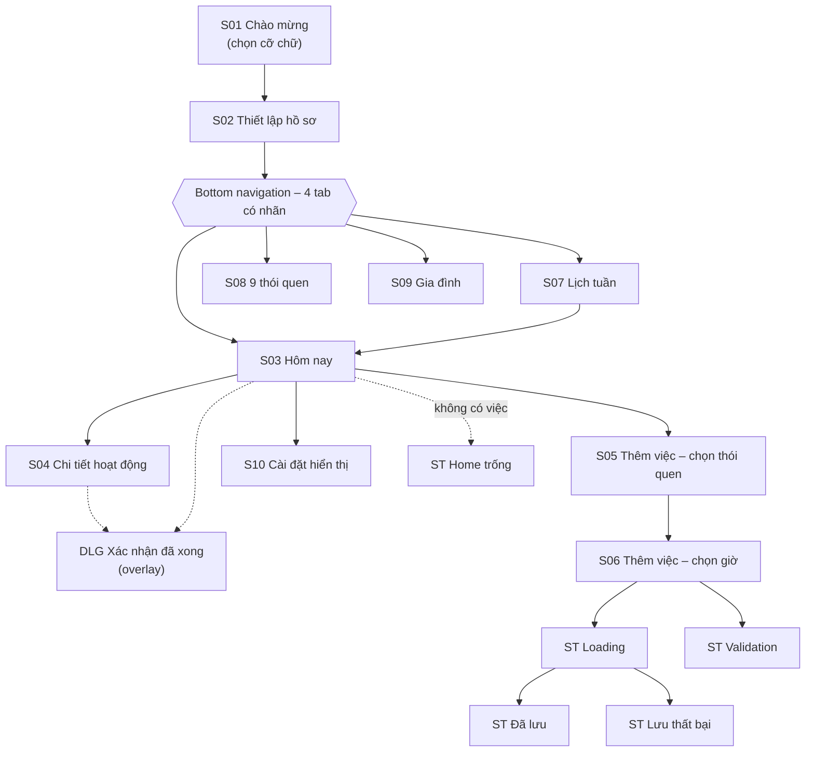
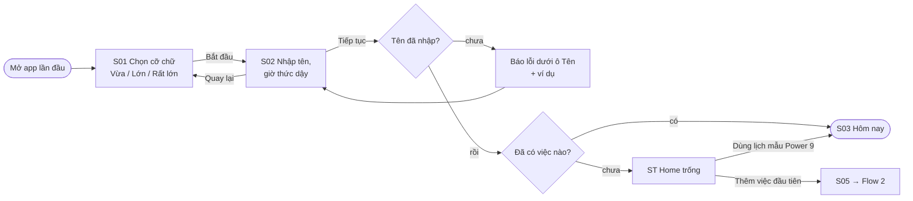
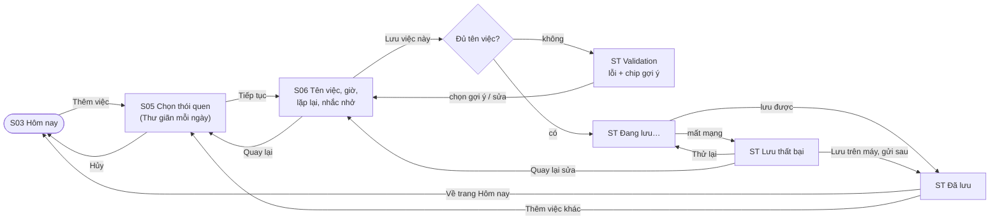
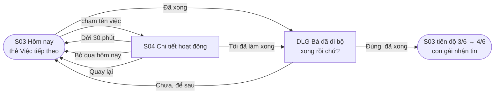

# Information Architecture & User Flows

## 1. Information architecture

App có 4 tab cấp cao và mỗi tab sâu tối đa 2 cấp con, để người lớn tuổi không bị lạc. Màn Cài đặt mở từ nút có chữ trên app bar, không chiếm một tab riêng.

| Cấp | Màn hình |
| --- | --- |
| Onboarding (chỉ lần đầu) | S01, S02 |
| Cấp 1 – tab | S03 Hôm nay · S07 Lịch tuần · S08 9 thói quen · S09 Gia đình |
| Cấp 2 | S04 Chi tiết · S05 Thêm việc bước 1 · S10 Cài đặt |
| Cấp 3 | S06 Thêm việc bước 2 |
| State / overlay | ST-Empty, ST-Validation, ST-Loading, ST-Error, ST-Saved, DLG-Done |

## 2. Flow 1 – Lần đầu mở app (Onboarding)

**Mục tiêu:** bà Lan cài xong và thấy lịch hôm nay trong dưới 2 phút.

| Loại nhánh | Mô tả |
| --- | --- |
| Happy path | S01 → S02 → S03 |
| Alternate | Chưa có việc → ST-Empty → "Dùng lịch mẫu Power 9" → S03 |
| Error / recovery | Bỏ trống tên → báo lỗi ngay dưới ô (icon + chữ + ví dụ) → nhập lại |

## 3. Flow 2 – Thêm việc mới (có lỗi và phục hồi)

**Mục tiêu:** thêm "Tập thở chậm 10 phút, 8:00 sáng mỗi ngày" trong ≤ 60 giây.

| Loại nhánh | Mô tả |
| --- | --- |
| Happy path | S03 → S05 → S06 → Loading → Đã lưu → S03 |
| Alternate | Đã lưu → "Thêm việc khác" → S05; S05 → "Hủy" → S03 |
| Error / recovery 1 | Thiếu tên việc → ST-Validation → chọn chip gợi ý → S06 |
| Error / recovery 2 | Mất mạng → ST-Error → Thử lại / Lưu trên máy / Quay lại sửa |

## 4. Flow 3 – Hoàn thành một việc

**Mục tiêu:** đánh dấu "Đi bộ quanh công viên" đã xong trong ≤ 2 lần chạm.

| Loại nhánh | Mô tả |
| --- | --- |
| Happy path | S03 → "Đã xong" → DLG → "Đúng, đã xong" → S03 cập nhật |
| Alternate | S03 → S04 → "Dời 30 phút" hoặc "Bỏ qua hôm nay" |
| Error prevention | Dialog xác nhận chặn việc bấm nhầm; "Chưa, để sau" đưa về như cũ, không đổi dữ liệu |

## 5. Ánh xạ flow → màn hình → frame Figma

| Flow | Màn hình / state đi qua | Starting point trong page 06 |
| --- | --- | --- |
| Flow 1 Onboarding | S01, S02, (ST-Empty), S03 | `Flow 1 Onboarding` đặt tại S01 |
| Flow 2 Thêm việc | S03, S05, S06, ST-Validation, ST-Loading, ST-Error, ST-Saved | `Flow 2 Thêm việc` và `Flow 2b Mất mạng` đặt tại S03 |
| Flow 3 Hoàn thành | S03, S04, DLG-Done | `Flow 3 Hoàn thành` đặt tại S03 |
| Ngoài flow (bottom nav / app bar) | S07, S08, S09, S10 | Mở từ bất kỳ màn có bottom nav |

Kiểm tra không có ngõ cụt: mọi màn cấp 2–3 có nút "Quay lại" (prototype action **Back**); mọi state có ít nhất một nút dẫn tiếp.
